# Awesome Gemini 4 Carbon

English · [简体中文](README.zh-CN.md)

[](https://awesome.re) [](#contents) [](docs/prompts.md) [](https://github.com/sandbase-lab/awesome-gemini-4-carbon/actions/workflows/sync.yml) [](https://www.sandbase.ai/model/google/gemini-4-argon?utm_source=github&utm_medium=readme&utm_campaign=awesome-gemini-4-carbon)

[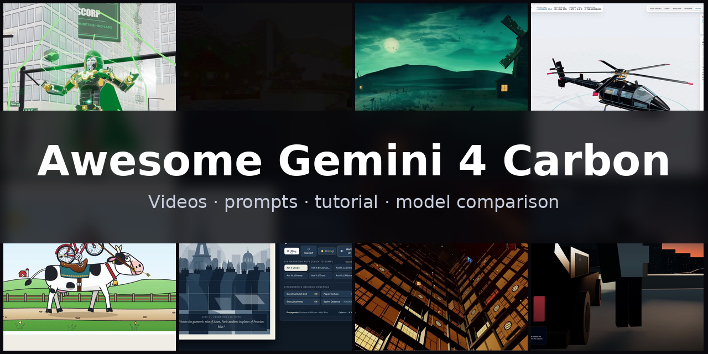](https://www.sandbase.ai/lab/ai-videos/gemini-4-carbon?utm_source=github&utm_medium=readme&utm_campaign=awesome-gemini-4-carbon&utm_content=banner)

A curated list of **Gemini 4 Carbon examples**: videos, prompts and demos made with Gemini 4 Carbon, the newest Gemini 4 checkpoint from Google — tested in the Arena under the codename Gemini 4 Argon and served on SandBase as `google/gemini-4-argon`. Interactive Three.js 3D scenes, cutaways and explode-view models, SVG and canvas animation, motion graphics showreels and product pages, most of them written as one self-contained HTML file from a prompt, each one credited to its creator and linked to the original post.

**109 videos** from **62 creators** · **32** with the creator's prompt · synced daily from [SandBase Lab](https://www.sandbase.ai/lab/ai-videos/gemini-4-carbon?utm_source=github&utm_medium=readme&utm_campaign=awesome-gemini-4-carbon&utm_content=stats)

## Start here

| I want to… | Go to |
|---|---|
| Watch the videos | [Browse by category](#contents) below, or [play them full-size on SandBase Lab](https://www.sandbase.ai/lab/ai-videos/gemini-4-carbon?utm_source=github&utm_medium=readme&utm_campaign=awesome-gemini-4-carbon&utm_content=quickstart) |
| Copy a prompt | [Prompt index](docs/prompts.md): every video that comes with its prompt |
| Write your own prompt | [Prompt guide](docs/prompt-guide.md): 6 patterns and a fill-in template |
| Make a video | [Tutorial](docs/tutorial.md): prompt → HTML → MP4, with the API, the CLI and a recording script |
| Pick a model | [Gemini 4 Carbon vs. Claude Opus 5.5, GPT-6 Astra and Gemini 4 Argon](docs/model-comparison.md) |
| Try it now | [Run Gemini 4 Carbon in the Lab arena](https://www.sandbase.ai/lab/x/llm-arena?models=google%2Fgemini-4-argon&utm_source=github&utm_medium=readme&utm_campaign=awesome-gemini-4-carbon&utm_content=quickstart), next to other models |

<a id="contents"></a>

## Contents

- [Featured](#featured) (8)
- [3D scenes](#3d-scene) (18)
- [Motion graphics](#motion-graphics) (9)
- [Games](#game) (3)
- [Product UI](#ui-demo) (2)
- [Explainers](#explainer) (1)
- [Anime](#anime) (1)
- [Tests & comparisons](#comparison) (48)
- [Model showcases](#showcase) (27)
- [Recreate a video with Gemini 4 Carbon](#recreate)
- [FAQ](#faq)
- [Suggest a video](#contribute)

Click a preview to play the video. Click a title for the post, the prompt and **Recreate** on SandBase Lab. **@handle** links to the creator's post on X.

<a id="featured"></a>

## Featured

<table>
<tr><td width="33%" valign="top"><a href="https://www.sandbase.ai/lab/media/x/gemini-4-carbon/2116757313575145683/video.mp4">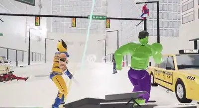</a><br><a href="https://www.sandbase.ai/lab/ai-videos/gemini-4-carbon/2116757313575145683?utm_source=github&utm_medium=readme&utm_campaign=awesome-gemini-4-carbon&utm_content=card"><b>Avengers fighting each other and Ironman transforming</b></a><br><sub><a href="https://x.com/chetaslua/status/2116757313575145683">@chetaslua</a> · 1:09</sub></td><td width="33%" valign="top"><a href="https://www.sandbase.ai/lab/media/x/gemini-4-carbon/2113185847566876679/video.mp4"></a><br><a href="https://www.sandbase.ai/lab/ai-videos/gemini-4-carbon/2113185847566876679?utm_source=github&utm_medium=readme&utm_campaign=awesome-gemini-4-carbon&utm_content=card"><b>Interactive 3D seaplane with infinite ocean</b></a><br><sub><a href="https://x.com/LuminaBench/status/2113185847566876679">@LuminaBench</a> · 0:50</sub></td><td width="33%" valign="top"><a href="https://www.sandbase.ai/lab/media/x/gemini-4-carbon/2116502497158201520/video.mp4">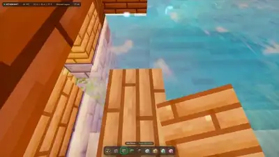</a><br><a href="https://www.sandbase.ai/lab/ai-videos/gemini-4-carbon/2116502497158201520?utm_source=github&utm_medium=readme&utm_campaign=awesome-gemini-4-carbon&utm_content=card"><b>Minecraft created with Gemini 4 Carbon</b></a><br><sub><a href="https://x.com/dummerspast39/status/2116502497158201520">@dummerspast39</a> · 1:00</sub></td></tr>
<tr><td width="33%" valign="top"><a href="https://www.sandbase.ai/lab/media/x/gemini-4-carbon/2114030630887641448/video.mp4">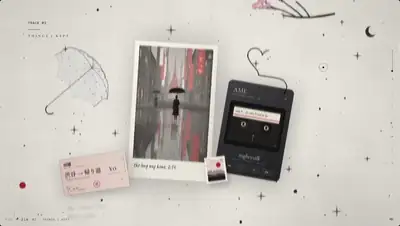</a><br><a href="https://www.sandbase.ai/lab/ai-videos/gemini-4-carbon/2114030630887641448?utm_source=github&utm_medium=readme&utm_campaign=awesome-gemini-4-carbon&utm_content=card"><b>A dynamic ink-wash story in Three.js</b></a><br><sub><a href="https://x.com/thtbee_/status/2114030630887641448">@thtbee_</a> · 0:32</sub></td><td width="33%" valign="top"><a href="https://www.sandbase.ai/lab/media/x/gemini-4-carbon/2116392703357558821/video.mp4">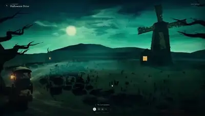</a><br><a href="https://www.sandbase.ai/lab/ai-videos/gemini-4-carbon/2116392703357558821?utm_source=github&utm_medium=readme&utm_campaign=awesome-gemini-4-carbon&utm_content=card"><b>Halloween walk animated scene with audio</b></a><br><sub><a href="https://x.com/abhinavflac/status/2116392703357558821">@abhinavflac</a> · 0:50</sub></td><td width="33%" valign="top"><a href="https://www.sandbase.ai/lab/media/x/gemini-4-carbon/2115794531136258115/video.mp4">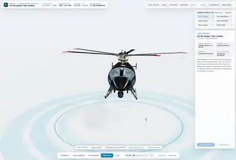</a><br><a href="https://www.sandbase.ai/lab/ai-videos/gemini-4-carbon/2115794531136258115?utm_source=github&utm_medium=readme&utm_campaign=awesome-gemini-4-carbon&utm_content=card"><b>Interactive 3D helicopter engineering viewer</b></a><br><sub><a href="https://x.com/RoundtableSpace/status/2115794531136258115">@RoundtableSpace</a> · 1:37</sub></td></tr>
<tr><td width="33%" valign="top"><a href="https://www.sandbase.ai/lab/media/x/gemini-4-carbon/2115512016811307487/video.mp4">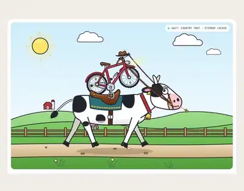</a><br><a href="https://www.sandbase.ai/lab/ai-videos/gemini-4-carbon/2115512016811307487?utm_source=github&utm_medium=readme&utm_campaign=awesome-gemini-4-carbon&utm_content=card"><b>SVG animation of a bicycle riding a cow</b></a><br><sub><a href="https://x.com/TimJayas/status/2115512016811307487">@TimJayas</a> · 0:29 · <a href="https://www.sandbase.ai/lab/ai-videos/gemini-4-carbon/2115512016811307487?utm_source=github&utm_medium=readme&utm_campaign=awesome-gemini-4-carbon&utm_content=card">prompt</a></sub></td><td width="33%" valign="top"><a href="https://www.sandbase.ai/lab/media/x/gemini-4-carbon/2115556773901807873/video.mp4">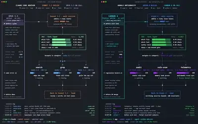</a><br><a href="https://www.sandbase.ai/lab/ai-videos/gemini-4-carbon/2115556773901807873?utm_source=github&utm_medium=readme&utm_campaign=awesome-gemini-4-carbon&utm_content=card"><b>Dual-terminal CLI setup with Claude and Gemini</b></a><br><sub><a href="https://x.com/marfinxx/status/2115556773901807873">@marfinxx</a> · 0:25</sub></td></tr>
</table>

<a id="3d-scene"></a>

## 3D scenes

<table>
<tr><td width="33%" valign="top"><a href="https://www.sandbase.ai/lab/media/x/gemini-4-carbon/2114279721911652451/video.mp4">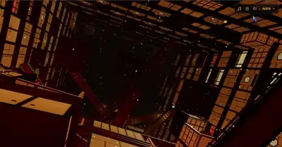</a><br><a href="https://www.sandbase.ai/lab/ai-videos/gemini-4-carbon/2114279721911652451?utm_source=github&utm_medium=readme&utm_campaign=awesome-gemini-4-carbon&utm_content=card"><b>Demon Slayer Infinite Castle 3D scene</b></a><br><sub><a href="https://x.com/DrstaOne/status/2114279721911652451">@DrstaOne</a> · 1:20</sub></td><td width="33%" valign="top"><a href="https://www.sandbase.ai/lab/media/x/gemini-4-carbon/2115065994016113051/video.mp4">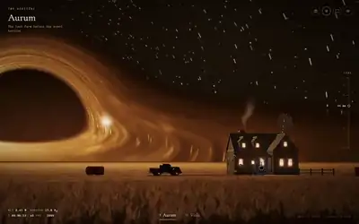</a><br><a href="https://www.sandbase.ai/lab/ai-videos/gemini-4-carbon/2115065994016113051?utm_source=github&utm_medium=readme&utm_campaign=awesome-gemini-4-carbon&utm_content=card"><b>Procedural Three.js farm and event horizon scene</b></a><br><sub><a href="https://x.com/itsfazley/status/2115065994016113051">@itsfazley</a> · 0:26</sub></td><td width="33%" valign="top"><a href="https://www.sandbase.ai/lab/media/x/gemini-4-carbon/2115547939707957591/video.mp4">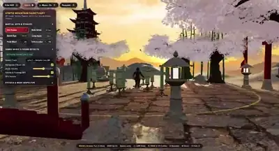</a><br><a href="https://www.sandbase.ai/lab/ai-videos/gemini-4-carbon/2115547939707957591?utm_source=github&utm_medium=readme&utm_campaign=awesome-gemini-4-carbon&utm_content=card"><b>A 3D scene built with Three.js and Blender MCP</b></a><br><sub><a href="https://x.com/c_nemri/status/2115547939707957591">@c_nemri</a> · 0:48</sub></td></tr>
<tr><td width="33%" valign="top"><a href="https://www.sandbase.ai/lab/media/x/gemini-4-carbon/2115556254101692515/video.mp4">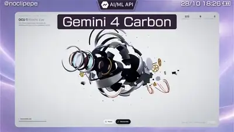</a><br><a href="https://www.sandbase.ai/lab/ai-videos/gemini-4-carbon/2115556254101692515?utm_source=github&utm_medium=readme&utm_campaign=awesome-gemini-4-carbon&utm_content=card"><b>Robotic eye blinking and exploding into parts</b></a><br><sub><a href="https://x.com/noclipepe/status/2115556254101692515">@noclipepe</a> · 0:31 · <a href="https://www.sandbase.ai/lab/ai-videos/gemini-4-carbon/2115556254101692515?utm_source=github&utm_medium=readme&utm_campaign=awesome-gemini-4-carbon&utm_content=card">prompt</a></sub></td><td width="33%" valign="top"><a href="https://www.sandbase.ai/lab/media/x/gemini-4-carbon/2115564198142923174/video.mp4"></a><br><a href="https://www.sandbase.ai/lab/ai-videos/gemini-4-carbon/2115564198142923174?utm_source=github&utm_medium=readme&utm_campaign=awesome-gemini-4-carbon&utm_content=card"><b>A 3D city generated in Three.js</b></a><br><sub><a href="https://x.com/leo114119/status/2115564198142923174">@leo114119</a> · 0:08</sub></td><td width="33%" valign="top"><a href="https://www.sandbase.ai/lab/media/x/gemini-4-carbon/2115727629861130735/video.mp4">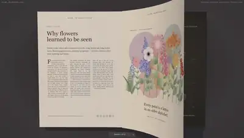</a><br><a href="https://www.sandbase.ai/lab/ai-videos/gemini-4-carbon/2115727629861130735?utm_source=github&utm_medium=readme&utm_campaign=awesome-gemini-4-carbon&utm_content=card"><b>Turning pages and paper physics simulation</b></a><br><sub><a href="https://x.com/abhinavflac/status/2115727629861130735">@abhinavflac</a> · 0:29</sub></td></tr>
</table>

<details>
<summary><b>Show all 18</b></summary>

<table>
<tr><td width="33%" valign="top"><a href="https://www.sandbase.ai/lab/media/x/gemini-4-carbon/2115794531136258115/video.mp4"></a><br><a href="https://www.sandbase.ai/lab/ai-videos/gemini-4-carbon/2115794531136258115?utm_source=github&utm_medium=readme&utm_campaign=awesome-gemini-4-carbon&utm_content=card"><b>Interactive 3D helicopter engineering viewer</b></a><br><sub><a href="https://x.com/RoundtableSpace/status/2115794531136258115">@RoundtableSpace</a> · 1:37</sub></td><td width="33%" valign="top"><a href="https://www.sandbase.ai/lab/media/x/gemini-4-carbon/2115819588382568478/video.mp4">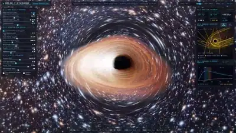</a><br><a href="https://www.sandbase.ai/lab/ai-videos/gemini-4-carbon/2115819588382568478?utm_source=github&utm_medium=readme&utm_campaign=awesome-gemini-4-carbon&utm_content=card"><b>Real-time Kerr black hole raymarching in WebGL2</b></a><br><sub><a href="https://x.com/White1637402/status/2115819588382568478">@White1637402</a> · 0:05</sub></td><td width="33%" valign="top"><a href="https://www.sandbase.ai/lab/media/x/gemini-4-carbon/2116172635545460909/video.mp4">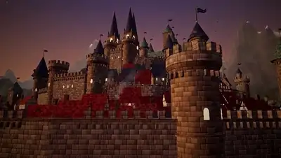</a><br><a href="https://www.sandbase.ai/lab/ai-videos/gemini-4-carbon/2116172635545460909?utm_source=github&utm_medium=readme&utm_campaign=awesome-gemini-4-carbon&utm_content=card"><b>A 3D scene built with Three.js</b></a><br><sub><a href="https://x.com/Mr_Salio/status/2116172635545460909">@Mr_Salio</a> · 0:41</sub></td></tr>
<tr><td width="33%" valign="top"><a href="https://www.sandbase.ai/lab/media/x/gemini-4-carbon/2116225114023059759/video.mp4">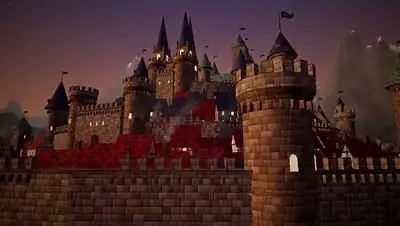</a><br><a href="https://www.sandbase.ai/lab/ai-videos/gemini-4-carbon/2116225114023059759?utm_source=github&utm_medium=readme&utm_campaign=awesome-gemini-4-carbon&utm_content=card"><b>Three.js 3D project generated with Gemini</b></a><br><sub><a href="https://x.com/ashawv5i/status/2116225114023059759">@ashawv5i</a> · 0:41</sub></td><td width="33%" valign="top"><a href="https://www.sandbase.ai/lab/media/x/gemini-4-carbon/2116277724130206046/video.mp4">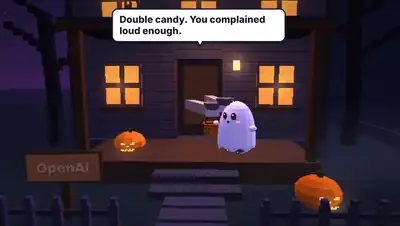</a><br><a href="https://www.sandbase.ai/lab/ai-videos/gemini-4-carbon/2116277724130206046?utm_source=github&utm_medium=readme&utm_campaign=awesome-gemini-4-carbon&utm_content=card"><b>Interactive AI lab Halloween street scene</b></a><br><sub><a href="https://x.com/After_Dark_AI/status/2116277724130206046">@After_Dark_AI</a> · 0:34</sub></td><td width="33%" valign="top"><a href="https://www.sandbase.ai/lab/media/x/gemini-4-carbon/2116392703357558821/video.mp4"></a><br><a href="https://www.sandbase.ai/lab/ai-videos/gemini-4-carbon/2116392703357558821?utm_source=github&utm_medium=readme&utm_campaign=awesome-gemini-4-carbon&utm_content=card"><b>Halloween walk animated scene with audio</b></a><br><sub><a href="https://x.com/abhinavflac/status/2116392703357558821">@abhinavflac</a> · 0:50</sub></td></tr>
<tr><td width="33%" valign="top"><a href="https://www.sandbase.ai/lab/media/x/gemini-4-carbon/2116457996419010907/video.mp4">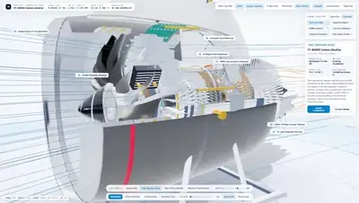</a><br><a href="https://www.sandbase.ai/lab/ai-videos/gemini-4-carbon/2116457996419010907?utm_source=github&utm_medium=readme&utm_campaign=awesome-gemini-4-carbon&utm_content=card"><b>Procedural 3D aerospace engineering in Three.js</b></a><br><sub><a href="https://x.com/StatsWire/status/2116457996419010907">@StatsWire</a> · 0:36</sub></td><td width="33%" valign="top"><a href="https://www.sandbase.ai/lab/media/x/gemini-4-carbon/2116470583097438519/video.mp4">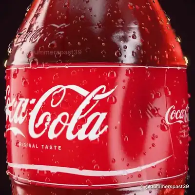</a><br><a href="https://www.sandbase.ai/lab/ai-videos/gemini-4-carbon/2116470583097438519?utm_source=github&utm_medium=readme&utm_campaign=awesome-gemini-4-carbon&utm_content=card"><b>Shader-based Coca Cola bottle in Three.js</b></a><br><sub><a href="https://x.com/dummerspast39/status/2116470583097438519">@dummerspast39</a> · 0:30</sub></td><td width="33%" valign="top"><a href="https://www.sandbase.ai/lab/media/x/gemini-4-carbon/2116482295444148254/video.mp4">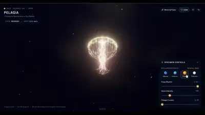</a><br><a href="https://www.sandbase.ai/lab/ai-videos/gemini-4-carbon/2116482295444148254?utm_source=github&utm_medium=readme&utm_campaign=awesome-gemini-4-carbon&utm_content=card"><b>Jellyfish animation in Three.js</b></a><br><sub><a href="https://x.com/srikanthvaluri/status/2116482295444148254">@srikanthvaluri</a> · 0:22</sub></td></tr>
<tr><td width="33%" valign="top"><a href="https://www.sandbase.ai/lab/media/x/gemini-4-carbon/2116533017934241886/video.mp4"></a><br><a href="https://www.sandbase.ai/lab/ai-videos/gemini-4-carbon/2116533017934241886?utm_source=github&utm_medium=readme&utm_campaign=awesome-gemini-4-carbon&utm_content=card"><b>Lantern river night 3D scene</b></a><br><sub><a href="https://x.com/pankajkumar_dev/status/2116533017934241886">@pankajkumar_dev</a> · 0:48 · <a href="https://www.sandbase.ai/lab/ai-videos/gemini-4-carbon/2116533017934241886?utm_source=github&utm_medium=readme&utm_campaign=awesome-gemini-4-carbon&utm_content=card">prompt</a></sub></td><td width="33%" valign="top"><a href="https://www.sandbase.ai/lab/media/x/gemini-4-carbon/2116578168874438910/video.mp4">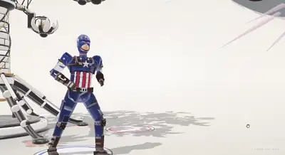</a><br><a href="https://www.sandbase.ai/lab/ai-videos/gemini-4-carbon/2116578168874438910?utm_source=github&utm_medium=readme&utm_campaign=awesome-gemini-4-carbon&utm_content=card"><b>Three.js generation using Gemini Carbon 4</b></a><br><sub><a href="https://x.com/chetaslua/status/2116578168874438910">@chetaslua</a> · 0:54</sub></td><td width="33%" valign="top"><a href="https://www.sandbase.ai/lab/media/x/gemini-4-carbon/2116621901934002336/video.mp4">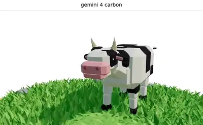</a><br><a href="https://www.sandbase.ai/lab/ai-videos/gemini-4-carbon/2116621901934002336?utm_source=github&utm_medium=readme&utm_campaign=awesome-gemini-4-carbon&utm_content=card"><b>A 3D model test render</b></a><br><sub><a href="https://x.com/Haleeeemahh/status/2116621901934002336">@Haleeeemahh</a> · 0:26</sub></td></tr>
</table>

</details>

<a id="motion-graphics"></a>

## Motion graphics

<table>
<tr><td width="33%" valign="top"><a href="https://www.sandbase.ai/lab/media/x/gemini-4-carbon/2114276034527056089/video.mp4">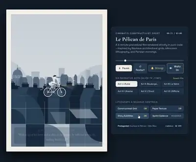</a><br><a href="https://www.sandbase.ai/lab/ai-videos/gemini-4-carbon/2114276034527056089?utm_source=github&utm_medium=readme&utm_campaign=awesome-gemini-4-carbon&utm_content=card"><b>Animated SVG movie of Le Pélican de Paris</b></a><br><sub><a href="https://x.com/Inmerson/status/2114276034527056089">@Inmerson</a> · 1:59</sub></td><td width="33%" valign="top"><a href="https://www.sandbase.ai/lab/media/x/gemini-4-carbon/2114330273710031224/video.mp4">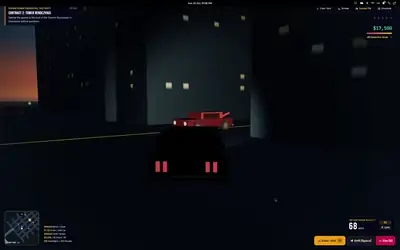</a><br><a href="https://www.sandbase.ai/lab/ai-videos/gemini-4-carbon/2114330273710031224?utm_source=github&utm_medium=readme&utm_campaign=awesome-gemini-4-carbon&utm_content=card"><b>GTA vibe animation generated from a photo</b></a><br><sub><a href="https://x.com/Inmerson/status/2114330273710031224">@Inmerson</a> · 3:01</sub></td><td width="33%" valign="top"><a href="https://www.sandbase.ai/lab/media/x/gemini-4-carbon/2115512016811307487/video.mp4"></a><br><a href="https://www.sandbase.ai/lab/ai-videos/gemini-4-carbon/2115512016811307487?utm_source=github&utm_medium=readme&utm_campaign=awesome-gemini-4-carbon&utm_content=card"><b>SVG animation of a bicycle riding a cow</b></a><br><sub><a href="https://x.com/TimJayas/status/2115512016811307487">@TimJayas</a> · 0:29 · <a href="https://www.sandbase.ai/lab/ai-videos/gemini-4-carbon/2115512016811307487?utm_source=github&utm_medium=readme&utm_campaign=awesome-gemini-4-carbon&utm_content=card">prompt</a></sub></td></tr>
<tr><td width="33%" valign="top"><a href="https://www.sandbase.ai/lab/media/x/gemini-4-carbon/2115521291314983078/video.mp4">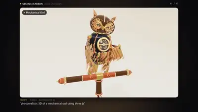</a><br><a href="https://www.sandbase.ai/lab/ai-videos/gemini-4-carbon/2115521291314983078?utm_source=github&utm_medium=readme&utm_campaign=awesome-gemini-4-carbon&utm_content=card"><b>Mechanical objects and interior scenes showcase</b></a><br><sub><a href="https://x.com/HarshithLucky3/status/2115521291314983078">@HarshithLucky3</a> · 3:00</sub></td><td width="33%" valign="top"><a href="https://www.sandbase.ai/lab/media/x/gemini-4-carbon/2115755454660059626/video.mp4">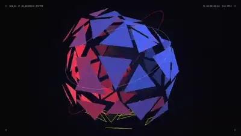</a><br><a href="https://www.sandbase.ai/lab/ai-videos/gemini-4-carbon/2115755454660059626?utm_source=github&utm_medium=readme&utm_campaign=awesome-gemini-4-carbon&utm_content=card"><b>Dynamic motion graphics showreel</b></a><br><sub><a href="https://x.com/aeroidesde/status/2115755454660059626">@aeroidesde</a> · 0:15 · <a href="https://www.sandbase.ai/lab/ai-videos/gemini-4-carbon/2115755454660059626?utm_source=github&utm_medium=readme&utm_campaign=awesome-gemini-4-carbon&utm_content=card">prompt</a></sub></td><td width="33%" valign="top"><a href="https://www.sandbase.ai/lab/media/x/gemini-4-carbon/2115903264550265122/video.mp4">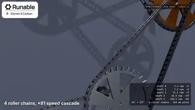</a><br><a href="https://www.sandbase.ai/lab/ai-videos/gemini-4-carbon/2115903264550265122?utm_source=github&utm_medium=readme&utm_campaign=awesome-gemini-4-carbon&utm_content=card"><b>Animated multi-stage roller chain mechanism</b></a><br><sub><a href="https://x.com/runable_hq/status/2115903264550265122">@runable_hq</a> · 0:12</sub></td></tr>
</table>

<details>
<summary><b>Show all 9</b></summary>

<table>
<tr><td width="33%" valign="top"><a href="https://www.sandbase.ai/lab/media/x/gemini-4-carbon/2115935747798950069/video.mp4"></a><br><a href="https://www.sandbase.ai/lab/ai-videos/gemini-4-carbon/2115935747798950069?utm_source=github&utm_medium=readme&utm_campaign=awesome-gemini-4-carbon&utm_content=card"><b>JS sleep loop with girl in rain SVG</b></a><br><sub><a href="https://x.com/chetaslua/status/2115935747798950069">@chetaslua</a> · 0:30</sub></td><td width="33%" valign="top"><a href="https://www.sandbase.ai/lab/media/x/gemini-4-carbon/2116055328005685507/video.mp4">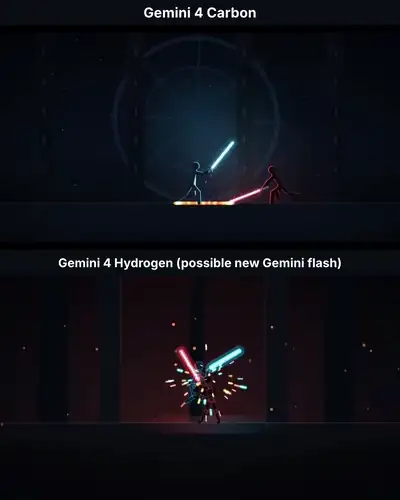</a><br><a href="https://www.sandbase.ai/lab/ai-videos/gemini-4-carbon/2116055328005685507?utm_source=github&utm_medium=readme&utm_campaign=awesome-gemini-4-carbon&utm_content=card"><b>Smooth animation coded by Gemini 4</b></a><br><sub><a href="https://x.com/AnikaCodes/status/2116055328005685507">@AnikaCodes</a> · 0:15</sub></td><td width="33%" valign="top"><a href="https://www.sandbase.ai/lab/media/x/gemini-4-carbon/2116757313575145683/video.mp4"></a><br><a href="https://www.sandbase.ai/lab/ai-videos/gemini-4-carbon/2116757313575145683?utm_source=github&utm_medium=readme&utm_campaign=awesome-gemini-4-carbon&utm_content=card"><b>Avengers fighting each other and Ironman transforming</b></a><br><sub><a href="https://x.com/chetaslua/status/2116757313575145683">@chetaslua</a> · 1:09</sub></td></tr>
</table>

</details>

<a id="game"></a>

## Games

<table>
<tr><td width="33%" valign="top"><a href="https://www.sandbase.ai/lab/media/x/gemini-4-carbon/2116502497158201520/video.mp4"></a><br><a href="https://www.sandbase.ai/lab/ai-videos/gemini-4-carbon/2116502497158201520?utm_source=github&utm_medium=readme&utm_campaign=awesome-gemini-4-carbon&utm_content=card"><b>Minecraft created with Gemini 4 Carbon</b></a><br><sub><a href="https://x.com/dummerspast39/status/2116502497158201520">@dummerspast39</a> · 1:00</sub></td><td width="33%" valign="top"><a href="https://www.sandbase.ai/lab/media/x/gemini-4-carbon/2116633632869613723/video.mp4">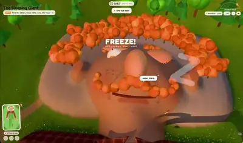</a><br><a href="https://www.sandbase.ai/lab/ai-videos/gemini-4-carbon/2116633632869613723?utm_source=github&utm_medium=readme&utm_campaign=awesome-gemini-4-carbon&utm_content=card"><b>Playable game of a button climbing a sleeping giant</b></a><br><sub><a href="https://x.com/0xRhinoX/status/2116633632869613723">@0xRhinoX</a> · 0:41</sub></td><td width="33%" valign="top"><a href="https://www.sandbase.ai/lab/media/x/gemini-4-carbon/2116800047195025596/video.mp4">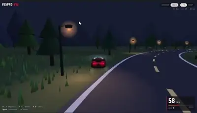</a><br><a href="https://www.sandbase.ai/lab/ai-videos/gemini-4-carbon/2116800047195025596?utm_source=github&utm_medium=readme&utm_campaign=awesome-gemini-4-carbon&utm_content=card"><b>Playable 3D car racing game in Gemini</b></a><br><sub><a href="https://x.com/ashawv5i/status/2116800047195025596">@ashawv5i</a> · 0:43</sub></td></tr>
</table>

<a id="ui-demo"></a>

## Product UI

<table>
<tr><td width="33%" valign="top"><a href="https://www.sandbase.ai/lab/media/x/gemini-4-carbon/2115551477389304023/video.mp4">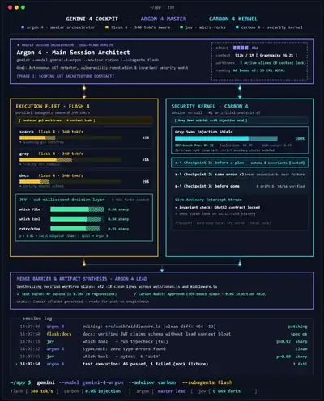</a><br><a href="https://www.sandbase.ai/lab/ai-videos/gemini-4-carbon/2115551477389304023?utm_source=github&utm_medium=readme&utm_campaign=awesome-gemini-4-carbon&utm_content=card"><b>Gemini 4 Carbon and Argon CLI workflow</b></a><br><sub><a href="https://x.com/damkina7/status/2115551477389304023">@damkina7</a> · 0:19</sub></td><td width="33%" valign="top"><a href="https://www.sandbase.ai/lab/media/x/gemini-4-carbon/2115556773901807873/video.mp4"></a><br><a href="https://www.sandbase.ai/lab/ai-videos/gemini-4-carbon/2115556773901807873?utm_source=github&utm_medium=readme&utm_campaign=awesome-gemini-4-carbon&utm_content=card"><b>Dual-terminal CLI setup with Claude and Gemini</b></a><br><sub><a href="https://x.com/marfinxx/status/2115556773901807873">@marfinxx</a> · 0:25</sub></td></tr>
</table>

<a id="explainer"></a>

## Explainers

<table>
<tr><td width="33%" valign="top"><a href="https://www.sandbase.ai/lab/media/x/gemini-4-carbon/2114758957181100216/video.mp4"></a><br><a href="https://www.sandbase.ai/lab/ai-videos/gemini-4-carbon/2114758957181100216?utm_source=github&utm_medium=readme&utm_campaign=awesome-gemini-4-carbon&utm_content=card"><b>Real-time observation of plants breathing through stomata</b></a><br><sub><a href="https://x.com/Rainmaker1973/status/2114758957181100216">@Rainmaker1973</a> · 0:08</sub></td></tr>
</table>

<a id="anime"></a>

## Anime

<table>
<tr><td width="33%" valign="top"><a href="https://www.sandbase.ai/lab/media/x/gemini-4-carbon/2113018068981182659/video.mp4">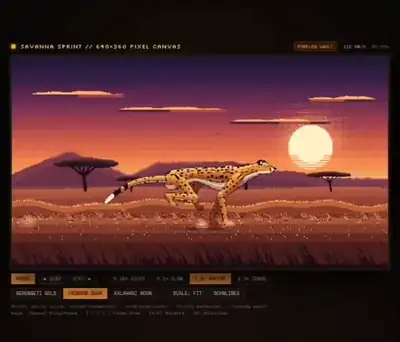</a><br><a href="https://www.sandbase.ai/lab/ai-videos/gemini-4-carbon/2113018068981182659?utm_source=github&utm_medium=readme&utm_campaign=awesome-gemini-4-carbon&utm_content=card"><b>Pixel art of a cheetah running</b></a><br><sub><a href="https://x.com/duke_mv/status/2113018068981182659">@duke_mv</a> · 0:16 · <a href="https://www.sandbase.ai/lab/ai-videos/gemini-4-carbon/2113018068981182659?utm_source=github&utm_medium=readme&utm_campaign=awesome-gemini-4-carbon&utm_content=card">prompt</a></sub></td></tr>
</table>

<a id="comparison"></a>

## Tests & comparisons

<table>
<tr><td width="33%" valign="top"><a href="https://www.sandbase.ai/lab/media/x/gemini-4-carbon/2112910206644756745/video.mp4">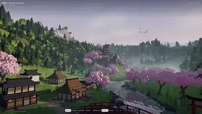</a><br><a href="https://www.sandbase.ai/lab/ai-videos/gemini-4-carbon/2112910206644756745?utm_source=github&utm_medium=readme&utm_campaign=awesome-gemini-4-carbon&utm_content=card"><b>Voxelbench test comparison between Carbon and Argon</b></a><br><sub><a href="https://x.com/abhinavflac/status/2112910206644756745">@abhinavflac</a> · 0:53</sub></td><td width="33%" valign="top"><a href="https://www.sandbase.ai/lab/media/x/gemini-4-carbon/2112976986066878614/video.mp4"></a><br><a href="https://www.sandbase.ai/lab/ai-videos/gemini-4-carbon/2112976986066878614?utm_source=github&utm_medium=readme&utm_campaign=awesome-gemini-4-carbon&utm_content=card"><b>Bike animation comparison across three AI models</b></a><br><sub><a href="https://x.com/PenguinWeb3/status/2112976986066878614">@PenguinWeb3</a> · 0:14</sub></td><td width="33%" valign="top"><a href="https://www.sandbase.ai/lab/media/x/gemini-4-carbon/2113184121883435047/video.mp4">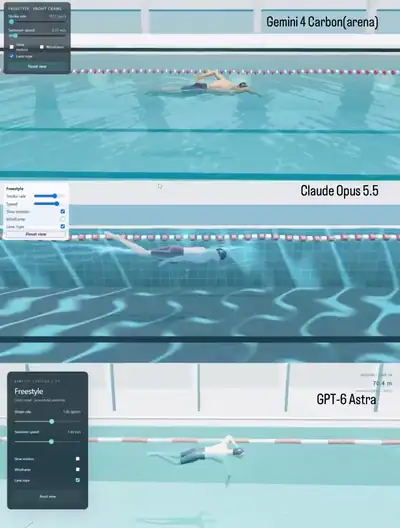</a><br><a href="https://www.sandbase.ai/lab/ai-videos/gemini-4-carbon/2113184121883435047?utm_source=github&utm_medium=readme&utm_campaign=awesome-gemini-4-carbon&utm_content=card"><b>Gemini 4 Carbon vs Opus and GPT-6 Astra</b></a><br><sub><a href="https://x.com/AI_Screening/status/2113184121883435047">@AI_Screening</a> · 0:15</sub></td></tr>
<tr><td width="33%" valign="top"><a href="https://www.sandbase.ai/lab/media/x/gemini-4-carbon/2113243268569870459/video.mp4">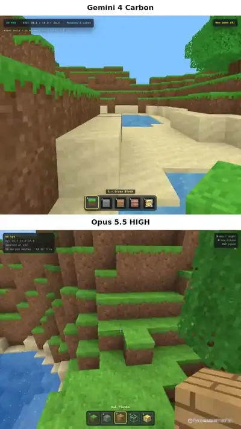</a><br><a href="https://www.sandbase.ai/lab/ai-videos/gemini-4-carbon/2113243268569870459?utm_source=github&utm_medium=readme&utm_campaign=awesome-gemini-4-carbon&utm_content=card"><b>Comparison between Gemini 4 Carbon and Opus 5.5</b></a><br><sub><a href="https://x.com/Haleeeemahh/status/2113243268569870459">@Haleeeemahh</a> · 0:27</sub></td><td width="33%" valign="top"><a href="https://www.sandbase.ai/lab/media/x/gemini-4-carbon/2113263958136414540/video.mp4">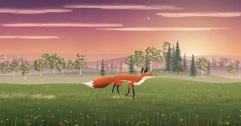</a><br><a href="https://www.sandbase.ai/lab/ai-videos/gemini-4-carbon/2113263958136414540?utm_source=github&utm_medium=readme&utm_campaign=awesome-gemini-4-carbon&utm_content=card"><b>Retesting Gemini 4 Carbon with updated checkpoint</b></a><br><sub><a href="https://x.com/srikanthvaluri/status/2113263958136414540">@srikanthvaluri</a> · 0:14</sub></td><td width="33%" valign="top"><a href="https://www.sandbase.ai/lab/media/x/gemini-4-carbon/2113289049075003839/video.mp4">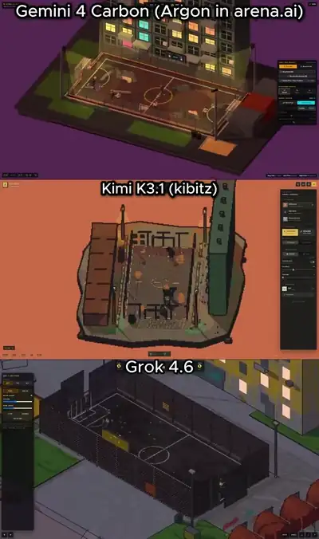</a><br><a href="https://www.sandbase.ai/lab/ai-videos/gemini-4-carbon/2113289049075003839?utm_source=github&utm_medium=readme&utm_campaign=awesome-gemini-4-carbon&utm_content=card"><b>Isometric street football court benchmark across three models</b></a><br><sub><a href="https://x.com/olezhavich/status/2113289049075003839">@olezhavich</a> · 0:18</sub></td></tr>
</table>

<details>
<summary><b>Show all 48</b></summary>

<table>
<tr><td width="33%" valign="top"><a href="https://www.sandbase.ai/lab/media/x/gemini-4-carbon/2113358260933988655/video.mp4">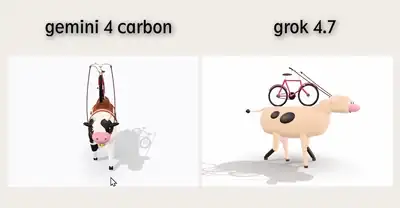</a><br><a href="https://www.sandbase.ai/lab/ai-videos/gemini-4-carbon/2113358260933988655?utm_source=github&utm_medium=readme&utm_campaign=awesome-gemini-4-carbon&utm_content=card"><b>Comparing 3D cow cycling outputs in Three.js</b></a><br><sub><a href="https://x.com/TimJayas/status/2113358260933988655">@TimJayas</a> · 0:50 · <a href="https://www.sandbase.ai/lab/ai-videos/gemini-4-carbon/2113358260933988655?utm_source=github&utm_medium=readme&utm_campaign=awesome-gemini-4-carbon&utm_content=card">prompt</a></sub></td><td width="33%" valign="top"><a href="https://www.sandbase.ai/lab/media/x/gemini-4-carbon/2113371478817399010/video.mp4">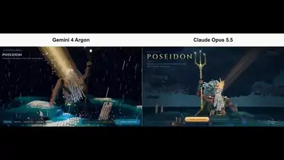</a><br><a href="https://www.sandbase.ai/lab/ai-videos/gemini-4-carbon/2113371478817399010?utm_source=github&utm_medium=readme&utm_campaign=awesome-gemini-4-carbon&utm_content=card"><b>Comparison between Gemini 4 and Opus 5.5</b></a><br><sub><a href="https://x.com/blueemi99/status/2113371478817399010">@blueemi99</a> · 0:10</sub></td><td width="33%" valign="top"><a href="https://www.sandbase.ai/lab/media/x/gemini-4-carbon/2113408447777522140/video.mp4">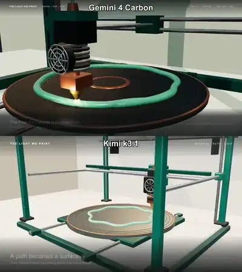</a><br><a href="https://www.sandbase.ai/lab/ai-videos/gemini-4-carbon/2113408447777522140?utm_source=github&utm_medium=readme&utm_campaign=awesome-gemini-4-carbon&utm_content=card"><b>3D generation comparison between Gemini and Kimi</b></a><br><sub><a href="https://x.com/SPAC89/status/2113408447777522140">@SPAC89</a> · 0:15</sub></td></tr>
<tr><td width="33%" valign="top"><a href="https://www.sandbase.ai/lab/media/x/gemini-4-carbon/2113497132841799858/video.mp4">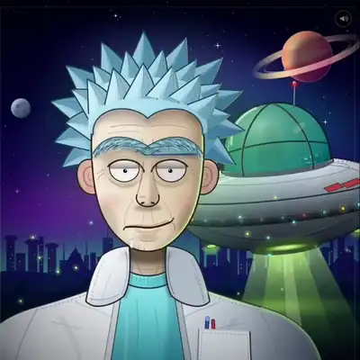</a><br><a href="https://www.sandbase.ai/lab/ai-videos/gemini-4-carbon/2113497132841799858?utm_source=github&utm_medium=readme&utm_campaign=awesome-gemini-4-carbon&utm_content=card"><b>Comparison of Rick Sanchez SVG animation</b></a><br><sub><a href="https://x.com/dummerspast39/status/2113497132841799858">@dummerspast39</a> · 0:15</sub></td><td width="33%" valign="top"><a href="https://www.sandbase.ai/lab/media/x/gemini-4-carbon/2113616533939466734/video.mp4">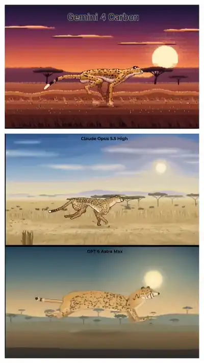</a><br><a href="https://www.sandbase.ai/lab/ai-videos/gemini-4-carbon/2113616533939466734?utm_source=github&utm_medium=readme&utm_campaign=awesome-gemini-4-carbon&utm_content=card"><b>Pixel art running cheetah model comparison</b></a><br><sub><a href="https://x.com/duke_mv/status/2113616533939466734">@duke_mv</a> · 0:12 · <a href="https://www.sandbase.ai/lab/ai-videos/gemini-4-carbon/2113616533939466734?utm_source=github&utm_medium=readme&utm_campaign=awesome-gemini-4-carbon&utm_content=card">prompt</a></sub></td><td width="33%" valign="top"><a href="https://www.sandbase.ai/lab/media/x/gemini-4-carbon/2113678010754961806/video.mp4">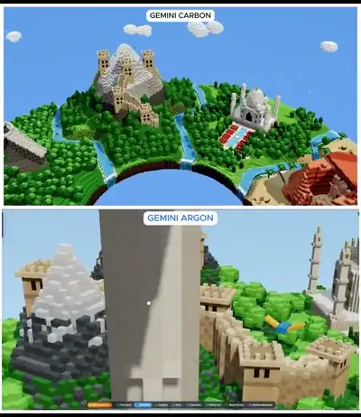</a><br><a href="https://www.sandbase.ai/lab/ai-videos/gemini-4-carbon/2113678010754961806?utm_source=github&utm_medium=readme&utm_campaign=awesome-gemini-4-carbon&utm_content=card"><b>Comparison between Gemini Carbon and Gemini 4 Argon</b></a><br><sub><a href="https://x.com/Adidotdev/status/2113678010754961806">@Adidotdev</a> · 0:40</sub></td></tr>
<tr><td width="33%" valign="top"><a href="https://www.sandbase.ai/lab/media/x/gemini-4-carbon/2114748807464546689/video.mp4">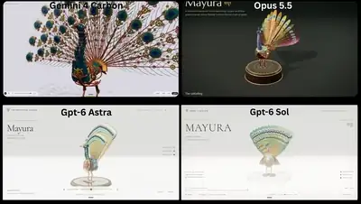</a><br><a href="https://www.sandbase.ai/lab/ai-videos/gemini-4-carbon/2114748807464546689?utm_source=github&utm_medium=readme&utm_campaign=awesome-gemini-4-carbon&utm_content=card"><b>Four models generating a mechanical Indian peacock</b></a><br><sub><a href="https://x.com/srikanthvaluri/status/2114748807464546689">@srikanthvaluri</a> · 0:31 · <a href="https://www.sandbase.ai/lab/ai-videos/gemini-4-carbon/2114748807464546689?utm_source=github&utm_medium=readme&utm_campaign=awesome-gemini-4-carbon&utm_content=card">prompt</a></sub></td><td width="33%" valign="top"><a href="https://www.sandbase.ai/lab/media/x/gemini-4-carbon/2115509328472113629/video.mp4">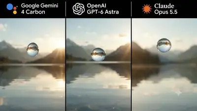</a><br><a href="https://www.sandbase.ai/lab/ai-videos/gemini-4-carbon/2115509328472113629?utm_source=github&utm_medium=readme&utm_campaign=awesome-gemini-4-carbon&utm_content=card"><b>Water droplet rendering comparison across AI models</b></a><br><sub><a href="https://x.com/QubitO1/status/2115509328472113629">@QubitO1</a> · 0:07</sub></td><td width="33%" valign="top"><a href="https://www.sandbase.ai/lab/media/x/gemini-4-carbon/2115518607715418494/video.mp4">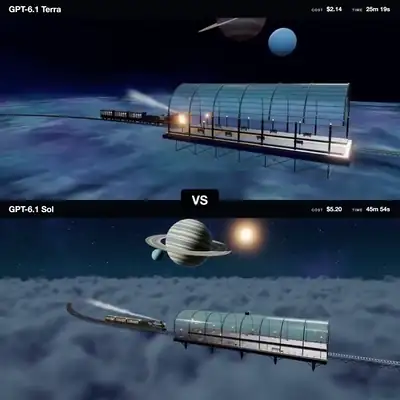</a><br><a href="https://www.sandbase.ai/lab/ai-videos/gemini-4-carbon/2115518607715418494?utm_source=github&utm_medium=readme&utm_campaign=awesome-gemini-4-carbon&utm_content=card"><b>GPT-6.1 Terra vs Sol space train benchmark</b></a><br><sub><a href="https://x.com/EnvolDev/status/2115518607715418494">@EnvolDev</a> · 0:25</sub></td></tr>
<tr><td width="33%" valign="top"><a href="https://www.sandbase.ai/lab/media/x/gemini-4-carbon/2115526209140568356/video.mp4">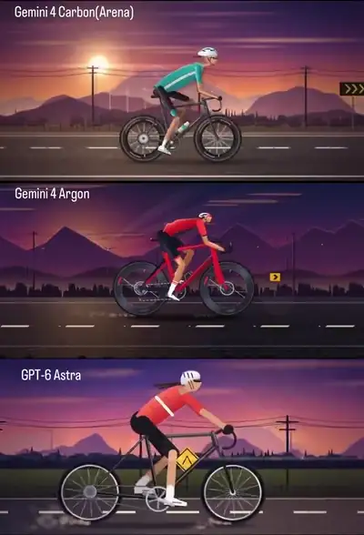</a><br><a href="https://www.sandbase.ai/lab/ai-videos/gemini-4-carbon/2115526209140568356?utm_source=github&utm_medium=readme&utm_campaign=awesome-gemini-4-carbon&utm_content=card"><b>Gemini 4 Carbon vs Argon vs GPT-6 Astra</b></a><br><sub><a href="https://x.com/ValakX18/status/2115526209140568356">@ValakX18</a> · 0:14</sub></td><td width="33%" valign="top"><a href="https://www.sandbase.ai/lab/media/x/gemini-4-carbon/2115577725373092274/video.mp4">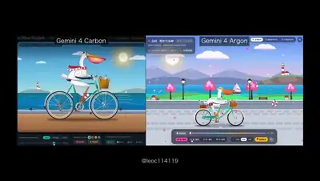</a><br><a href="https://www.sandbase.ai/lab/ai-videos/gemini-4-carbon/2115577725373092274?utm_source=github&utm_medium=readme&utm_campaign=awesome-gemini-4-carbon&utm_content=card"><b>Pelican riding bicycle SVG animation comparison</b></a><br><sub><a href="https://x.com/leo114119/status/2115577725373092274">@leo114119</a> · 0:22</sub></td><td width="33%" valign="top"><a href="https://www.sandbase.ai/lab/media/x/gemini-4-carbon/2115699353675354307/video.mp4">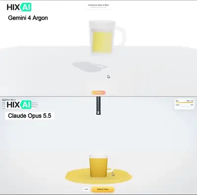</a><br><a href="https://www.sandbase.ai/lab/ai-videos/gemini-4-carbon/2115699353675354307?utm_source=github&utm_medium=readme&utm_campaign=awesome-gemini-4-carbon&utm_content=card"><b>Pouring beer interactive 3D webpage comparison</b></a><br><sub><a href="https://x.com/HIX_AI_/status/2115699353675354307">@HIX_AI_</a> · 0:23 · <a href="https://www.sandbase.ai/lab/ai-videos/gemini-4-carbon/2115699353675354307?utm_source=github&utm_medium=readme&utm_campaign=awesome-gemini-4-carbon&utm_content=card">prompt</a></sub></td></tr>
<tr><td width="33%" valign="top"><a href="https://www.sandbase.ai/lab/media/x/gemini-4-carbon/2115721948886155726/video.mp4">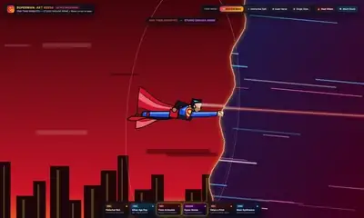</a><br><a href="https://www.sandbase.ai/lab/ai-videos/gemini-4-carbon/2115721948886155726?utm_source=github&utm_medium=readme&utm_campaign=awesome-gemini-4-carbon&utm_content=card"><b>Superman multiverse animation comparison</b></a><br><sub><a href="https://x.com/Inmerson/status/2115721948886155726">@Inmerson</a> · 0:58 · <a href="https://www.sandbase.ai/lab/ai-videos/gemini-4-carbon/2115721948886155726?utm_source=github&utm_medium=readme&utm_campaign=awesome-gemini-4-carbon&utm_content=card">prompt</a></sub></td><td width="33%" valign="top"><a href="https://www.sandbase.ai/lab/media/x/gemini-4-carbon/2115728069398757827/video.mp4"></a><br><a href="https://www.sandbase.ai/lab/ai-videos/gemini-4-carbon/2115728069398757827?utm_source=github&utm_medium=readme&utm_campaign=awesome-gemini-4-carbon&utm_content=card"><b>Eye generation benchmark across flagship AI models</b></a><br><sub><a href="https://x.com/noclipepe/status/2115728069398757827">@noclipepe</a> · 0:29</sub></td><td width="33%" valign="top"><a href="https://www.sandbase.ai/lab/media/x/gemini-4-carbon/2115802517942497491/video.mp4"></a><br><a href="https://www.sandbase.ai/lab/ai-videos/gemini-4-carbon/2115802517942497491?utm_source=github&utm_medium=readme&utm_campaign=awesome-gemini-4-carbon&utm_content=card"><b>Interactive 3D cafe racer bike comparison</b></a><br><sub><a href="https://x.com/dromexa/status/2115802517942497491">@dromexa</a> · 0:29 · <a href="https://www.sandbase.ai/lab/ai-videos/gemini-4-carbon/2115802517942497491?utm_source=github&utm_medium=readme&utm_campaign=awesome-gemini-4-carbon&utm_content=card">prompt</a></sub></td></tr>
<tr><td width="33%" valign="top"><a href="https://www.sandbase.ai/lab/media/x/gemini-4-carbon/2115823149849714738/video.mp4"></a><br><a href="https://www.sandbase.ai/lab/ai-videos/gemini-4-carbon/2115823149849714738?utm_source=github&utm_medium=readme&utm_campaign=awesome-gemini-4-carbon&utm_content=card"><b>Comparison of motion graphics showreel code</b></a><br><sub><a href="https://x.com/leo114119/status/2115823149849714738">@leo114119</a> · 0:15 · <a href="https://www.sandbase.ai/lab/ai-videos/gemini-4-carbon/2115823149849714738?utm_source=github&utm_medium=readme&utm_campaign=awesome-gemini-4-carbon&utm_content=card">prompt</a></sub></td><td width="33%" valign="top"><a href="https://www.sandbase.ai/lab/media/x/gemini-4-carbon/2115839073701257422/video.mp4"></a><br><a href="https://www.sandbase.ai/lab/ai-videos/gemini-4-carbon/2115839073701257422?utm_source=github&utm_medium=readme&utm_campaign=awesome-gemini-4-carbon&utm_content=card"><b>Interactive 3D Oxford city comparison</b></a><br><sub><a href="https://x.com/leo114119/status/2115839073701257422">@leo114119</a> · 0:08</sub></td><td width="33%" valign="top"><a href="https://www.sandbase.ai/lab/media/x/gemini-4-carbon/2115840921342456062/video.mp4"></a><br><a href="https://www.sandbase.ai/lab/ai-videos/gemini-4-carbon/2115840921342456062?utm_source=github&utm_medium=readme&utm_campaign=awesome-gemini-4-carbon&utm_content=card"><b>Comparison between Gemini Argon and Carbon</b></a><br><sub><a href="https://x.com/glitch_catAI/status/2115840921342456062">@glitch_catAI</a> · 0:10</sub></td></tr>
<tr><td width="33%" valign="top"><a href="https://www.sandbase.ai/lab/media/x/gemini-4-carbon/2115841153635418347/video.mp4"></a><br><a href="https://www.sandbase.ai/lab/ai-videos/gemini-4-carbon/2115841153635418347?utm_source=github&utm_medium=readme&utm_campaign=awesome-gemini-4-carbon&utm_content=card"><b>3D White House in Three.js comparison</b></a><br><sub><a href="https://x.com/exploraX_/status/2115841153635418347">@exploraX_</a> · 0:57</sub></td><td width="33%" valign="top"><a href="https://www.sandbase.ai/lab/media/x/gemini-4-carbon/2115891194383200515/video.mp4"></a><br><a href="https://www.sandbase.ai/lab/ai-videos/gemini-4-carbon/2115891194383200515?utm_source=github&utm_medium=readme&utm_campaign=awesome-gemini-4-carbon&utm_content=card"><b>Interactive rainbow jelly comparison across models</b></a><br><sub><a href="https://x.com/0xRhinoX/status/2115891194383200515">@0xRhinoX</a> · 0:23 · <a href="https://www.sandbase.ai/lab/ai-videos/gemini-4-carbon/2115891194383200515?utm_source=github&utm_medium=readme&utm_campaign=awesome-gemini-4-carbon&utm_content=card">prompt</a></sub></td><td width="33%" valign="top"><a href="https://www.sandbase.ai/lab/media/x/gemini-4-carbon/2115918611676041698/video.mp4"></a><br><a href="https://www.sandbase.ai/lab/ai-videos/gemini-4-carbon/2115918611676041698?utm_source=github&utm_medium=readme&utm_campaign=awesome-gemini-4-carbon&utm_content=card"><b>Running T-rex in Three.js model comparison</b></a><br><sub><a href="https://x.com/ValencianaAbel/status/2115918611676041698">@ValencianaAbel</a> · 0:08 · <a href="https://www.sandbase.ai/lab/ai-videos/gemini-4-carbon/2115918611676041698?utm_source=github&utm_medium=readme&utm_campaign=awesome-gemini-4-carbon&utm_content=card">prompt</a></sub></td></tr>
<tr><td width="33%" valign="top"><a href="https://www.sandbase.ai/lab/media/x/gemini-4-carbon/2115918919303069762/video.mp4"></a><br><a href="https://www.sandbase.ai/lab/ai-videos/gemini-4-carbon/2115918919303069762?utm_source=github&utm_medium=readme&utm_campaign=awesome-gemini-4-carbon&utm_content=card"><b>Island with pumpkin and bats prompt comparison</b></a><br><sub><a href="https://x.com/0xlillyy/status/2115918919303069762">@0xlillyy</a> · 0:13</sub></td><td width="33%" valign="top"><a href="https://www.sandbase.ai/lab/media/x/gemini-4-carbon/2115953941808550313/video.mp4"></a><br><a href="https://www.sandbase.ai/lab/ai-videos/gemini-4-carbon/2115953941808550313?utm_source=github&utm_medium=readme&utm_campaign=awesome-gemini-4-carbon&utm_content=card"><b>Chrome Dino game generation benchmark across models</b></a><br><sub><a href="https://x.com/noclipepe/status/2115953941808550313">@noclipepe</a> · 0:27</sub></td><td width="33%" valign="top"><a href="https://www.sandbase.ai/lab/media/x/gemini-4-carbon/2116108534051905642/video.mp4"></a><br><a href="https://www.sandbase.ai/lab/ai-videos/gemini-4-carbon/2116108534051905642?utm_source=github&utm_medium=readme&utm_campaign=awesome-gemini-4-carbon&utm_content=card"><b>Tiny troublemakers benchmark between Carbon and Opus</b></a><br><sub><a href="https://x.com/0xPorterio/status/2116108534051905642">@0xPorterio</a> · 0:29 · <a href="https://www.sandbase.ai/lab/ai-videos/gemini-4-carbon/2116108534051905642?utm_source=github&utm_medium=readme&utm_campaign=awesome-gemini-4-carbon&utm_content=card">prompt</a></sub></td></tr>
<tr><td width="33%" valign="top"><a href="https://www.sandbase.ai/lab/media/x/gemini-4-carbon/2116148349791346698/video.mp4"></a><br><a href="https://www.sandbase.ai/lab/ai-videos/gemini-4-carbon/2116148349791346698?utm_source=github&utm_medium=readme&utm_campaign=awesome-gemini-4-carbon&utm_content=card"><b>Model comparison of a PS5 controller SVG</b></a><br><sub><a href="https://x.com/marcthecreatorr/status/2116148349791346698">@marcthecreatorr</a> · 0:22</sub></td><td width="33%" valign="top"><a href="https://www.sandbase.ai/lab/media/x/gemini-4-carbon/2116198626187706722/video.mp4"></a><br><a href="https://www.sandbase.ai/lab/ai-videos/gemini-4-carbon/2116198626187706722?utm_source=github&utm_medium=readme&utm_campaign=awesome-gemini-4-carbon&utm_content=card"><b>Iterative improvement of dragon and castle scene</b></a><br><sub><a href="https://x.com/semichenkko/status/2116198626187706722">@semichenkko</a> · 0:13</sub></td><td width="33%" valign="top"><a href="https://www.sandbase.ai/lab/media/x/gemini-4-carbon/2116301725951013180/video.mp4"></a><br><a href="https://www.sandbase.ai/lab/ai-videos/gemini-4-carbon/2116301725951013180?utm_source=github&utm_medium=readme&utm_campaign=awesome-gemini-4-carbon&utm_content=card"><b>Interactive rainbow jelly pumpkin comparison</b></a><br><sub><a href="https://x.com/0xRhinoX/status/2116301725951013180">@0xRhinoX</a> · 0:26 · <a href="https://www.sandbase.ai/lab/ai-videos/gemini-4-carbon/2116301725951013180?utm_source=github&utm_medium=readme&utm_campaign=awesome-gemini-4-carbon&utm_content=card">prompt</a></sub></td></tr>
<tr><td width="33%" valign="top"><a href="https://www.sandbase.ai/lab/media/x/gemini-4-carbon/2116445289468850366/video.mp4"></a><br><a href="https://www.sandbase.ai/lab/ai-videos/gemini-4-carbon/2116445289468850366?utm_source=github&utm_medium=readme&utm_campaign=awesome-gemini-4-carbon&utm_content=card"><b>Zombie hand animation model comparison</b></a><br><sub><a href="https://x.com/noclipepe/status/2116445289468850366">@noclipepe</a> · 0:39 · <a href="https://www.sandbase.ai/lab/ai-videos/gemini-4-carbon/2116445289468850366?utm_source=github&utm_medium=readme&utm_campaign=awesome-gemini-4-carbon&utm_content=card">prompt</a></sub></td><td width="33%" valign="top"><a href="https://www.sandbase.ai/lab/media/x/gemini-4-carbon/2116518366919667775/video.mp4"></a><br><a href="https://www.sandbase.ai/lab/ai-videos/gemini-4-carbon/2116518366919667775?utm_source=github&utm_medium=readme&utm_campaign=awesome-gemini-4-carbon&utm_content=card"><b>Mechanical watch 3D model comparison</b></a><br><sub><a href="https://x.com/dromexa/status/2116518366919667775">@dromexa</a> · 0:30 · <a href="https://www.sandbase.ai/lab/ai-videos/gemini-4-carbon/2116518366919667775?utm_source=github&utm_medium=readme&utm_campaign=awesome-gemini-4-carbon&utm_content=card">prompt</a></sub></td><td width="33%" valign="top"><a href="https://www.sandbase.ai/lab/media/x/gemini-4-carbon/2116527640479662179/video.mp4"></a><br><a href="https://www.sandbase.ai/lab/ai-videos/gemini-4-carbon/2116527640479662179?utm_source=github&utm_medium=readme&utm_campaign=awesome-gemini-4-carbon&utm_content=card"><b>Cross section of a cartoon cruise ship comparison</b></a><br><sub><a href="https://x.com/olezhavich/status/2116527640479662179">@olezhavich</a> · 0:28 · <a href="https://www.sandbase.ai/lab/ai-videos/gemini-4-carbon/2116527640479662179?utm_source=github&utm_medium=readme&utm_campaign=awesome-gemini-4-carbon&utm_content=card">prompt</a></sub></td></tr>
<tr><td width="33%" valign="top"><a href="https://www.sandbase.ai/lab/media/x/gemini-4-carbon/2116548548334321967/video.mp4"></a><br><a href="https://www.sandbase.ai/lab/ai-videos/gemini-4-carbon/2116548548334321967?utm_source=github&utm_medium=readme&utm_campaign=awesome-gemini-4-carbon&utm_content=card"><b>Robotic great white shark model comparison</b></a><br><sub><a href="https://x.com/0xPorterio/status/2116548548334321967">@0xPorterio</a> · 0:29 · <a href="https://www.sandbase.ai/lab/ai-videos/gemini-4-carbon/2116548548334321967?utm_source=github&utm_medium=readme&utm_campaign=awesome-gemini-4-carbon&utm_content=card">prompt</a></sub></td><td width="33%" valign="top"><a href="https://www.sandbase.ai/lab/media/x/gemini-4-carbon/2116556350130163783/video.mp4"></a><br><a href="https://www.sandbase.ai/lab/ai-videos/gemini-4-carbon/2116556350130163783?utm_source=github&utm_medium=readme&utm_campaign=awesome-gemini-4-carbon&utm_content=card"><b>Haunted house website comparison</b></a><br><sub><a href="https://x.com/keydol123/status/2116556350130163783">@keydol123</a> · 0:24 · <a href="https://www.sandbase.ai/lab/ai-videos/gemini-4-carbon/2116556350130163783?utm_source=github&utm_medium=readme&utm_campaign=awesome-gemini-4-carbon&utm_content=card">prompt</a></sub></td><td width="33%" valign="top"><a href="https://www.sandbase.ai/lab/media/x/gemini-4-carbon/2116577106238873765/video.mp4"></a><br><a href="https://www.sandbase.ai/lab/ai-videos/gemini-4-carbon/2116577106238873765?utm_source=github&utm_medium=readme&utm_campaign=awesome-gemini-4-carbon&utm_content=card"><b>Interactive hot spring with capybaras comparison</b></a><br><sub><a href="https://x.com/ottollm/status/2116577106238873765">@ottollm</a> · 0:31 · <a href="https://www.sandbase.ai/lab/ai-videos/gemini-4-carbon/2116577106238873765?utm_source=github&utm_medium=readme&utm_campaign=awesome-gemini-4-carbon&utm_content=card">prompt</a></sub></td></tr>
<tr><td width="33%" valign="top"><a href="https://www.sandbase.ai/lab/media/x/gemini-4-carbon/2116606788241969445/video.mp4"></a><br><a href="https://www.sandbase.ai/lab/ai-videos/gemini-4-carbon/2116606788241969445?utm_source=github&utm_medium=readme&utm_campaign=awesome-gemini-4-carbon&utm_content=card"><b>Animated cutaway of a radial airplane engine</b></a><br><sub><a href="https://x.com/olezhavich/status/2116606788241969445">@olezhavich</a> · 0:11 · <a href="https://www.sandbase.ai/lab/ai-videos/gemini-4-carbon/2116606788241969445?utm_source=github&utm_medium=readme&utm_campaign=awesome-gemini-4-carbon&utm_content=card">prompt</a></sub></td><td width="33%" valign="top"><a href="https://www.sandbase.ai/lab/media/x/gemini-4-carbon/2116767284618486044/video.mp4"></a><br><a href="https://www.sandbase.ai/lab/ai-videos/gemini-4-carbon/2116767284618486044?utm_source=github&utm_medium=readme&utm_campaign=awesome-gemini-4-carbon&utm_content=card"><b>Three.js mechanical eagle comparison</b></a><br><sub><a href="https://x.com/srikanthvaluri/status/2116767284618486044">@srikanthvaluri</a> · 0:27 · <a href="https://www.sandbase.ai/lab/ai-videos/gemini-4-carbon/2116767284618486044?utm_source=github&utm_medium=readme&utm_campaign=awesome-gemini-4-carbon&utm_content=card">prompt</a></sub></td><td width="33%" valign="top"><a href="https://www.sandbase.ai/lab/media/x/gemini-4-carbon/2116799920523153750/video.mp4"></a><br><a href="https://www.sandbase.ai/lab/ai-videos/gemini-4-carbon/2116799920523153750?utm_source=github&utm_medium=readme&utm_campaign=awesome-gemini-4-carbon&utm_content=card"><b>Pelican riding visual comparison between models</b></a><br><sub><a href="https://x.com/insanekrishnaa/status/2116799920523153750">@insanekrishnaa</a> · 0:08</sub></td></tr>
<tr><td width="33%" valign="top"><a href="https://www.sandbase.ai/lab/media/x/gemini-4-carbon/2116813166009106935/video.mp4"></a><br><a href="https://www.sandbase.ai/lab/ai-videos/gemini-4-carbon/2116813166009106935?utm_source=github&utm_medium=readme&utm_campaign=awesome-gemini-4-carbon&utm_content=card"><b>Opus 5.5 versus Gemini 4 Carbon comparison</b></a><br><sub><a href="https://x.com/Haleeeemahh/status/2116813166009106935">@Haleeeemahh</a> · 0:26</sub></td><td width="33%" valign="top"><a href="https://www.sandbase.ai/lab/media/x/gemini-4-carbon/2116853285617336424/video.mp4"></a><br><a href="https://www.sandbase.ai/lab/ai-videos/gemini-4-carbon/2116853285617336424?utm_source=github&utm_medium=readme&utm_campaign=awesome-gemini-4-carbon&utm_content=card"><b>Nine-cylinder radial engine animation comparison</b></a><br><sub><a href="https://x.com/m1lad_az/status/2116853285617336424">@m1lad_az</a> · 0:11 · <a href="https://www.sandbase.ai/lab/ai-videos/gemini-4-carbon/2116853285617336424?utm_source=github&utm_medium=readme&utm_campaign=awesome-gemini-4-carbon&utm_content=card">prompt</a></sub></td><td width="33%" valign="top"><a href="https://www.sandbase.ai/lab/media/x/gemini-4-carbon/2116879524671475759/video.mp4"></a><br><a href="https://www.sandbase.ai/lab/ai-videos/gemini-4-carbon/2116879524671475759?utm_source=github&utm_medium=readme&utm_campaign=awesome-gemini-4-carbon&utm_content=card"><b>Gemini 4 Carbon versus Claude Opus 5.5 comparison</b></a><br><sub><a href="https://x.com/0xPorterio/status/2116879524671475759">@0xPorterio</a> · 0:42</sub></td></tr>
<tr><td width="33%" valign="top"><a href="https://www.sandbase.ai/lab/media/x/gemini-4-carbon/2116883000361427433/video.mp4"></a><br><a href="https://www.sandbase.ai/lab/ai-videos/gemini-4-carbon/2116883000361427433?utm_source=github&utm_medium=readme&utm_campaign=awesome-gemini-4-carbon&utm_content=card"><b>Pelican riding a bicycle SVG animation</b></a><br><sub><a href="https://x.com/xiax0603/status/2116883000361427433">@xiax0603</a> · 0:39</sub></td><td width="33%" valign="top"><a href="https://www.sandbase.ai/lab/media/x/gemini-4-carbon/2116892619309461745/video.mp4"></a><br><a href="https://www.sandbase.ai/lab/ai-videos/gemini-4-carbon/2116892619309461745?utm_source=github&utm_medium=readme&utm_campaign=awesome-gemini-4-carbon&utm_content=card"><b>Two-stroke chainsaw engine cutaway comparison</b></a><br><sub><a href="https://x.com/olezhavich/status/2116892619309461745">@olezhavich</a> · 0:11 · <a href="https://www.sandbase.ai/lab/ai-videos/gemini-4-carbon/2116892619309461745?utm_source=github&utm_medium=readme&utm_campaign=awesome-gemini-4-carbon&utm_content=card">prompt</a></sub></td><td width="33%" valign="top"><a href="https://www.sandbase.ai/lab/media/x/gemini-4-carbon/2116927253980594275/video.mp4"></a><br><a href="https://www.sandbase.ai/lab/ai-videos/gemini-4-carbon/2116927253980594275?utm_source=github&utm_medium=readme&utm_campaign=awesome-gemini-4-carbon&utm_content=card"><b>Interactive running V8 engine model comparison</b></a><br><sub><a href="https://x.com/dromexa/status/2116927253980594275">@dromexa</a> · 0:29 · <a href="https://www.sandbase.ai/lab/ai-videos/gemini-4-carbon/2116927253980594275?utm_source=github&utm_medium=readme&utm_campaign=awesome-gemini-4-carbon&utm_content=card">prompt</a></sub></td></tr>
</table>

</details>

<a id="showcase"></a>

## Model showcases

<table>
<tr><td width="33%" valign="top"><a href="https://www.sandbase.ai/lab/media/x/gemini-4-carbon/2112827860713156853/video.mp4"></a><br><a href="https://www.sandbase.ai/lab/ai-videos/gemini-4-carbon/2112827860713156853?utm_source=github&utm_medium=readme&utm_campaign=awesome-gemini-4-carbon&utm_content=card"><b>3D video of carbon stability with Gemini mascot</b></a><br><sub><a href="https://x.com/chetaslua/status/2112827860713156853">@chetaslua</a> · 0:20</sub></td><td width="33%" valign="top"><a href="https://www.sandbase.ai/lab/media/x/gemini-4-carbon/2112848294581813473/video.mp4"></a><br><a href="https://www.sandbase.ai/lab/ai-videos/gemini-4-carbon/2112848294581813473?utm_source=github&utm_medium=readme&utm_campaign=awesome-gemini-4-carbon&utm_content=card"><b>Super Mario game generated by AI</b></a><br><sub><a href="https://x.com/LuminaBench/status/2112848294581813473">@LuminaBench</a> · 1:14</sub></td><td width="33%" valign="top"><a href="https://www.sandbase.ai/lab/media/x/gemini-4-carbon/2112896305773060111/video.mp4"></a><br><a href="https://www.sandbase.ai/lab/ai-videos/gemini-4-carbon/2112896305773060111?utm_source=github&utm_medium=readme&utm_campaign=awesome-gemini-4-carbon&utm_content=card"><b>Interactive PS5 controller created in SVG</b></a><br><sub><a href="https://x.com/karanC_12/status/2112896305773060111">@karanC_12</a> · 0:17</sub></td></tr>
<tr><td width="33%" valign="top"><a href="https://www.sandbase.ai/lab/media/x/gemini-4-carbon/2112906929253282038/video.mp4"></a><br><a href="https://www.sandbase.ai/lab/ai-videos/gemini-4-carbon/2112906929253282038?utm_source=github&utm_medium=readme&utm_campaign=awesome-gemini-4-carbon&utm_content=card"><b>Animation test generated by Gemini 4 Carbon</b></a><br><sub><a href="https://x.com/dextune/status/2112906929253282038">@dextune</a> · 0:14</sub></td><td width="33%" valign="top"><a href="https://www.sandbase.ai/lab/media/x/gemini-4-carbon/2112909613788230013/video.mp4"></a><br><a href="https://www.sandbase.ai/lab/ai-videos/gemini-4-carbon/2112909613788230013?utm_source=github&utm_medium=readme&utm_campaign=awesome-gemini-4-carbon&utm_content=card"><b>Thirty-second professional motion graphics animation</b></a><br><sub><a href="https://x.com/Genysis_Ai_26/status/2112909613788230013">@Genysis_Ai_26</a> · 1:13 · <a href="https://www.sandbase.ai/lab/ai-videos/gemini-4-carbon/2112909613788230013?utm_source=github&utm_medium=readme&utm_campaign=awesome-gemini-4-carbon&utm_content=card">prompt</a></sub></td><td width="33%" valign="top"><a href="https://www.sandbase.ai/lab/media/x/gemini-4-carbon/2112933636093919333/video.mp4"></a><br><a href="https://www.sandbase.ai/lab/ai-videos/gemini-4-carbon/2112933636093919333?utm_source=github&utm_medium=readme&utm_campaign=awesome-gemini-4-carbon&utm_content=card"><b>Pelican riding a bike across four seasons SVG</b></a><br><sub><a href="https://x.com/hamoudi_yo/status/2112933636093919333">@hamoudi_yo</a> · 0:19</sub></td></tr>
</table>

<details>
<summary><b>Show all 27</b></summary>

<table>
<tr><td width="33%" valign="top"><a href="https://www.sandbase.ai/lab/media/x/gemini-4-carbon/2112935205703147750/video.mp4"></a><br><a href="https://www.sandbase.ai/lab/ai-videos/gemini-4-carbon/2112935205703147750?utm_source=github&utm_medium=readme&utm_campaign=awesome-gemini-4-carbon&utm_content=card"><b>A mechanical flower made in Three.js</b></a><br><sub><a href="https://x.com/thtbee_/status/2112935205703147750">@thtbee_</a> · 0:44</sub></td><td width="33%" valign="top"><a href="https://www.sandbase.ai/lab/media/x/gemini-4-carbon/2112946681977430469/video.mp4"></a><br><a href="https://www.sandbase.ai/lab/ai-videos/gemini-4-carbon/2112946681977430469?utm_source=github&utm_medium=readme&utm_campaign=awesome-gemini-4-carbon&utm_content=card"><b>Interactive 3D crystal citrus generated by Gemini</b></a><br><sub><a href="https://x.com/pankajkumar_dev/status/2112946681977430469">@pankajkumar_dev</a> · 0:40</sub></td><td width="33%" valign="top"><a href="https://www.sandbase.ai/lab/media/x/gemini-4-carbon/2112950910892789979/video.mp4"></a><br><a href="https://www.sandbase.ai/lab/ai-videos/gemini-4-carbon/2112950910892789979?utm_source=github&utm_medium=readme&utm_campaign=awesome-gemini-4-carbon&utm_content=card"><b>A bicycle riding a cow in Three.js</b></a><br><sub><a href="https://x.com/TimJayas/status/2112950910892789979">@TimJayas</a> · 0:49 · <a href="https://www.sandbase.ai/lab/ai-videos/gemini-4-carbon/2112950910892789979?utm_source=github&utm_medium=readme&utm_campaign=awesome-gemini-4-carbon&utm_content=card">prompt</a></sub></td></tr>
<tr><td width="33%" valign="top"><a href="https://www.sandbase.ai/lab/media/x/gemini-4-carbon/2112967343559332168/video.mp4"></a><br><a href="https://www.sandbase.ai/lab/ai-videos/gemini-4-carbon/2112967343559332168?utm_source=github&utm_medium=readme&utm_campaign=awesome-gemini-4-carbon&utm_content=card"><b>Visual output generated on Arena from Gemini 4</b></a><br><sub><a href="https://x.com/fayequepeerzade/status/2112967343559332168">@fayequepeerzade</a> · 0:37</sub></td><td width="33%" valign="top"><a href="https://www.sandbase.ai/lab/media/x/gemini-4-carbon/2112999200472596959/video.mp4"></a><br><a href="https://www.sandbase.ai/lab/ai-videos/gemini-4-carbon/2112999200472596959?utm_source=github&utm_medium=readme&utm_campaign=awesome-gemini-4-carbon&utm_content=card"><b>SVG graphic of a cola can</b></a><br><sub><a href="https://x.com/dummerspast39/status/2112999200472596959">@dummerspast39</a> · 0:30</sub></td><td width="33%" valign="top"><a href="https://www.sandbase.ai/lab/media/x/gemini-4-carbon/2113144877257248816/video.mp4"></a><br><a href="https://www.sandbase.ai/lab/ai-videos/gemini-4-carbon/2113144877257248816?utm_source=github&utm_medium=readme&utm_campaign=awesome-gemini-4-carbon&utm_content=card"><b>A freestyle swimmer created using Three.js</b></a><br><sub><a href="https://x.com/AI_Screening/status/2113144877257248816">@AI_Screening</a> · 0:15 · <a href="https://www.sandbase.ai/lab/ai-videos/gemini-4-carbon/2113144877257248816?utm_source=github&utm_medium=readme&utm_campaign=awesome-gemini-4-carbon&utm_content=card">prompt</a></sub></td></tr>
<tr><td width="33%" valign="top"><a href="https://www.sandbase.ai/lab/media/x/gemini-4-carbon/2113185847566876679/video.mp4"></a><br><a href="https://www.sandbase.ai/lab/ai-videos/gemini-4-carbon/2113185847566876679?utm_source=github&utm_medium=readme&utm_campaign=awesome-gemini-4-carbon&utm_content=card"><b>Interactive 3D seaplane with infinite ocean</b></a><br><sub><a href="https://x.com/LuminaBench/status/2113185847566876679">@LuminaBench</a> · 0:50</sub></td><td width="33%" valign="top"><a href="https://www.sandbase.ai/lab/media/x/gemini-4-carbon/2113293118695256514/video.mp4"></a><br><a href="https://www.sandbase.ai/lab/ai-videos/gemini-4-carbon/2113293118695256514?utm_source=github&utm_medium=readme&utm_campaign=awesome-gemini-4-carbon&utm_content=card"><b>A full interactive car configurator</b></a><br><sub><a href="https://x.com/k2sbhai/status/2113293118695256514">@k2sbhai</a> · 0:42</sub></td><td width="33%" valign="top"><a href="https://www.sandbase.ai/lab/media/x/gemini-4-carbon/2113301369826464147/video.mp4"></a><br><a href="https://www.sandbase.ai/lab/ai-videos/gemini-4-carbon/2113301369826464147?utm_source=github&utm_medium=readme&utm_campaign=awesome-gemini-4-carbon&utm_content=card"><b>Two black hole event horizons in Three.js</b></a><br><sub><a href="https://x.com/thtbee_/status/2113301369826464147">@thtbee_</a> · 0:28</sub></td></tr>
<tr><td width="33%" valign="top"><a href="https://www.sandbase.ai/lab/media/x/gemini-4-carbon/2113308560629145908/video.mp4"></a><br><a href="https://www.sandbase.ai/lab/ai-videos/gemini-4-carbon/2113308560629145908?utm_source=github&utm_medium=readme&utm_campaign=awesome-gemini-4-carbon&utm_content=card"><b>First-person shooter zombie game generated by AI</b></a><br><sub><a href="https://x.com/LuminaBench/status/2113308560629145908">@LuminaBench</a> · 3:04</sub></td><td width="33%" valign="top"><a href="https://www.sandbase.ai/lab/media/x/gemini-4-carbon/2113308975437598966/video.mp4"></a><br><a href="https://www.sandbase.ai/lab/ai-videos/gemini-4-carbon/2113308975437598966?utm_source=github&utm_medium=readme&utm_campaign=awesome-gemini-4-carbon&utm_content=card"><b>Voxel-style Japanese temple valley in 3D</b></a><br><sub><a href="https://x.com/pankajkumar_dev/status/2113308975437598966">@pankajkumar_dev</a> · 0:56 · <a href="https://www.sandbase.ai/lab/ai-videos/gemini-4-carbon/2113308975437598966?utm_source=github&utm_medium=readme&utm_campaign=awesome-gemini-4-carbon&utm_content=card">prompt</a></sub></td><td width="33%" valign="top"><a href="https://www.sandbase.ai/lab/media/x/gemini-4-carbon/2113320060097814874/video.mp4"></a><br><a href="https://www.sandbase.ai/lab/ai-videos/gemini-4-carbon/2113320060097814874?utm_source=github&utm_medium=readme&utm_campaign=awesome-gemini-4-carbon&utm_content=card"><b>Rube Goldberg marble machine simulator test</b></a><br><sub><a href="https://x.com/openanysi/status/2113320060097814874">@openanysi</a> · 0:35</sub></td></tr>
<tr><td width="33%" valign="top"><a href="https://www.sandbase.ai/lab/media/x/gemini-4-carbon/2113373228630704237/video.mp4"></a><br><a href="https://www.sandbase.ai/lab/ai-videos/gemini-4-carbon/2113373228630704237?utm_source=github&utm_medium=readme&utm_campaign=awesome-gemini-4-carbon&utm_content=card"><b>Motorbike riding a pelican trying to eat fish</b></a><br><sub><a href="https://x.com/DrstaOne/status/2113373228630704237">@DrstaOne</a> · 0:36 · <a href="https://www.sandbase.ai/lab/ai-videos/gemini-4-carbon/2113373228630704237?utm_source=github&utm_medium=readme&utm_campaign=awesome-gemini-4-carbon&utm_content=card">prompt</a></sub></td><td width="33%" valign="top"><a href="https://www.sandbase.ai/lab/media/x/gemini-4-carbon/2113582737802109275/video.mp4"></a><br><a href="https://www.sandbase.ai/lab/ai-videos/gemini-4-carbon/2113582737802109275?utm_source=github&utm_medium=readme&utm_campaign=awesome-gemini-4-carbon&utm_content=card"><b>Portraits and SVGs by Gemini 4 Carbon</b></a><br><sub><a href="https://x.com/RealFedeURU/status/2113582737802109275">@RealFedeURU</a> · 0:18</sub></td><td width="33%" valign="top"><a href="https://www.sandbase.ai/lab/media/x/gemini-4-carbon/2113635302485159945/video.mp4"></a><br><a href="https://www.sandbase.ai/lab/ai-videos/gemini-4-carbon/2113635302485159945?utm_source=github&utm_medium=readme&utm_campaign=awesome-gemini-4-carbon&utm_content=card"><b>Procedural 3D pelican riding a beach cruiser</b></a><br><sub><a href="https://x.com/StatsWire/status/2113635302485159945">@StatsWire</a> · 0:55</sub></td></tr>
<tr><td width="33%" valign="top"><a href="https://www.sandbase.ai/lab/media/x/gemini-4-carbon/2113651634618384426/video.mp4"></a><br><a href="https://www.sandbase.ai/lab/ai-videos/gemini-4-carbon/2113651634618384426?utm_source=github&utm_medium=readme&utm_campaign=awesome-gemini-4-carbon&utm_content=card"><b>A photorealistic 3D luxury bathroom</b></a><br><sub><a href="https://x.com/pankajkumar_dev/status/2113651634618384426">@pankajkumar_dev</a> · 1:07</sub></td><td width="33%" valign="top"><a href="https://www.sandbase.ai/lab/media/x/gemini-4-carbon/2113662031379464549/video.mp4"></a><br><a href="https://www.sandbase.ai/lab/ai-videos/gemini-4-carbon/2113662031379464549?utm_source=github&utm_medium=readme&utm_campaign=awesome-gemini-4-carbon&utm_content=card"><b>An ethereal cloudy cat chasing a butterfly</b></a><br><sub><a href="https://x.com/thtbee_/status/2113662031379464549">@thtbee_</a> · 0:40</sub></td><td width="33%" valign="top"><a href="https://www.sandbase.ai/lab/media/x/gemini-4-carbon/2113666949691629677/video.mp4"></a><br><a href="https://www.sandbase.ai/lab/ai-videos/gemini-4-carbon/2113666949691629677?utm_source=github&utm_medium=readme&utm_campaign=awesome-gemini-4-carbon&utm_content=card"><b>A 3D cola rendered in Three.js</b></a><br><sub><a href="https://x.com/AndyL5cc/status/2113666949691629677">@AndyL5cc</a> · 0:30</sub></td></tr>
<tr><td width="33%" valign="top"><a href="https://www.sandbase.ai/lab/media/x/gemini-4-carbon/2113960038423572794/video.mp4"></a><br><a href="https://www.sandbase.ai/lab/ai-videos/gemini-4-carbon/2113960038423572794?utm_source=github&utm_medium=readme&utm_campaign=awesome-gemini-4-carbon&utm_content=card"><b>A 3D helicopter generated by Gemini 4 Carbon</b></a><br><sub><a href="https://x.com/LuminaBench/status/2113960038423572794">@LuminaBench</a> · 1:37</sub></td><td width="33%" valign="top"><a href="https://www.sandbase.ai/lab/media/x/gemini-4-carbon/2114030630887641448/video.mp4"></a><br><a href="https://www.sandbase.ai/lab/ai-videos/gemini-4-carbon/2114030630887641448?utm_source=github&utm_medium=readme&utm_campaign=awesome-gemini-4-carbon&utm_content=card"><b>A dynamic ink-wash story in Three.js</b></a><br><sub><a href="https://x.com/thtbee_/status/2114030630887641448">@thtbee_</a> · 0:32</sub></td><td width="33%" valign="top"><a href="https://www.sandbase.ai/lab/media/x/gemini-4-carbon/2114057600509632888/video.mp4"></a><br><a href="https://www.sandbase.ai/lab/ai-videos/gemini-4-carbon/2114057600509632888?utm_source=github&utm_medium=readme&utm_campaign=awesome-gemini-4-carbon&utm_content=card"><b>New style SVGs generated by Gemini 4 Carbon</b></a><br><sub><a href="https://x.com/Inmerson/status/2114057600509632888">@Inmerson</a> · 0:41</sub></td></tr>
</table>

</details>

**[See all 109 on SandBase Lab →](https://www.sandbase.ai/lab/ai-videos/gemini-4-carbon?utm_source=github&utm_medium=readme&utm_campaign=awesome-gemini-4-carbon&utm_content=section)**

<a id="recreate"></a>

## Recreate a video with Gemini 4 Carbon

Every video page on [SandBase Lab](https://www.sandbase.ai/lab/ai-videos/gemini-4-carbon?utm_source=github&utm_medium=readme&utm_campaign=awesome-gemini-4-carbon&utm_content=recreate) has a **Recreate** button: it sends the post to Carbon in the Lab text arena and returns the code, ready to play in the browser.

With the API, Gemini 4 Carbon is `google/gemini-4-argon` on SandBase (OpenAI-compatible) — the Carbon checkpoint is served under the Argon id. Put a prompt in `prompt.txt`, create a key in the [console](https://www.sandbase.ai/console/keys?utm_source=github&utm_medium=readme&utm_campaign=awesome-gemini-4-carbon), and run:

```bash
jq -n --rawfile prompt prompt.txt \
  '{model: "google/gemini-4-argon", max_tokens: 65536, messages: [{role: "user", content: $prompt}]}' |
curl -sS --max-time 900 https://api.sandbase.ai/v1/chat/completions \
  -H "Authorization: Bearer $SANDBASE_API_KEY" \
  -H "Content-Type: application/json" \
  -d @- | jq -r '.choices[0].message.content' | sed '/^```/d' > gemini-carbon.html
```

Open `gemini-carbon.html` in a browser, or run it in a [SandBase Sandbox](https://www.sandbase.ai/landing/sandbox?utm_source=github&utm_medium=readme&utm_campaign=awesome-gemini-4-carbon) to keep generated code isolated. Thinking is always on for this model, and the hidden reasoning tokens come out of `max_tokens`, so the call above asks for the full 65,536 the API accepts. Full walkthrough: [tutorial](docs/tutorial.md). Pricing: [model page](https://www.sandbase.ai/model/google/gemini-4-argon?utm_source=github&utm_medium=readme&utm_campaign=awesome-gemini-4-carbon).

<a id="faq"></a>

## FAQ

### What is Gemini 4 Carbon?

Gemini 4 Carbon is the newest checkpoint of Gemini 4 Argon, Google's flagship reasoning model and the first of the Gemini 4 generation, generally available since October 13, 2026. Creators first met it in the Arena under the codename "Gemini 4 Argon"; the newer checkpoint showed up days later and the community named it Carbon. It accepts text, image, video, audio and PDF input, has a 1,048,576-token context window and up to 65,536 output tokens, always reasons before answering (low, medium or high effort), and supports function calling and structured output. On SandBase the Carbon checkpoint is served under the same id: `google/gemini-4-argon`. Source: `sandbase inspect google/gemini-4-argon`.

### How are these Gemini 4 Carbon videos made?

The model doesn't render video. It writes a web page (HTML with Three.js, Canvas or SVG), and the creator records the page playing. Most posts here are Arena runs — creators tested the Carbon checkpoint against Opus 5.5, GPT-6 Astra or Argon itself, one shot each, then recorded both pages side by side. See the [tutorial](docs/tutorial.md).

### Where do I find the prompt for a video?

Videos tagged **prompt** come with the creator's prompt on their Lab page. The [prompt index](docs/prompts.md) lists all of them.

### How do I write a good Gemini 4 Carbon prompt?

Name one self-contained HTML file and the renderer you want (Three.js, Canvas or SVG), describe the scene, the interactions and the state a recording should catch, ban external assets, and ask it to test its own page. Leave a large `max_tokens`: thinking is always on and shares that budget. Details and a template: [prompt guide](docs/prompt-guide.md).

### How do I use the Gemini 4 Carbon API?

On SandBase the model id is `google/gemini-4-argon` on the OpenAI-compatible `/v1/chat/completions` endpoint — the Carbon checkpoint is served under the Argon id. One key works for every model. There is no `reasoning_effort` parameter: the model always reasons at the effort its description picks. See [Recreate](#recreate) and the [model page](https://www.sandbase.ai/model/google/gemini-4-argon?utm_source=github&utm_medium=readme&utm_campaign=awesome-gemini-4-carbon).

### Is Gemini 4 Carbon better than Claude Opus 5.5, GPT-6 Astra or Gemini 4 Argon?

On the measured side, yes on the headline board: the Lab [Evals boards](https://www.sandbase.ai/lab/evals?utm_source=github&utm_medium=readme&utm_campaign=awesome-gemini-4-carbon) (Artificial Analysis, snapshot 2026-10-29) put Gemini 4 Carbon (High) at #1 on the Intelligence Index, 59.4 — ahead of Opus 5.5 Max (58.4), GPT-6 Astra Max (56.9) and its own previous checkpoint, Argon (50.4, #13). The Lab [Pelican Test](https://www.sandbase.ai/lab/pelican-test?utm_source=github&utm_medium=readme&utm_campaign=awesome-gemini-4-carbon) row is under `google/gemini-4-argon` — the id Carbon runs under — and it is #1 of 22 models, 3.81, at about $0.12 a drawing (read 2026-11-01). Creators agree on 3D quality but not on everything: several crowned Carbon over Opus on explode-view models and interactive scenes, one scored it 77–90 behind Opus on a mechanical shark, and Carbon costs like a flagship — reported runs run $3–$14 against cheaper flash-tier rivals. Details: [model comparison](docs/model-comparison.md).

### How much does one video cost?

Creators report single runs from about $3.20 (a jelly pumpkin scene) to $14 (a rainbow jelly page that Opus priced at $14 and Carbon at $4.30), with most Arena comparisons landing at $3–$10 per page and 24–85 minutes per run. The list price on SandBase is $4 per million input tokens and $20 per million output tokens, and reasoning tokens bill as output; cached input reads at 0.05x.

### Can I reuse these videos?

No, not by default. They belong to their creators. See [MEDIA-RIGHTS](MEDIA-RIGHTS.md).

<a id="contribute"></a>

## Suggest a video

Know a Gemini 4 Carbon creation that should be here? [Open a submission](https://github.com/sandbase-lab/awesome-gemini-4-carbon/issues/new?template=submit-video.yml) with the original X post. Accepted posts are added on SandBase Lab and show up here on the next daily sync. If this list helped you, a ⭐ helps others find it.

## Credits & rights

Every video, prompt and post belongs to its creator. Cards credit the author and link to the original post. The MIT license covers this repository's scripts only. To correct a credit or remove a video, see [MEDIA-RIGHTS](MEDIA-RIGHTS.md).

Not affiliated with or endorsed by Google.

---

Maintained by [SandBase Lab](https://www.sandbase.ai/lab/?utm_source=github&utm_medium=readme&utm_campaign=awesome-gemini-4-carbon) · [All AI video collections](https://www.sandbase.ai/lab/ai-videos?utm_source=github&utm_medium=readme&utm_campaign=awesome-gemini-4-carbon)
