# Awesome Gemini 4 Carbon

[English](README.md) · 简体中文

[](https://awesome.re) [](#contents) [](docs/zh-CN/prompts.md) [](https://github.com/sandbase-lab/awesome-gemini-4-carbon/actions/workflows/sync.yml) [](https://www.sandbase.ai/model/google/gemini-4-argon?utm_source=github&utm_medium=readme&utm_campaign=awesome-gemini-4-carbon)

[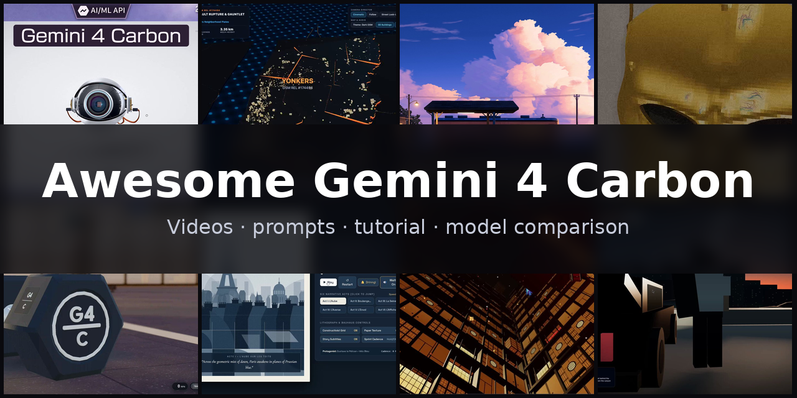](https://www.sandbase.ai/lab/ai-videos/gemini-4-carbon?lang=zh-CN&utm_source=github&utm_medium=readme&utm_campaign=awesome-gemini-4-carbon&utm_content=banner)

精选 **Gemini 4 Carbon 案例**合集：用 Gemini 4 Carbon（Google 最新的 Gemini 4 检查点，在竞技场里以代号 Gemini 4 Argon 测试，在 SandBase 上以 `google/gemini-4-argon` 提供）做出的视频、提示词和演示。包括可交互的 Three.js 3D 场景、剖面与爆炸视图模型、SVG 与 Canvas 动画、动效 showreel 和产品页面，大多是模型根据提示词写成的单文件网页，均注明作者并链接原帖。

共 **227 条视频**，来自 **137 位创作者** · **61 条**附作者提示词 · 每天从 [SandBase Lab](https://www.sandbase.ai/lab/ai-videos/gemini-4-carbon?lang=zh-CN&utm_source=github&utm_medium=readme&utm_campaign=awesome-gemini-4-carbon&utm_content=stats) 同步

## 从这里开始

| 我想… | 去这里 |
|---|---|
| 看视频 | 在下方 [按分类浏览](#contents)，或 [在 SandBase Lab 大屏播放](https://www.sandbase.ai/lab/ai-videos/gemini-4-carbon?lang=zh-CN&utm_source=github&utm_medium=readme&utm_campaign=awesome-gemini-4-carbon&utm_content=quickstart) |
| 复制提示词 | [提示词索引](docs/zh-CN/prompts.md)：所有附带提示词的视频 |
| 自己写提示词 | [提示词写法](docs/zh-CN/prompt-guide.md)：6 条写法和一个填空模板 |
| 做一个视频 | [教程](docs/zh-CN/tutorial.md)：提示词 → HTML → MP4，含 API、CLI 调用和录屏脚本 |
| 选模型 | [Gemini 4 Carbon 对比 Claude Opus 5.5、GPT-6 Astra 和 Gemini 4 Argon](docs/zh-CN/model-comparison.md) |
| 马上试试 | [在 Lab 竞技场运行 Gemini 4 Carbon](https://www.sandbase.ai/lab/x/llm-arena?models=google%2Fgemini-4-argon&lang=zh-CN&utm_source=github&utm_medium=readme&utm_campaign=awesome-gemini-4-carbon&utm_content=quickstart)，和其他模型并排对比 |

<a id="contents"></a>

## 目录

- [精选](#featured) (8)
- [3D 场景](#3d-scene) (54)
- [动效](#motion-graphics) (26)
- [游戏](#game) (18)
- [产品界面](#ui-demo) (4)
- [粒子与形状](#particles) (2)
- [讲解](#explainer) (3)
- [动画](#anime) (1)
- [测试对比](#comparison) (93)
- [模型展示](#showcase) (26)
- [用 Gemini 4 Carbon 复刻视频](#recreate)
- [常见问题](#faq)
- [推荐作品](#contribute)

点击预览图播放视频；点击标题前往 SandBase Lab 查看原帖、提示词，并一键 **复刻**；**@作者** 链接到 X 原帖。

<a id="featured"></a>

## 精选

<table>
<tr><td width="33%" valign="top"><a href="https://www.sandbase.ai/lab/media/x/gemini-4-carbon/2112999200472596959/video.mp4">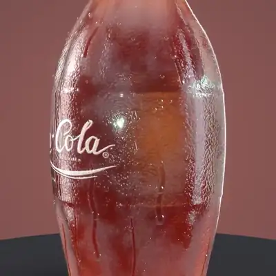</a><br><a href="https://www.sandbase.ai/lab/ai-videos/gemini-4-carbon/2112999200472596959?lang=zh-CN&utm_source=github&utm_medium=readme&utm_campaign=awesome-gemini-4-carbon&utm_content=card"><b>可乐的SVG矢量图形展示</b></a><br><sub><a href="https://x.com/dummerspast39/status/2112999200472596959">@dummerspast39</a> · 0:30</sub></td><td width="33%" valign="top"><a href="https://www.sandbase.ai/lab/media/x/gemini-4-carbon/2115556254101692515/video.mp4">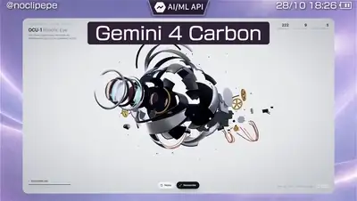</a><br><a href="https://www.sandbase.ai/lab/ai-videos/gemini-4-carbon/2115556254101692515?lang=zh-CN&utm_source=github&utm_medium=readme&utm_campaign=awesome-gemini-4-carbon&utm_content=card"><b>机械眼眨眼对焦并爆炸解构</b></a><br><sub><a href="https://x.com/noclipepe/status/2115556254101692515">@noclipepe</a> · 0:31 · <a href="https://www.sandbase.ai/lab/ai-videos/gemini-4-carbon/2115556254101692515?lang=zh-CN&utm_source=github&utm_medium=readme&utm_campaign=awesome-gemini-4-carbon&utm_content=card">提示词</a></sub></td><td width="33%" valign="top"><a href="https://www.sandbase.ai/lab/media/x/gemini-4-carbon/2120258951594037732/video.mp4">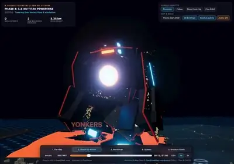</a><br><a href="https://www.sandbase.ai/lab/ai-videos/gemini-4-carbon/2120258951594037732?lang=zh-CN&utm_source=github&utm_medium=readme&utm_campaign=awesome-gemini-4-carbon&utm_content=card"><b>在纽约漫步的巨型机甲Three.js动画</b></a><br><sub><a href="https://x.com/simonw/status/2120258951594037732">@simonw</a> · 1:00 · <a href="https://www.sandbase.ai/lab/ai-videos/gemini-4-carbon/2120258951594037732?lang=zh-CN&utm_source=github&utm_medium=readme&utm_campaign=awesome-gemini-4-carbon&utm_content=card">提示词</a></sub></td></tr>
<tr><td width="33%" valign="top"><a href="https://www.sandbase.ai/lab/media/x/gemini-4-hydrogen/2120944141559550409/video.mp4">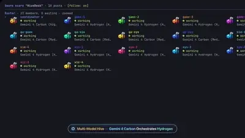</a><br><a href="https://www.sandbase.ai/lab/ai-videos/gemini-4-carbon/2120944141559550409?lang=zh-CN&utm_source=github&utm_medium=readme&utm_campaign=awesome-gemini-4-carbon&utm_content=card"><b>多智能体终端集群构建画布应用</b></a><br><sub><a href="https://x.com/shengzheyao/status/2120944141559550409">@shengzheyao</a> · 0:26</sub></td><td width="33%" valign="top"><a href="https://www.sandbase.ai/lab/media/x/gemini-4-carbon/2113185847566876679/video.mp4"></a><br><a href="https://www.sandbase.ai/lab/ai-videos/gemini-4-carbon/2113185847566876679?lang=zh-CN&utm_source=github&utm_medium=readme&utm_campaign=awesome-gemini-4-carbon&utm_content=card"><b>具备驾驶控制的3D水上飞机与无尽海洋</b></a><br><sub><a href="https://x.com/LuminaBench/status/2113185847566876679">@LuminaBench</a> · 0:50</sub></td><td width="33%" valign="top"><a href="https://www.sandbase.ai/lab/media/x/gemini-4-carbon/2120200837305884813/video.mp4"></a><br><a href="https://www.sandbase.ai/lab/ai-videos/gemini-4-carbon/2120200837305884813?lang=zh-CN&utm_source=github&utm_medium=readme&utm_campaign=awesome-gemini-4-carbon&utm_content=card"><b>单张参考图转纯代码生成的动画</b></a><br><sub><a href="https://x.com/devteamdrew/status/2120200837305884813">@devteamdrew</a> · 0:15</sub></td></tr>
<tr><td width="33%" valign="top"><a href="https://www.sandbase.ai/lab/media/x/gemini-4-carbon/2120185497637024013/video.mp4">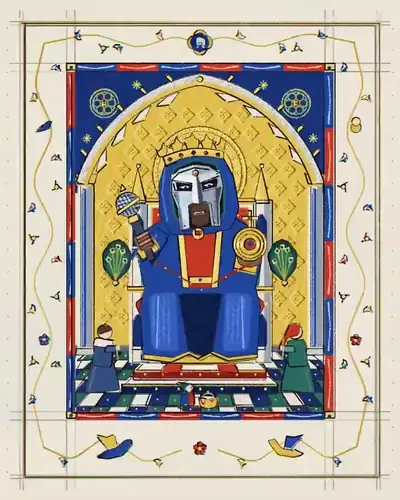</a><br><a href="https://www.sandbase.ai/lab/ai-videos/gemini-4-carbon/2120185497637024013?lang=zh-CN&utm_source=github&utm_medium=readme&utm_campaign=awesome-gemini-4-carbon&utm_content=card"><b>纯代码生成的音乐视频动画</b></a><br><sub><a href="https://x.com/kickingkeys/status/2120185497637024013">@kickingkeys</a> · 2:15</sub></td><td width="33%" valign="top"><a href="https://www.sandbase.ai/lab/media/x/gemini-4-carbon/2120191944643190808/video.mp4">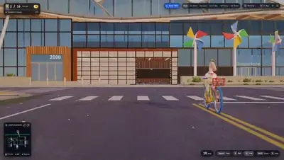</a><br><a href="https://www.sandbase.ai/lab/ai-videos/gemini-4-carbon/2120191944643190808?lang=zh-CN&utm_source=github&utm_medium=readme&utm_campaign=awesome-gemini-4-carbon&utm_content=card"><b>鹈鹕骑车收集芯片的 3D 网页游戏</b></a><br><sub><a href="https://x.com/vamsibatchuk/status/2120191944643190808">@vamsibatchuk</a> · 1:17</sub></td></tr>
</table>

<a id="3d-scene"></a>

## 3D 场景

<table>
<tr><td width="33%" valign="top"><a href="https://www.sandbase.ai/lab/media/x/gemini-4-carbon/2114279721911652451/video.mp4">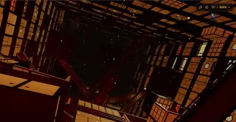</a><br><a href="https://www.sandbase.ai/lab/ai-videos/gemini-4-carbon/2114279721911652451?lang=zh-CN&utm_source=github&utm_medium=readme&utm_campaign=awesome-gemini-4-carbon&utm_content=card"><b>鬼灭之刃无限城3D场景</b></a><br><sub><a href="https://x.com/DrstaOne/status/2114279721911652451">@DrstaOne</a> · 1:20</sub></td><td width="33%" valign="top"><a href="https://www.sandbase.ai/lab/media/x/gemini-4-carbon/2115065994016113051/video.mp4">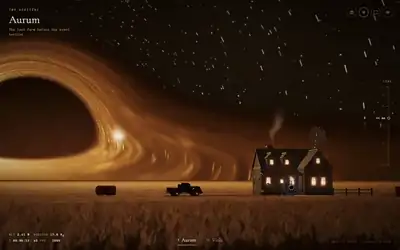</a><br><a href="https://www.sandbase.ai/lab/ai-videos/gemini-4-carbon/2115065994016113051?lang=zh-CN&utm_source=github&utm_medium=readme&utm_campaign=awesome-gemini-4-carbon&utm_content=card"><b>Three.js程序化农场与视界场景</b></a><br><sub><a href="https://x.com/itsfazley/status/2115065994016113051">@itsfazley</a> · 0:26</sub></td><td width="33%" valign="top"><a href="https://www.sandbase.ai/lab/media/x/gemini-4-carbon/2115547939707957591/video.mp4">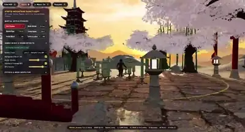</a><br><a href="https://www.sandbase.ai/lab/ai-videos/gemini-4-carbon/2115547939707957591?lang=zh-CN&utm_source=github&utm_medium=readme&utm_campaign=awesome-gemini-4-carbon&utm_content=card"><b>结合 Three.js 与 Blender MCP 构建的3D场景</b></a><br><sub><a href="https://x.com/c_nemri/status/2115547939707957591">@c_nemri</a> · 0:48</sub></td></tr>
<tr><td width="33%" valign="top"><a href="https://www.sandbase.ai/lab/media/x/gemini-4-carbon/2115556254101692515/video.mp4"></a><br><a href="https://www.sandbase.ai/lab/ai-videos/gemini-4-carbon/2115556254101692515?lang=zh-CN&utm_source=github&utm_medium=readme&utm_campaign=awesome-gemini-4-carbon&utm_content=card"><b>机械眼眨眼对焦并爆炸解构</b></a><br><sub><a href="https://x.com/noclipepe/status/2115556254101692515">@noclipepe</a> · 0:31 · <a href="https://www.sandbase.ai/lab/ai-videos/gemini-4-carbon/2115556254101692515?lang=zh-CN&utm_source=github&utm_medium=readme&utm_campaign=awesome-gemini-4-carbon&utm_content=card">提示词</a></sub></td><td width="33%" valign="top"><a href="https://www.sandbase.ai/lab/media/x/gemini-4-carbon/2115564198142923174/video.mp4">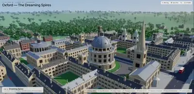</a><br><a href="https://www.sandbase.ai/lab/ai-videos/gemini-4-carbon/2115564198142923174?lang=zh-CN&utm_source=github&utm_medium=readme&utm_campaign=awesome-gemini-4-carbon&utm_content=card"><b>使用 Three.js 生成的3D城市</b></a><br><sub><a href="https://x.com/leo114119/status/2115564198142923174">@leo114119</a> · 0:08</sub></td><td width="33%" valign="top"><a href="https://www.sandbase.ai/lab/media/x/gemini-4-carbon/2115727629861130735/video.mp4">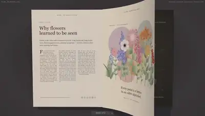</a><br><a href="https://www.sandbase.ai/lab/ai-videos/gemini-4-carbon/2115727629861130735?lang=zh-CN&utm_source=github&utm_medium=readme&utm_campaign=awesome-gemini-4-carbon&utm_content=card"><b>物理翻页与纸张弯曲效果测试</b></a><br><sub><a href="https://x.com/abhinavflac/status/2115727629861130735">@abhinavflac</a> · 0:29</sub></td></tr>
</table>

<details>
<summary><b>展开全部 54 条</b></summary>

<table>
<tr><td width="33%" valign="top"><a href="https://www.sandbase.ai/lab/media/x/gemini-4-carbon/2115794531136258115/video.mp4">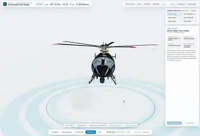</a><br><a href="https://www.sandbase.ai/lab/ai-videos/gemini-4-carbon/2115794531136258115?lang=zh-CN&utm_source=github&utm_medium=readme&utm_campaign=awesome-gemini-4-carbon&utm_content=card"><b>可交互 3D 直升机工程结构查看器</b></a><br><sub><a href="https://x.com/RoundtableSpace/status/2115794531136258115">@RoundtableSpace</a> · 1:37</sub></td><td width="33%" valign="top"><a href="https://www.sandbase.ai/lab/media/x/gemini-4-carbon/2115819588382568478/video.mp4">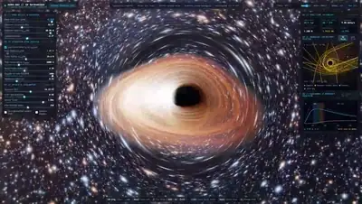</a><br><a href="https://www.sandbase.ai/lab/ai-videos/gemini-4-carbon/2115819588382568478?lang=zh-CN&utm_source=github&utm_medium=readme&utm_campaign=awesome-gemini-4-carbon&utm_content=card"><b>WebGL2实时克尔黑洞光线步进渲染</b></a><br><sub><a href="https://x.com/White1637402/status/2115819588382568478">@White1637402</a> · 0:05</sub></td><td width="33%" valign="top"><a href="https://www.sandbase.ai/lab/media/x/gemini-4-carbon/2116172635545460909/video.mp4"></a><br><a href="https://www.sandbase.ai/lab/ai-videos/gemini-4-carbon/2116172635545460909?lang=zh-CN&utm_source=github&utm_medium=readme&utm_campaign=awesome-gemini-4-carbon&utm_content=card"><b>Three.js制作的3D场景演示</b></a><br><sub><a href="https://x.com/Mr_Salio/status/2116172635545460909">@Mr_Salio</a> · 0:41</sub></td></tr>
<tr><td width="33%" valign="top"><a href="https://www.sandbase.ai/lab/media/x/gemini-4-carbon/2116225114023059759/video.mp4"></a><br><a href="https://www.sandbase.ai/lab/ai-videos/gemini-4-carbon/2116225114023059759?lang=zh-CN&utm_source=github&utm_medium=readme&utm_campaign=awesome-gemini-4-carbon&utm_content=card"><b>使用 Gemini 生成的 Three.js 3D 项目</b></a><br><sub><a href="https://x.com/ashawv5i/status/2116225114023059759">@ashawv5i</a> · 0:41</sub></td><td width="33%" valign="top"><a href="https://www.sandbase.ai/lab/media/x/gemini-4-carbon/2116277724130206046/video.mp4">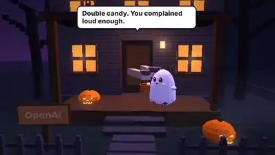</a><br><a href="https://www.sandbase.ai/lab/ai-videos/gemini-4-carbon/2116277724130206046?lang=zh-CN&utm_source=github&utm_medium=readme&utm_campaign=awesome-gemini-4-carbon&utm_content=card"><b>AI实验室万圣节互动街景</b></a><br><sub><a href="https://x.com/After_Dark_AI/status/2116277724130206046">@After_Dark_AI</a> · 0:34</sub></td><td width="33%" valign="top"><a href="https://www.sandbase.ai/lab/media/x/gemini-4-carbon/2116392703357558821/video.mp4">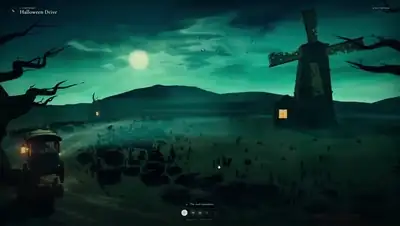</a><br><a href="https://www.sandbase.ai/lab/ai-videos/gemini-4-carbon/2116392703357558821?lang=zh-CN&utm_source=github&utm_medium=readme&utm_campaign=awesome-gemini-4-carbon&utm_content=card"><b>带立体声的万圣节漫步动画场景</b></a><br><sub><a href="https://x.com/abhinavflac/status/2116392703357558821">@abhinavflac</a> · 0:50</sub></td></tr>
<tr><td width="33%" valign="top"><a href="https://www.sandbase.ai/lab/media/x/gemini-4-carbon/2116457996419010907/video.mp4">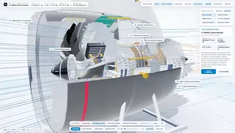</a><br><a href="https://www.sandbase.ai/lab/ai-videos/gemini-4-carbon/2116457996419010907?lang=zh-CN&utm_source=github&utm_medium=readme&utm_campaign=awesome-gemini-4-carbon&utm_content=card"><b>Three.js 程序化 3D 航空航天工程展示</b></a><br><sub><a href="https://x.com/StatsWire/status/2116457996419010907">@StatsWire</a> · 0:36</sub></td><td width="33%" valign="top"><a href="https://www.sandbase.ai/lab/media/x/gemini-4-carbon/2116470583097438519/video.mp4">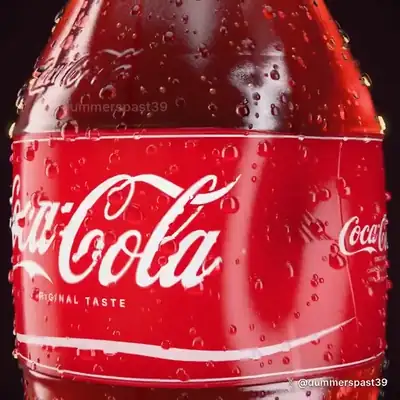</a><br><a href="https://www.sandbase.ai/lab/ai-videos/gemini-4-carbon/2116470583097438519?lang=zh-CN&utm_source=github&utm_medium=readme&utm_campaign=awesome-gemini-4-carbon&utm_content=card"><b>Three.js 纯着色器生成的零度可乐瓶</b></a><br><sub><a href="https://x.com/dummerspast39/status/2116470583097438519">@dummerspast39</a> · 0:30</sub></td><td width="33%" valign="top"><a href="https://www.sandbase.ai/lab/media/x/gemini-4-carbon/2116482295444148254/video.mp4">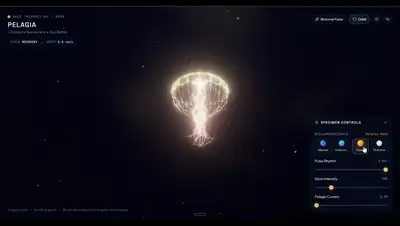</a><br><a href="https://www.sandbase.ai/lab/ai-videos/gemini-4-carbon/2116482295444148254?lang=zh-CN&utm_source=github&utm_medium=readme&utm_campaign=awesome-gemini-4-carbon&utm_content=card"><b>Three.js中的水母动画</b></a><br><sub><a href="https://x.com/srikanthvaluri/status/2116482295444148254">@srikanthvaluri</a> · 0:22</sub></td></tr>
<tr><td width="33%" valign="top"><a href="https://www.sandbase.ai/lab/media/x/gemini-4-carbon/2116533017934241886/video.mp4"></a><br><a href="https://www.sandbase.ai/lab/ai-videos/gemini-4-carbon/2116533017934241886?lang=zh-CN&utm_source=github&utm_medium=readme&utm_campaign=awesome-gemini-4-carbon&utm_content=card"><b>河灯夜景 3D 氛围场景</b></a><br><sub><a href="https://x.com/pankajkumar_dev/status/2116533017934241886">@pankajkumar_dev</a> · 0:48 · <a href="https://www.sandbase.ai/lab/ai-videos/gemini-4-carbon/2116533017934241886?lang=zh-CN&utm_source=github&utm_medium=readme&utm_campaign=awesome-gemini-4-carbon&utm_content=card">提示词</a></sub></td><td width="33%" valign="top"><a href="https://www.sandbase.ai/lab/media/x/gemini-4-carbon/2116578168874438910/video.mp4">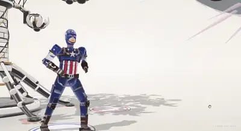</a><br><a href="https://www.sandbase.ai/lab/ai-videos/gemini-4-carbon/2116578168874438910?lang=zh-CN&utm_source=github&utm_medium=readme&utm_campaign=awesome-gemini-4-carbon&utm_content=card"><b>使用 Gemini Carbon 4 生成的 Three.js 场景</b></a><br><sub><a href="https://x.com/chetaslua/status/2116578168874438910">@chetaslua</a> · 0:54</sub></td><td width="33%" valign="top"><a href="https://www.sandbase.ai/lab/media/x/gemini-4-carbon/2116621901934002336/video.mp4">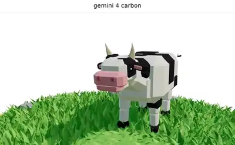</a><br><a href="https://www.sandbase.ai/lab/ai-videos/gemini-4-carbon/2116621901934002336?lang=zh-CN&utm_source=github&utm_medium=readme&utm_campaign=awesome-gemini-4-carbon&utm_content=card"><b>3D模型渲染测试</b></a><br><sub><a href="https://x.com/Haleeeemahh/status/2116621901934002336">@Haleeeemahh</a> · 0:26</sub></td></tr>
<tr><td width="33%" valign="top"><a href="https://www.sandbase.ai/lab/media/x/gemini-4-carbon/2118321845091160167/video.mp4">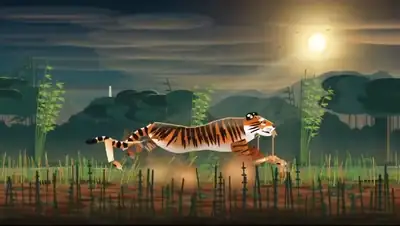</a><br><a href="https://www.sandbase.ai/lab/ai-videos/gemini-4-carbon/2118321845091160167?lang=zh-CN&utm_source=github&utm_medium=readme&utm_campaign=awesome-gemini-4-carbon&utm_content=card"><b>Gemini 4 Carbon的三维Three.js生成测试</b></a><br><sub><a href="https://x.com/AI_Screening/status/2118321845091160167">@AI_Screening</a> · 0:24</sub></td><td width="33%" valign="top"><a href="https://www.sandbase.ai/lab/media/x/gemini-4-carbon/2118693455442641260/video.mp4">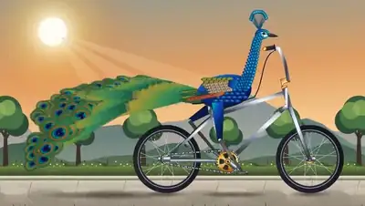</a><br><a href="https://www.sandbase.ai/lab/ai-videos/gemini-4-carbon/2118693455442641260?lang=zh-CN&utm_source=github&utm_medium=readme&utm_campaign=awesome-gemini-4-carbon&utm_content=card"><b>孔雀在日落时分骑自行车</b></a><br><sub><a href="https://x.com/SahilPanhotra/status/2118693455442641260">@SahilPanhotra</a> · 0:12</sub></td><td width="33%" valign="top"><a href="https://www.sandbase.ai/lab/media/x/gemini-4-carbon/2119317415175790947/video.mp4">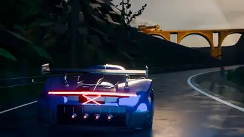</a><br><a href="https://www.sandbase.ai/lab/ai-videos/gemini-4-carbon/2119317415175790947?lang=zh-CN&utm_source=github&utm_medium=readme&utm_campaign=awesome-gemini-4-carbon&utm_content=card"><b>Blender中超跑追逐蒸汽火车的3D场景</b></a><br><sub><a href="https://x.com/HeathIsidr64707/status/2119317415175790947">@HeathIsidr64707</a> · 0:10</sub></td></tr>
<tr><td width="33%" valign="top"><a href="https://www.sandbase.ai/lab/media/x/gemini-4-carbon/2119705258314043440/video.mp4">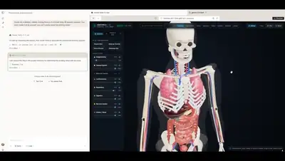</a><br><a href="https://www.sandbase.ai/lab/ai-videos/gemini-4-carbon/2119705258314043440?lang=zh-CN&utm_source=github&utm_medium=readme&utm_campaign=awesome-gemini-4-carbon&utm_content=card"><b>Three.js实现的人体解剖结构浏览器</b></a><br><sub><a href="https://x.com/SimonasLTU1/status/2119705258314043440">@SimonasLTU1</a> · 0:57</sub></td><td width="33%" valign="top"><a href="https://www.sandbase.ai/lab/media/x/gemini-4-carbon/2119830648315588994/video.mp4">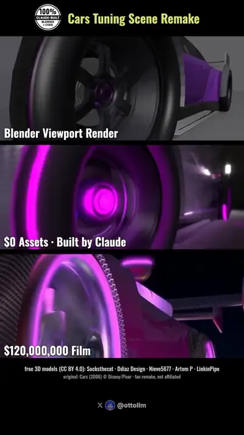</a><br><a href="https://www.sandbase.ai/lab/ai-videos/gemini-4-carbon/2119830648315588994?lang=zh-CN&utm_source=github&utm_medium=readme&utm_campaign=awesome-gemini-4-carbon&utm_content=card"><b>使用Claude在Blender中复刻赛车总动员改装车场景</b></a><br><sub><a href="https://x.com/ottollm/status/2119830648315588994">@ottollm</a> · 0:45</sub></td><td width="33%" valign="top"><a href="https://www.sandbase.ai/lab/media/x/gemini-4-carbon/2120158160074002823/video.mp4"></a><br><a href="https://www.sandbase.ai/lab/ai-videos/gemini-4-carbon/2120158160074002823?lang=zh-CN&utm_source=github&utm_medium=readme&utm_campaign=awesome-gemini-4-carbon&utm_content=card"><b>包含火车与飞艇的单HTML文件体素场景</b></a><br><sub><a href="https://x.com/Adidotdev/status/2120158160074002823">@Adidotdev</a> · 0:45</sub></td></tr>
<tr><td width="33%" valign="top"><a href="https://www.sandbase.ai/lab/media/x/gemini-4-carbon/2120168853816926235/video.mp4">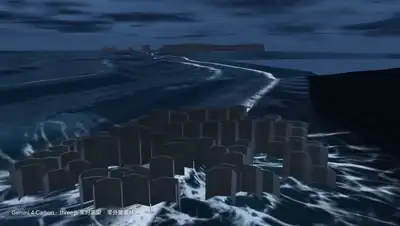</a><br><a href="https://www.sandbase.ai/lab/ai-videos/gemini-4-carbon/2120168853816926235?lang=zh-CN&utm_source=github&utm_medium=readme&utm_campaign=awesome-gemini-4-carbon&utm_content=card"><b>Three.js 纯代码生成的冰岛黑沙滩</b></a><br><sub><a href="https://x.com/RJasonHA/status/2120168853816926235">@RJasonHA</a> · 0:54</sub></td><td width="33%" valign="top"><a href="https://www.sandbase.ai/lab/media/x/gemini-4-carbon/2120185448727462301/video.mp4">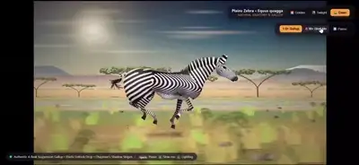</a><br><a href="https://www.sandbase.ai/lab/ai-videos/gemini-4-carbon/2120185448727462301?lang=zh-CN&utm_source=github&utm_medium=readme&utm_campaign=awesome-gemini-4-carbon&utm_content=card"><b>Three.js中奔跑的斑马动画</b></a><br><sub><a href="https://x.com/AI_Screening/status/2120185448727462301">@AI_Screening</a> · 0:18</sub></td><td width="33%" valign="top"><a href="https://www.sandbase.ai/lab/media/x/gemini-4-carbon/2120186354537812452/video.mp4">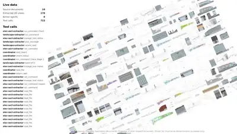</a><br><a href="https://www.sandbase.ai/lab/ai-videos/gemini-4-carbon/2120186354537812452?lang=zh-CN&utm_source=github&utm_medium=readme&utm_campaign=awesome-gemini-4-carbon&utm_content=card"><b>基于PDF图纸生成的办公室交互式3D重建</b></a><br><sub><a href="https://x.com/_philschmid/status/2120186354537812452">@_philschmid</a> · 0:56</sub></td></tr>
<tr><td width="33%" valign="top"><a href="https://www.sandbase.ai/lab/media/x/gemini-4-carbon/2120186998707163533/video.mp4"></a><br><a href="https://www.sandbase.ai/lab/ai-videos/gemini-4-carbon/2120186998707163533?lang=zh-CN&utm_source=github&utm_medium=readme&utm_campaign=awesome-gemini-4-carbon&utm_content=card"><b>纯代码生成的 3D 篮球场场景</b></a><br><sub><a href="https://x.com/LexnLin/status/2120186998707163533">@LexnLin</a> · 0:30</sub></td><td width="33%" valign="top"><a href="https://www.sandbase.ai/lab/media/x/gemini-4-carbon/2120187064184664162/video.mp4">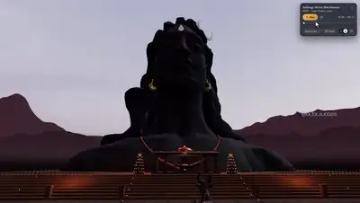</a><br><a href="https://www.sandbase.ai/lab/ai-videos/gemini-4-carbon/2120187064184664162?lang=zh-CN&utm_source=github&utm_medium=readme&utm_campaign=awesome-gemini-4-carbon&utm_content=card"><b>Adiyogi Divya Darshanam 3D 演示</b></a><br><sub><a href="https://x.com/ai_for_success/status/2120187064184664162">@ai_for_success</a> · 1:06</sub></td><td width="33%" valign="top"><a href="https://www.sandbase.ai/lab/media/x/gemini-4-carbon/2120188535152222407/video.mp4">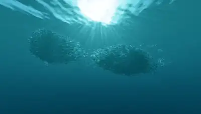</a><br><a href="https://www.sandbase.ai/lab/ai-videos/gemini-4-carbon/2120188535152222407?lang=zh-CN&utm_source=github&utm_medium=readme&utm_campaign=awesome-gemini-4-carbon&utm_content=card"><b>自定义 CUDA 引擎制作的 3D 场景</b></a><br><sub><a href="https://x.com/fofrAI/status/2120188535152222407">@fofrAI</a> · 0:26</sub></td></tr>
<tr><td width="33%" valign="top"><a href="https://www.sandbase.ai/lab/media/x/gemini-4-carbon/2120189430782734608/video.mp4">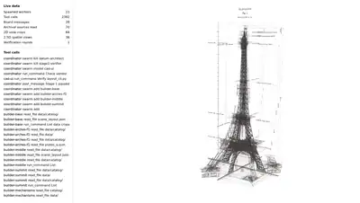</a><br><a href="https://www.sandbase.ai/lab/ai-videos/gemini-4-carbon/2120189430782734608?lang=zh-CN&utm_source=github&utm_medium=readme&utm_campaign=awesome-gemini-4-carbon&utm_content=card"><b>埃菲尔铁塔建造交互式 3D 展览</b></a><br><sub><a href="https://x.com/choblin29/status/2120189430782734608">@choblin29</a> · 0:59</sub></td><td width="33%" valign="top"><a href="https://www.sandbase.ai/lab/media/x/gemini-4-carbon/2120192174239146417/video.mp4">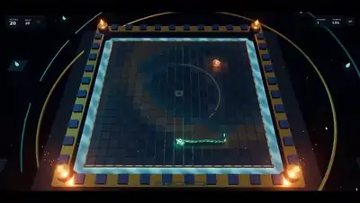</a><br><a href="https://www.sandbase.ai/lab/ai-videos/gemini-4-carbon/2120192174239146417?lang=zh-CN&utm_source=github&utm_medium=readme&utm_campaign=awesome-gemini-4-carbon&utm_content=card"><b>Gemini 4 Carbon生成的Three.js场景</b></a><br><sub><a href="https://x.com/SimonasLTU1/status/2120192174239146417">@SimonasLTU1</a> · 0:35 · <a href="https://www.sandbase.ai/lab/ai-videos/gemini-4-carbon/2120192174239146417?lang=zh-CN&utm_source=github&utm_medium=readme&utm_campaign=awesome-gemini-4-carbon&utm_content=card">提示词</a></sub></td><td width="33%" valign="top"><a href="https://www.sandbase.ai/lab/media/x/gemini-4-carbon/2120193855333273753/video.mp4">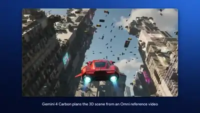</a><br><a href="https://www.sandbase.ai/lab/ai-videos/gemini-4-carbon/2120193855333273753?lang=zh-CN&utm_source=github&utm_medium=readme&utm_campaign=awesome-gemini-4-carbon&utm_content=card"><b>浏览器端实时运行的3D水下亚特兰蒂斯</b></a><br><sub><a href="https://x.com/alexmichael/status/2120193855333273753">@alexmichael</a> · 1:04</sub></td></tr>
<tr><td width="33%" valign="top"><a href="https://www.sandbase.ai/lab/media/x/gemini-4-carbon/2120198832202125322/video.mp4">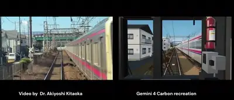</a><br><a href="https://www.sandbase.ai/lab/ai-videos/gemini-4-carbon/2120198832202125322?lang=zh-CN&utm_source=github&utm_medium=readme&utm_campaign=awesome-gemini-4-carbon&utm_content=card"><b>用 Three.js 复刻的视频剪辑场景</b></a><br><sub><a href="https://x.com/emollick/status/2120198832202125322">@emollick</a> · 0:14</sub></td><td width="33%" valign="top"><a href="https://www.sandbase.ai/lab/media/x/gemini-4-carbon/2120199271588737356/video.mp4">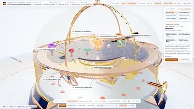</a><br><a href="https://www.sandbase.ai/lab/ai-videos/gemini-4-carbon/2120199271588737356?lang=zh-CN&utm_source=github&utm_medium=readme&utm_campaign=awesome-gemini-4-carbon&utm_content=card"><b>用Three.js纯代码生成的浑天仪机械装置</b></a><br><sub><a href="https://x.com/StatsWire/status/2120199271588737356">@StatsWire</a> · 0:36</sub></td><td width="33%" valign="top"><a href="https://www.sandbase.ai/lab/media/x/gemini-4-carbon/2120201759305998343/video.mp4">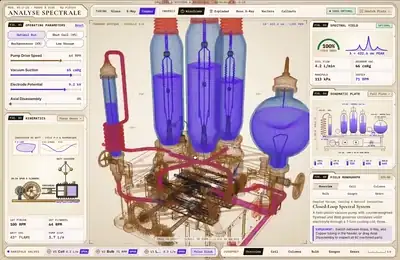</a><br><a href="https://www.sandbase.ai/lab/ai-videos/gemini-4-carbon/2120201759305998343?lang=zh-CN&utm_source=github&utm_medium=readme&utm_campaign=awesome-gemini-4-carbon&utm_content=card"><b>19世纪巴黎复古风格物理实验室交互场景</b></a><br><sub><a href="https://x.com/thebuggeddev/status/2120201759305998343">@thebuggeddev</a> · 0:48</sub></td></tr>
<tr><td width="33%" valign="top"><a href="https://www.sandbase.ai/lab/media/x/gemini-4-carbon/2120203148883366162/video.mp4">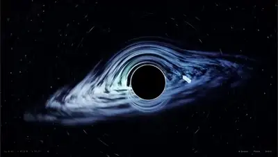</a><br><a href="https://www.sandbase.ai/lab/ai-videos/gemini-4-carbon/2120203148883366162?lang=zh-CN&utm_source=github&utm_medium=readme&utm_campaign=awesome-gemini-4-carbon&utm_content=card"><b>纯代码生成的电影级3D黑洞模拟</b></a><br><sub><a href="https://x.com/pankajkumar_dev/status/2120203148883366162">@pankajkumar_dev</a> · 0:32</sub></td><td width="33%" valign="top"><a href="https://www.sandbase.ai/lab/media/x/gemini-4-carbon/2120204269173563872/video.mp4"></a><br><a href="https://www.sandbase.ai/lab/ai-videos/gemini-4-carbon/2120204269173563872?lang=zh-CN&utm_source=github&utm_medium=readme&utm_campaign=awesome-gemini-4-carbon&utm_content=card"><b>复原考文垂大教堂的电影级漫游视频</b></a><br><sub><a href="https://x.com/LeslieNooteboom/status/2120204269173563872">@LeslieNooteboom</a> · 1:40</sub></td><td width="33%" valign="top"><a href="https://www.sandbase.ai/lab/media/x/gemini-4-carbon/2120204803771183140/video.mp4">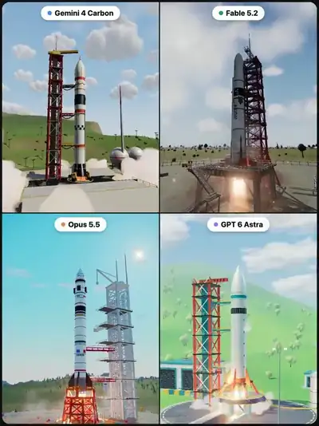</a><br><a href="https://www.sandbase.ai/lab/ai-videos/gemini-4-carbon/2120204803771183140?lang=zh-CN&utm_source=github&utm_medium=readme&utm_campaign=awesome-gemini-4-carbon&utm_content=card"><b>Gemini 4 Carbon生成的火箭发射场景</b></a><br><sub><a href="https://x.com/Bhavani_00007/status/2120204803771183140">@Bhavani_00007</a> · 0:25</sub></td></tr>
<tr><td width="33%" valign="top"><a href="https://www.sandbase.ai/lab/media/x/gemini-4-carbon/2120208990089175300/video.mp4">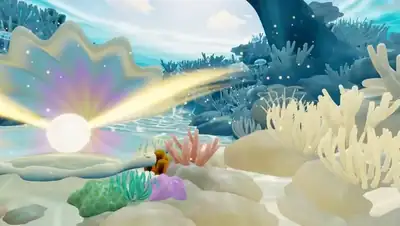</a><br><a href="https://www.sandbase.ai/lab/ai-videos/gemini-4-carbon/2120208990089175300?lang=zh-CN&utm_source=github&utm_medium=readme&utm_campaign=awesome-gemini-4-carbon&utm_content=card"><b>用Three.js纯代码生成的珊瑚礁短片</b></a><br><sub><a href="https://x.com/Adidotdev/status/2120208990089175300">@Adidotdev</a> · 0:32</sub></td><td width="33%" valign="top"><a href="https://www.sandbase.ai/lab/media/x/gemini-4-carbon/2120217910425866255/video.mp4">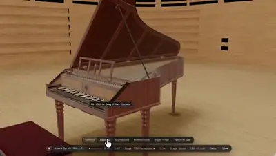</a><br><a href="https://www.sandbase.ai/lab/ai-videos/gemini-4-carbon/2120217910425866255?lang=zh-CN&utm_source=github&utm_medium=readme&utm_campaign=awesome-gemini-4-carbon&utm_content=card"><b>包含可弹奏1780年钢琴的交互空间</b></a><br><sub><a href="https://x.com/mwjoffe/status/2120217910425866255">@mwjoffe</a> · 0:39</sub></td><td width="33%" valign="top"><a href="https://www.sandbase.ai/lab/media/x/gemini-4-carbon/2120227531504918833/video.mp4">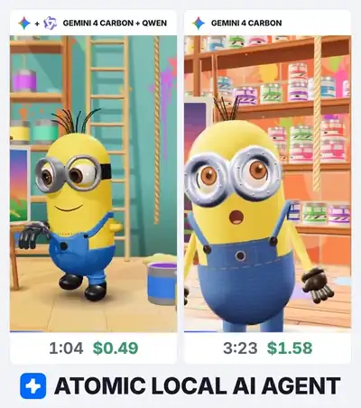</a><br><a href="https://www.sandbase.ai/lab/ai-videos/gemini-4-carbon/2120227531504918833?lang=zh-CN&utm_source=github&utm_medium=readme&utm_campaign=awesome-gemini-4-carbon&utm_content=card"><b>本地编排生成的千军万马小黄人场景</b></a><br><sub><a href="https://x.com/atomicagent_io/status/2120227531504918833">@atomicagent_io</a> · 0:30</sub></td></tr>
<tr><td width="33%" valign="top"><a href="https://www.sandbase.ai/lab/media/x/gemini-4-carbon/2120258951594037732/video.mp4"></a><br><a href="https://www.sandbase.ai/lab/ai-videos/gemini-4-carbon/2120258951594037732?lang=zh-CN&utm_source=github&utm_medium=readme&utm_campaign=awesome-gemini-4-carbon&utm_content=card"><b>在纽约漫步的巨型机甲Three.js动画</b></a><br><sub><a href="https://x.com/simonw/status/2120258951594037732">@simonw</a> · 1:00 · <a href="https://www.sandbase.ai/lab/ai-videos/gemini-4-carbon/2120258951594037732?lang=zh-CN&utm_source=github&utm_medium=readme&utm_campaign=awesome-gemini-4-carbon&utm_content=card">提示词</a></sub></td><td width="33%" valign="top"><a href="https://www.sandbase.ai/lab/media/x/gemini-4-carbon/2120280429680812198/video.mp4">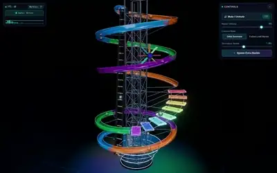</a><br><a href="https://www.sandbase.ai/lab/ai-videos/gemini-4-carbon/2120280429680812198?lang=zh-CN&utm_source=github&utm_medium=readme&utm_campaign=awesome-gemini-4-carbon&utm_content=card"><b>Three.js 制作的无尽音乐弹珠塔</b></a><br><sub><a href="https://x.com/sunset_evm/status/2120280429680812198">@sunset_evm</a> · 0:15</sub></td><td width="33%" valign="top"><a href="https://www.sandbase.ai/lab/media/x/gemini-4-carbon/2120285278871158902/video.mp4">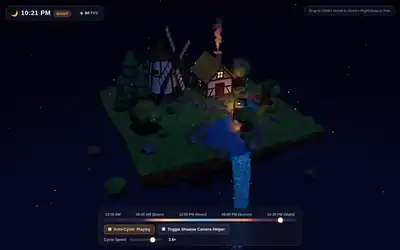</a><br><a href="https://www.sandbase.ai/lab/ai-videos/gemini-4-carbon/2120285278871158902?lang=zh-CN&utm_source=github&utm_medium=readme&utm_campaign=awesome-gemini-4-carbon&utm_content=card"><b>Three.js 低多边形浮岛昼夜循环场景</b></a><br><sub><a href="https://x.com/sunset_evm/status/2120285278871158902">@sunset_evm</a> · 0:16</sub></td></tr>
<tr><td width="33%" valign="top"><a href="https://www.sandbase.ai/lab/media/x/gemini-4-carbon/2120317619588972867/video.mp4">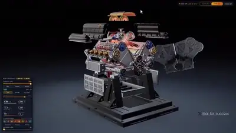</a><br><a href="https://www.sandbase.ai/lab/ai-videos/gemini-4-carbon/2120317619588972867?lang=zh-CN&utm_source=github&utm_medium=readme&utm_campaign=awesome-gemini-4-carbon&utm_content=card"><b>使用FreeCAD与Blender构建的V8引擎细节</b></a><br><sub><a href="https://x.com/ai_for_success/status/2120317619588972867">@ai_for_success</a> · 0:59</sub></td><td width="33%" valign="top"><a href="https://www.sandbase.ai/lab/media/x/gemini-4-carbon/2120319133254557926/video.mp4">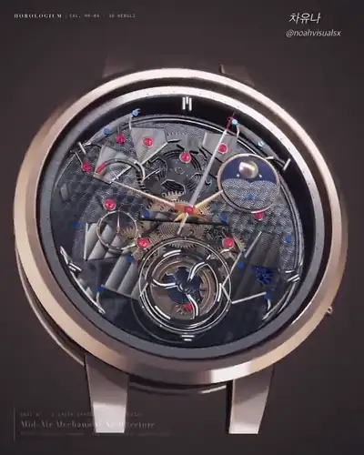</a><br><a href="https://www.sandbase.ai/lab/ai-videos/gemini-4-carbon/2120319133254557926?lang=zh-CN&utm_source=github&utm_medium=readme&utm_campaign=awesome-gemini-4-carbon&utm_content=card"><b>纯 WebGL2 渲染的 3D 大复杂陀飞轮腕表</b></a><br><sub><a href="https://x.com/noahvisualsx/status/2120319133254557926">@noahvisualsx</a> · 0:24</sub></td><td width="33%" valign="top"><a href="https://www.sandbase.ai/lab/media/x/gemini-4-carbon/2120403057364369472/video.mp4">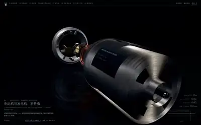</a><br><a href="https://www.sandbase.ai/lab/ai-videos/gemini-4-carbon/2120403057364369472?lang=zh-CN&utm_source=github&utm_medium=readme&utm_campaign=awesome-gemini-4-carbon&utm_content=card"><b>Three.js电动机与发电机3D演示</b></a><br><sub><a href="https://x.com/akokoi1/status/2120403057364369472">@akokoi1</a> · 0:25</sub></td></tr>
<tr><td width="33%" valign="top"><a href="https://www.sandbase.ai/lab/media/x/gemini-4-carbon/2120457237013668210/video.mp4">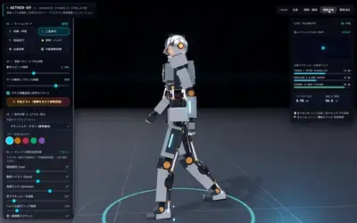</a><br><a href="https://www.sandbase.ai/lab/ai-videos/gemini-4-carbon/2120457237013668210?lang=zh-CN&utm_source=github&utm_medium=readme&utm_campaign=awesome-gemini-4-carbon&utm_content=card"><b>Three.js人形机器人3D仿真模拟</b></a><br><sub><a href="https://x.com/masahirochaen/status/2120457237013668210">@masahirochaen</a> · 0:47</sub></td><td width="33%" valign="top"><a href="https://www.sandbase.ai/lab/media/x/gemini-4-carbon/2120497733995831640/video.mp4">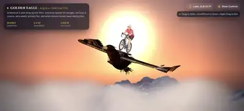</a><br><a href="https://www.sandbase.ai/lab/ai-videos/gemini-4-carbon/2120497733995831640?lang=zh-CN&utm_source=github&utm_medium=readme&utm_campaign=awesome-gemini-4-carbon&utm_content=card"><b>Gemini 4 Carbon 生成的 Three.js 场景</b></a><br><sub><a href="https://x.com/parves075/status/2120497733995831640">@parves075</a> · 0:24</sub></td><td width="33%" valign="top"><a href="https://www.sandbase.ai/lab/media/x/gemini-4-carbon/2120517499829768527/video.mp4">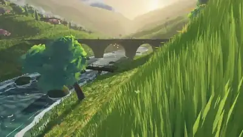</a><br><a href="https://www.sandbase.ai/lab/ai-videos/gemini-4-carbon/2120517499829768527?lang=zh-CN&utm_source=github&utm_medium=readme&utm_campaign=awesome-gemini-4-carbon&utm_content=card"><b>Gemini使用自定义C++生成的图形效果</b></a><br><sub><a href="https://x.com/Lentils80/status/2120517499829768527">@Lentils80</a> · 1:10</sub></td></tr>
<tr><td width="33%" valign="top"><a href="https://www.sandbase.ai/lab/media/x/gemini-4-carbon/2120560937426198637/video.mp4"></a><br><a href="https://www.sandbase.ai/lab/ai-videos/gemini-4-carbon/2120560937426198637?lang=zh-CN&utm_source=github&utm_medium=readme&utm_campaign=awesome-gemini-4-carbon&utm_content=card"><b>浏览器中的实时 3D 泰姬陵建筑群重现</b></a><br><sub><a href="https://x.com/vipinxtwt/status/2120560937426198637">@vipinxtwt</a> · 2:43</sub></td><td width="33%" valign="top"><a href="https://www.sandbase.ai/lab/media/x/gemini-4-carbon/2120565588745654500/video.mp4"></a><br><a href="https://www.sandbase.ai/lab/ai-videos/gemini-4-carbon/2120565588745654500?lang=zh-CN&utm_source=github&utm_medium=readme&utm_campaign=awesome-gemini-4-carbon&utm_content=card"><b>Three.js 程序化生成的木生真菌苔藓</b></a><br><sub><a href="https://x.com/thebuggeddev/status/2120565588745654500">@thebuggeddev</a> · 0:54</sub></td><td width="33%" valign="top"><a href="https://www.sandbase.ai/lab/media/x/gemini-4-carbon/2120605361615073681/video.mp4"></a><br><a href="https://www.sandbase.ai/lab/ai-videos/gemini-4-carbon/2120605361615073681?lang=zh-CN&utm_source=github&utm_medium=readme&utm_campaign=awesome-gemini-4-carbon&utm_content=card"><b>月光沙龙中的小提琴独奏音乐短片</b></a><br><sub><a href="https://x.com/IamEmily2050/status/2120605361615073681">@IamEmily2050</a> · 3:00 · <a href="https://www.sandbase.ai/lab/ai-videos/gemini-4-carbon/2120605361615073681?lang=zh-CN&utm_source=github&utm_medium=readme&utm_campaign=awesome-gemini-4-carbon&utm_content=card">提示词</a></sub></td></tr>
</table>

</details>

<a id="motion-graphics"></a>

## 动效

<table>
<tr><td width="33%" valign="top"><a href="https://www.sandbase.ai/lab/media/x/gemini-4-carbon/2114276034527056089/video.mp4"></a><br><a href="https://www.sandbase.ai/lab/ai-videos/gemini-4-carbon/2114276034527056089?lang=zh-CN&utm_source=github&utm_medium=readme&utm_campaign=awesome-gemini-4-carbon&utm_content=card"><b>巴黎鹈鹕SVG动画短片</b></a><br><sub><a href="https://x.com/Inmerson/status/2114276034527056089">@Inmerson</a> · 1:59</sub></td><td width="33%" valign="top"><a href="https://www.sandbase.ai/lab/media/x/gemini-4-carbon/2114330273710031224/video.mp4"></a><br><a href="https://www.sandbase.ai/lab/ai-videos/gemini-4-carbon/2114330273710031224?lang=zh-CN&utm_source=github&utm_medium=readme&utm_campaign=awesome-gemini-4-carbon&utm_content=card"><b>由单张照片生成的GTA风格动画</b></a><br><sub><a href="https://x.com/Inmerson/status/2114330273710031224">@Inmerson</a> · 3:01</sub></td><td width="33%" valign="top"><a href="https://www.sandbase.ai/lab/media/x/gemini-4-carbon/2115512016811307487/video.mp4"></a><br><a href="https://www.sandbase.ai/lab/ai-videos/gemini-4-carbon/2115512016811307487?lang=zh-CN&utm_source=github&utm_medium=readme&utm_campaign=awesome-gemini-4-carbon&utm_content=card"><b>牛骑自行车的SVG动画</b></a><br><sub><a href="https://x.com/TimJayas/status/2115512016811307487">@TimJayas</a> · 0:29 · <a href="https://www.sandbase.ai/lab/ai-videos/gemini-4-carbon/2115512016811307487?lang=zh-CN&utm_source=github&utm_medium=readme&utm_campaign=awesome-gemini-4-carbon&utm_content=card">提示词</a></sub></td></tr>
<tr><td width="33%" valign="top"><a href="https://www.sandbase.ai/lab/media/x/gemini-4-carbon/2115521291314983078/video.mp4"></a><br><a href="https://www.sandbase.ai/lab/ai-videos/gemini-4-carbon/2115521291314983078?lang=zh-CN&utm_source=github&utm_medium=readme&utm_campaign=awesome-gemini-4-carbon&utm_content=card"><b>机械物件与室内场景展示</b></a><br><sub><a href="https://x.com/HarshithLucky3/status/2115521291314983078">@HarshithLucky3</a> · 3:00</sub></td><td width="33%" valign="top"><a href="https://www.sandbase.ai/lab/media/x/gemini-4-carbon/2115755454660059626/video.mp4"></a><br><a href="https://www.sandbase.ai/lab/ai-videos/gemini-4-carbon/2115755454660059626?lang=zh-CN&utm_source=github&utm_medium=readme&utm_campaign=awesome-gemini-4-carbon&utm_content=card"><b>动态动态设计作品集展示</b></a><br><sub><a href="https://x.com/aeroidesde/status/2115755454660059626">@aeroidesde</a> · 0:15 · <a href="https://www.sandbase.ai/lab/ai-videos/gemini-4-carbon/2115755454660059626?lang=zh-CN&utm_source=github&utm_medium=readme&utm_campaign=awesome-gemini-4-carbon&utm_content=card">提示词</a></sub></td><td width="33%" valign="top"><a href="https://www.sandbase.ai/lab/media/x/gemini-4-carbon/2115903264550265122/video.mp4"></a><br><a href="https://www.sandbase.ai/lab/ai-videos/gemini-4-carbon/2115903264550265122?lang=zh-CN&utm_source=github&utm_medium=readme&utm_campaign=awesome-gemini-4-carbon&utm_content=card"><b>多级滚子链动画机构演示</b></a><br><sub><a href="https://x.com/runable_hq/status/2115903264550265122">@runable_hq</a> · 0:12</sub></td></tr>
</table>

<details>
<summary><b>展开全部 26 条</b></summary>

<table>
<tr><td width="33%" valign="top"><a href="https://www.sandbase.ai/lab/media/x/gemini-4-carbon/2115935747798950069/video.mp4"></a><br><a href="https://www.sandbase.ai/lab/ai-videos/gemini-4-carbon/2115935747798950069?lang=zh-CN&utm_source=github&utm_medium=readme&utm_campaign=awesome-gemini-4-carbon&utm_content=card"><b>雨中女孩 SVG 与背景音乐助眠动画</b></a><br><sub><a href="https://x.com/chetaslua/status/2115935747798950069">@chetaslua</a> · 0:30</sub></td><td width="33%" valign="top"><a href="https://www.sandbase.ai/lab/media/x/gemini-4-carbon/2116055328005685507/video.mp4"></a><br><a href="https://www.sandbase.ai/lab/ai-videos/gemini-4-carbon/2116055328005685507?lang=zh-CN&utm_source=github&utm_medium=readme&utm_campaign=awesome-gemini-4-carbon&utm_content=card"><b>Gemini 4 编写的流畅动画</b></a><br><sub><a href="https://x.com/AnikaCodes/status/2116055328005685507">@AnikaCodes</a> · 0:15</sub></td><td width="33%" valign="top"><a href="https://www.sandbase.ai/lab/media/x/gemini-4-carbon/2117142662100754825/video.mp4"></a><br><a href="https://www.sandbase.ai/lab/ai-videos/gemini-4-carbon/2117142662100754825?lang=zh-CN&utm_source=github&utm_medium=readme&utm_campaign=awesome-gemini-4-carbon&utm_content=card"><b>SVG动态设计展示短片</b></a><br><sub><a href="https://x.com/leo114119/status/2117142662100754825">@leo114119</a> · 0:15 · <a href="https://www.sandbase.ai/lab/ai-videos/gemini-4-carbon/2117142662100754825?lang=zh-CN&utm_source=github&utm_medium=readme&utm_campaign=awesome-gemini-4-carbon&utm_content=card">提示词</a></sub></td></tr>
<tr><td width="33%" valign="top"><a href="https://www.sandbase.ai/lab/media/x/gemini-4-carbon/2117624981521592790/video.mp4"></a><br><a href="https://www.sandbase.ai/lab/ai-videos/gemini-4-carbon/2117624981521592790?lang=zh-CN&utm_source=github&utm_medium=readme&utm_campaign=awesome-gemini-4-carbon&utm_content=card"><b>Gemini 4 Carbon 纯代码生成的视频</b></a><br><sub><a href="https://x.com/pipeline_os/status/2117624981521592790">@pipeline_os</a> · 1:21</sub></td><td width="33%" valign="top"><a href="https://www.sandbase.ai/lab/media/x/gemini-4-carbon/2117646891051889052/video.mp4"></a><br><a href="https://www.sandbase.ai/lab/ai-videos/gemini-4-carbon/2117646891051889052?lang=zh-CN&utm_source=github&utm_medium=readme&utm_campaign=awesome-gemini-4-carbon&utm_content=card"><b>迈尔斯·莫拉莱斯大战绿魔</b></a><br><sub><a href="https://x.com/TimJayas/status/2117646891051889052">@TimJayas</a> · 0:21 · <a href="https://www.sandbase.ai/lab/ai-videos/gemini-4-carbon/2117646891051889052?lang=zh-CN&utm_source=github&utm_medium=readme&utm_campaign=awesome-gemini-4-carbon&utm_content=card">提示词</a></sub></td><td width="33%" valign="top"><a href="https://www.sandbase.ai/lab/media/x/gemini-4-carbon/2118397189022171422/video.mp4"></a><br><a href="https://www.sandbase.ai/lab/ai-videos/gemini-4-carbon/2118397189022171422?lang=zh-CN&utm_source=github&utm_medium=readme&utm_campaign=awesome-gemini-4-carbon&utm_content=card"><b>Gemini Omni 1.2 Flash生成的测试视频</b></a><br><sub><a href="https://x.com/notjazii/status/2118397189022171422">@notjazii</a> · 0:15</sub></td></tr>
<tr><td width="33%" valign="top"><a href="https://www.sandbase.ai/lab/media/x/gemini-4-carbon/2118439866203783587/video.mp4"></a><br><a href="https://www.sandbase.ai/lab/ai-videos/gemini-4-carbon/2118439866203783587?lang=zh-CN&utm_source=github&utm_medium=readme&utm_campaign=awesome-gemini-4-carbon&utm_content=card"><b>同时进行AI视频剪辑与游戏多任务处理</b></a><br><sub><a href="https://x.com/flick__23/status/2118439866203783587">@flick__23</a> · 0:17</sub></td><td width="33%" valign="top"><a href="https://www.sandbase.ai/lab/media/x/gemini-4-carbon/2119729206888145162/video.mp4"></a><br><a href="https://www.sandbase.ai/lab/ai-videos/gemini-4-carbon/2119729206888145162?lang=zh-CN&utm_source=github&utm_medium=readme&utm_campaign=awesome-gemini-4-carbon&utm_content=card"><b>GPT-6.2生成的游戏手柄骑自行车与鹈鹕SVG动画</b></a><br><sub><a href="https://x.com/SongyuKite/status/2119729206888145162">@SongyuKite</a> · 0:07 · <a href="https://www.sandbase.ai/lab/ai-videos/gemini-4-carbon/2119729206888145162?lang=zh-CN&utm_source=github&utm_medium=readme&utm_campaign=awesome-gemini-4-carbon&utm_content=card">提示词</a></sub></td><td width="33%" valign="top"><a href="https://www.sandbase.ai/lab/media/x/gemini-4-carbon/2120143436481265960/video.mp4"></a><br><a href="https://www.sandbase.ai/lab/ai-videos/gemini-4-carbon/2120143436481265960?lang=zh-CN&utm_source=github&utm_medium=readme&utm_campaign=awesome-gemini-4-carbon&utm_content=card"><b>鹈鹕骑自行车SVG基准测试</b></a><br><sub><a href="https://x.com/RJasonHA/status/2120143436481265960">@RJasonHA</a> · 0:46 · <a href="https://www.sandbase.ai/lab/ai-videos/gemini-4-carbon/2120143436481265960?lang=zh-CN&utm_source=github&utm_medium=readme&utm_campaign=awesome-gemini-4-carbon&utm_content=card">提示词</a></sub></td></tr>
<tr><td width="33%" valign="top"><a href="https://www.sandbase.ai/lab/media/x/gemini-4-carbon/2120185497637024013/video.mp4"></a><br><a href="https://www.sandbase.ai/lab/ai-videos/gemini-4-carbon/2120185497637024013?lang=zh-CN&utm_source=github&utm_medium=readme&utm_campaign=awesome-gemini-4-carbon&utm_content=card"><b>纯代码生成的音乐视频动画</b></a><br><sub><a href="https://x.com/kickingkeys/status/2120185497637024013">@kickingkeys</a> · 2:15</sub></td><td width="33%" valign="top"><a href="https://www.sandbase.ai/lab/media/x/gemini-4-carbon/2120188198592663935/video.mp4"></a><br><a href="https://www.sandbase.ai/lab/ai-videos/gemini-4-carbon/2120188198592663935?lang=zh-CN&utm_source=github&utm_medium=readme&utm_campaign=awesome-gemini-4-carbon&utm_content=card"><b>单HTML文件纯代码生成动画</b></a><br><sub><a href="https://x.com/itsPaulAi/status/2120188198592663935">@itsPaulAi</a> · 0:43</sub></td><td width="33%" valign="top"><a href="https://www.sandbase.ai/lab/media/x/gemini-4-carbon/2120192694622580794/video.mp4"></a><br><a href="https://www.sandbase.ai/lab/ai-videos/gemini-4-carbon/2120192694622580794?lang=zh-CN&utm_source=github&utm_medium=readme&utm_campaign=awesome-gemini-4-carbon&utm_content=card"><b>一颗星星展示动画15项基本法则</b></a><br><sub><a href="https://x.com/CodeByPoonam/status/2120192694622580794">@CodeByPoonam</a> · 0:30</sub></td></tr>
<tr><td width="33%" valign="top"><a href="https://www.sandbase.ai/lab/media/x/gemini-4-carbon/2120200837305884813/video.mp4"></a><br><a href="https://www.sandbase.ai/lab/ai-videos/gemini-4-carbon/2120200837305884813?lang=zh-CN&utm_source=github&utm_medium=readme&utm_campaign=awesome-gemini-4-carbon&utm_content=card"><b>单张参考图转纯代码生成的动画</b></a><br><sub><a href="https://x.com/devteamdrew/status/2120200837305884813">@devteamdrew</a> · 0:15</sub></td><td width="33%" valign="top"><a href="https://www.sandbase.ai/lab/media/x/gemini-4-carbon/2120236571165368720/video.mp4"></a><br><a href="https://www.sandbase.ai/lab/ai-videos/gemini-4-carbon/2120236571165368720?lang=zh-CN&utm_source=github&utm_medium=readme&utm_campaign=awesome-gemini-4-carbon&utm_content=card"><b>两只螃蟹接近骑车鹈鹕的SVG动画</b></a><br><sub><a href="https://x.com/HarshithLucky3/status/2120236571165368720">@HarshithLucky3</a> · 0:28 · <a href="https://www.sandbase.ai/lab/ai-videos/gemini-4-carbon/2120236571165368720?lang=zh-CN&utm_source=github&utm_medium=readme&utm_campaign=awesome-gemini-4-carbon&utm_content=card">提示词</a></sub></td><td width="33%" valign="top"><a href="https://www.sandbase.ai/lab/media/x/gemini-4-carbon/2120239775693349110/video.mp4"></a><br><a href="https://www.sandbase.ai/lab/ai-videos/gemini-4-carbon/2120239775693349110?lang=zh-CN&utm_source=github&utm_medium=readme&utm_campaign=awesome-gemini-4-carbon&utm_content=card"><b>Gemini 4 Carbon单提示词生成效果</b></a><br><sub><a href="https://x.com/athrix_codes/status/2120239775693349110">@athrix_codes</a> · 0:31</sub></td></tr>
<tr><td width="33%" valign="top"><a href="https://www.sandbase.ai/lab/media/x/gemini-4-carbon/2120316212492083205/video.mp4"></a><br><a href="https://www.sandbase.ai/lab/ai-videos/gemini-4-carbon/2120316212492083205?lang=zh-CN&utm_source=github&utm_medium=readme&utm_campaign=awesome-gemini-4-carbon&utm_content=card"><b>Fable 5.2 与 Carbon 创意视频制作工作流</b></a><br><sub><a href="https://x.com/muratcan/status/2120316212492083205">@muratcan</a> · 0:12</sub></td><td width="33%" valign="top"><a href="https://www.sandbase.ai/lab/media/x/gemini-4-carbon/2120368913087119450/video.mp4"></a><br><a href="https://www.sandbase.ai/lab/ai-videos/gemini-4-carbon/2120368913087119450?lang=zh-CN&utm_source=github&utm_medium=readme&utm_campaign=awesome-gemini-4-carbon&utm_content=card"><b>《香水有毒》AI 制作音乐视频</b></a><br><sub><a href="https://x.com/diebbCN/status/2120368913087119450">@diebbCN</a> · 0:32 · <a href="https://www.sandbase.ai/lab/ai-videos/gemini-4-carbon/2120368913087119450?lang=zh-CN&utm_source=github&utm_medium=readme&utm_campaign=awesome-gemini-4-carbon&utm_content=card">提示词</a></sub></td><td width="33%" valign="top"><a href="https://www.sandbase.ai/lab/media/x/gemini-4-carbon/2120479082815029694/video.mp4"></a><br><a href="https://www.sandbase.ai/lab/ai-videos/gemini-4-carbon/2120479082815029694?lang=zh-CN&utm_source=github&utm_medium=readme&utm_campaign=awesome-gemini-4-carbon&utm_content=card"><b>Gemini 4 Carbon 与 WAN 3.0 测试</b></a><br><sub><a href="https://x.com/Sin_Yiyao/status/2120479082815029694">@Sin_Yiyao</a> · 0:17</sub></td></tr>
<tr><td width="33%" valign="top"><a href="https://www.sandbase.ai/lab/media/x/gemini-4-carbon/2120505349090558145/video.mp4"></a><br><a href="https://www.sandbase.ai/lab/ai-videos/gemini-4-carbon/2120505349090558145?lang=zh-CN&utm_source=github&utm_medium=readme&utm_campaign=awesome-gemini-4-carbon&utm_content=card"><b>跨越六千年的鹈鹕测试艺术历史展览</b></a><br><sub><a href="https://x.com/Smlay_ero/status/2120505349090558145">@Smlay_ero</a> · 2:17</sub></td><td width="33%" valign="top"><a href="https://www.sandbase.ai/lab/media/x/gemini-4-carbon/2120586376089674180/video.mp4"></a><br><a href="https://www.sandbase.ai/lab/ai-videos/gemini-4-carbon/2120586376089674180?lang=zh-CN&utm_source=github&utm_medium=readme&utm_campaign=awesome-gemini-4-carbon&utm_content=card"><b>贝多芬风格的钢琴奏鸣曲乐章</b></a><br><sub><a href="https://x.com/aug5thmusic/status/2120586376089674180">@aug5thmusic</a> · 4:19 · <a href="https://www.sandbase.ai/lab/ai-videos/gemini-4-carbon/2120586376089674180?lang=zh-CN&utm_source=github&utm_medium=readme&utm_campaign=awesome-gemini-4-carbon&utm_content=card">提示词</a></sub></td></tr>
</table>

</details>

<a id="game"></a>

## 游戏

<table>
<tr><td width="33%" valign="top"><a href="https://www.sandbase.ai/lab/media/x/gemini-4-carbon/2116502497158201520/video.mp4"></a><br><a href="https://www.sandbase.ai/lab/ai-videos/gemini-4-carbon/2116502497158201520?lang=zh-CN&utm_source=github&utm_medium=readme&utm_campaign=awesome-gemini-4-carbon&utm_content=card"><b>用 Gemini 4 Carbon 制作的 Minecraft</b></a><br><sub><a href="https://x.com/dummerspast39/status/2116502497158201520">@dummerspast39</a> · 1:00</sub></td><td width="33%" valign="top"><a href="https://www.sandbase.ai/lab/media/x/gemini-4-carbon/2116798612361375995/video.mp4"></a><br><a href="https://www.sandbase.ai/lab/ai-videos/gemini-4-carbon/2116798612361375995?lang=zh-CN&utm_source=github&utm_medium=readme&utm_campaign=awesome-gemini-4-carbon&utm_content=card"><b>可玩的3D赛车游戏</b></a><br><sub><a href="https://x.com/Mr_Salio/status/2116798612361375995">@Mr_Salio</a> · 0:43</sub></td><td width="33%" valign="top"><a href="https://www.sandbase.ai/lab/media/x/gemini-4-carbon/2116800047195025596/video.mp4"></a><br><a href="https://www.sandbase.ai/lab/ai-videos/gemini-4-carbon/2116800047195025596?lang=zh-CN&utm_source=github&utm_medium=readme&utm_campaign=awesome-gemini-4-carbon&utm_content=card"><b>Gemini 4 Carbon构建的3D赛车游戏</b></a><br><sub><a href="https://x.com/ashawv5i/status/2116800047195025596">@ashawv5i</a> · 0:43</sub></td></tr>
<tr><td width="33%" valign="top"><a href="https://www.sandbase.ai/lab/media/x/gemini-4-carbon/2118310499213312478/video.mp4"></a><br><a href="https://www.sandbase.ai/lab/ai-videos/gemini-4-carbon/2118310499213312478?lang=zh-CN&utm_source=github&utm_medium=readme&utm_campaign=awesome-gemini-4-carbon&utm_content=card"><b>Three.js制作的3D抓娃娃机游戏演示</b></a><br><sub><a href="https://x.com/RenaRoze_doll/status/2118310499213312478">@RenaRoze_doll</a> · 0:32</sub></td><td width="33%" valign="top"><a href="https://www.sandbase.ai/lab/media/x/gemini-4-carbon/2120186826451288182/video.mp4"></a><br><a href="https://www.sandbase.ai/lab/ai-videos/gemini-4-carbon/2120186826451288182?lang=zh-CN&utm_source=github&utm_medium=readme&utm_campaign=awesome-gemini-4-carbon&utm_content=card"><b>类似Flappy Bird的平台跳跃风格游戏</b></a><br><sub><a href="https://x.com/SimonasLTU1/status/2120186826451288182">@SimonasLTU1</a> · 0:40 · <a href="https://www.sandbase.ai/lab/ai-videos/gemini-4-carbon/2120186826451288182?lang=zh-CN&utm_source=github&utm_medium=readme&utm_campaign=awesome-gemini-4-carbon&utm_content=card">提示词</a></sub></td><td width="33%" valign="top"><a href="https://www.sandbase.ai/lab/media/x/gemini-4-carbon/2120190606333059167/video.mp4"></a><br><a href="https://www.sandbase.ai/lab/ai-videos/gemini-4-carbon/2120190606333059167?lang=zh-CN&utm_source=github&utm_medium=readme&utm_campaign=awesome-gemini-4-carbon&utm_content=card"><b>鹈鹕骑GBike探索谷歌园区的3D开放世界游戏</b></a><br><sub><a href="https://x.com/choblin29/status/2120190606333059167">@choblin29</a> · 1:17</sub></td></tr>
</table>

<details>
<summary><b>展开全部 18 条</b></summary>

<table>
<tr><td width="33%" valign="top"><a href="https://www.sandbase.ai/lab/media/x/gemini-4-carbon/2120191944643190808/video.mp4"></a><br><a href="https://www.sandbase.ai/lab/ai-videos/gemini-4-carbon/2120191944643190808?lang=zh-CN&utm_source=github&utm_medium=readme&utm_campaign=awesome-gemini-4-carbon&utm_content=card"><b>鹈鹕骑车收集芯片的 3D 网页游戏</b></a><br><sub><a href="https://x.com/vamsibatchuk/status/2120191944643190808">@vamsibatchuk</a> · 1:17</sub></td><td width="33%" valign="top"><a href="https://www.sandbase.ai/lab/media/x/gemini-4-carbon/2120206262176796771/video.mp4"></a><br><a href="https://www.sandbase.ai/lab/ai-videos/gemini-4-carbon/2120206262176796771?lang=zh-CN&utm_source=github&utm_medium=readme&utm_campaign=awesome-gemini-4-carbon&utm_content=card"><b>Three.js制作的鹈鹕骑自行车3D游戏</b></a><br><sub><a href="https://x.com/EnvolDev/status/2120206262176796771">@EnvolDev</a> · 1:17</sub></td><td width="33%" valign="top"><a href="https://www.sandbase.ai/lab/media/x/gemini-4-carbon/2120212182482682232/video.mp4"></a><br><a href="https://www.sandbase.ai/lab/ai-videos/gemini-4-carbon/2120212182482682232?lang=zh-CN&utm_source=github&utm_medium=readme&utm_campaign=awesome-gemini-4-carbon&utm_content=card"><b>Three.js制作的3D超跑沿海赛车游戏</b></a><br><sub><a href="https://x.com/StatsWire/status/2120212182482682232">@StatsWire</a> · 0:32</sub></td></tr>
<tr><td width="33%" valign="top"><a href="https://www.sandbase.ai/lab/media/x/gemini-4-carbon/2120213817573740687/video.mp4"></a><br><a href="https://www.sandbase.ai/lab/ai-videos/gemini-4-carbon/2120213817573740687?lang=zh-CN&utm_source=github&utm_medium=readme&utm_campaign=awesome-gemini-4-carbon&utm_content=card"><b>基于浏览器的微型3D卡丁车竞速游戏</b></a><br><sub><a href="https://x.com/anuragdotdev/status/2120213817573740687">@anuragdotdev</a> · 1:16</sub></td><td width="33%" valign="top"><a href="https://www.sandbase.ai/lab/media/x/gemini-4-carbon/2120228626608050335/video.mp4"></a><br><a href="https://www.sandbase.ai/lab/ai-videos/gemini-4-carbon/2120228626608050335?lang=zh-CN&utm_source=github&utm_medium=readme&utm_campaign=awesome-gemini-4-carbon&utm_content=card"><b>原生WebGL2与光线追踪着色器游戏</b></a><br><sub><a href="https://x.com/ia_met/status/2120228626608050335">@ia_met</a> · 0:42</sub></td><td width="33%" valign="top"><a href="https://www.sandbase.ai/lab/media/x/gemini-4-carbon/2120265663188996587/video.mp4"></a><br><a href="https://www.sandbase.ai/lab/ai-videos/gemini-4-carbon/2120265663188996587?lang=zh-CN&utm_source=github&utm_medium=readme&utm_campaign=awesome-gemini-4-carbon&utm_content=card"><b>Three.js制作的可玩魔方</b></a><br><sub><a href="https://x.com/sunset_evm/status/2120265663188996587">@sunset_evm</a> · 0:14</sub></td></tr>
<tr><td width="33%" valign="top"><a href="https://www.sandbase.ai/lab/media/x/gemini-4-carbon/2120343862061486359/video.mp4"></a><br><a href="https://www.sandbase.ai/lab/ai-videos/gemini-4-carbon/2120343862061486359?lang=zh-CN&utm_source=github&utm_medium=readme&utm_campaign=awesome-gemini-4-carbon&utm_content=card"><b>Three.js 构建的 3D 马里奥网页游戏</b></a><br><sub><a href="https://x.com/Delroy715/status/2120343862061486359">@Delroy715</a> · 0:30</sub></td><td width="33%" valign="top"><a href="https://www.sandbase.ai/lab/media/x/gemini-4-carbon/2120393810941456710/video.mp4"></a><br><a href="https://www.sandbase.ai/lab/ai-videos/gemini-4-carbon/2120393810941456710?lang=zh-CN&utm_source=github&utm_medium=readme&utm_campaign=awesome-gemini-4-carbon&utm_content=card"><b>像素艺术风格重制版主题公园游戏</b></a><br><sub><a href="https://x.com/DeryaTR_/status/2120393810941456710">@DeryaTR_</a> · 1:54</sub></td><td width="33%" valign="top"><a href="https://www.sandbase.ai/lab/media/x/gemini-4-carbon/2120414470308770162/video.mp4"></a><br><a href="https://www.sandbase.ai/lab/ai-videos/gemini-4-carbon/2120414470308770162?lang=zh-CN&utm_source=github&utm_medium=readme&utm_campaign=awesome-gemini-4-carbon&utm_content=card"><b>3D全息海战棋游戏演示</b></a><br><sub><a href="https://x.com/FiniYang/status/2120414470308770162">@FiniYang</a> · 0:43</sub></td></tr>
<tr><td width="33%" valign="top"><a href="https://www.sandbase.ai/lab/media/x/gemini-4-carbon/2120472142689235226/video.mp4"></a><br><a href="https://www.sandbase.ai/lab/ai-videos/gemini-4-carbon/2120472142689235226?lang=zh-CN&utm_source=github&utm_medium=readme&utm_campaign=awesome-gemini-4-carbon&utm_content=card"><b>使用Gemini 4 Carbon构建的3D游戏</b></a><br><sub><a href="https://x.com/masahirochaen/status/2120472142689235226">@masahirochaen</a> · 1:17</sub></td><td width="33%" valign="top"><a href="https://www.sandbase.ai/lab/media/x/gemini-4-carbon/2120516902644834779/video.mp4"></a><br><a href="https://www.sandbase.ai/lab/ai-videos/gemini-4-carbon/2120516902644834779?lang=zh-CN&utm_source=github&utm_medium=readme&utm_campaign=awesome-gemini-4-carbon&utm_content=card"><b>四款 AI 大模型制作的八球台球游戏</b></a><br><sub><a href="https://x.com/runable_hq/status/2120516902644834779">@runable_hq</a> · 0:15</sub></td><td width="33%" valign="top"><a href="https://www.sandbase.ai/lab/media/x/gemini-4-carbon/2121314170557612245/video.mp4"></a><br><a href="https://www.sandbase.ai/lab/ai-videos/gemini-4-carbon/2121314170557612245?lang=zh-CN&utm_source=github&utm_medium=readme&utm_campaign=awesome-gemini-4-carbon&utm_content=card"><b>模拟GTA 6公路驾驶游戏画面</b></a><br><sub><a href="https://x.com/p0lybender/status/2121314170557612245">@p0lybender</a> · 0:51 · <a href="https://www.sandbase.ai/lab/ai-videos/gemini-4-carbon/2121314170557612245?lang=zh-CN&utm_source=github&utm_medium=readme&utm_campaign=awesome-gemini-4-carbon&utm_content=card">提示词</a></sub></td></tr>
</table>

</details>

<a id="ui-demo"></a>

## 产品界面

<table>
<tr><td width="33%" valign="top"><a href="https://www.sandbase.ai/lab/media/x/gemini-4-carbon/2115551477389304023/video.mp4"></a><br><a href="https://www.sandbase.ai/lab/ai-videos/gemini-4-carbon/2115551477389304023?lang=zh-CN&utm_source=github&utm_medium=readme&utm_campaign=awesome-gemini-4-carbon&utm_content=card"><b>Gemini 4 Carbon与Argon命令行工作流</b></a><br><sub><a href="https://x.com/damkina7/status/2115551477389304023">@damkina7</a> · 0:19</sub></td><td width="33%" valign="top"><a href="https://www.sandbase.ai/lab/media/x/gemini-4-carbon/2115556773901807873/video.mp4"></a><br><a href="https://www.sandbase.ai/lab/ai-videos/gemini-4-carbon/2115556773901807873?lang=zh-CN&utm_source=github&utm_medium=readme&utm_campaign=awesome-gemini-4-carbon&utm_content=card"><b>Claude与Gemini双终端CLI协同演示</b></a><br><sub><a href="https://x.com/marfinxx/status/2115556773901807873">@marfinxx</a> · 0:25</sub></td><td width="33%" valign="top"><a href="https://www.sandbase.ai/lab/media/x/gemini-4-carbon/2120201582319190381/video.mp4"></a><br><a href="https://www.sandbase.ai/lab/ai-videos/gemini-4-carbon/2120201582319190381?lang=zh-CN&utm_source=github&utm_medium=readme&utm_campaign=awesome-gemini-4-carbon&utm_content=card"><b>十四款垂直行业应用演示合集</b></a><br><sub><a href="https://x.com/giyu_codes/status/2120201582319190381">@giyu_codes</a> · 1:25 · <a href="https://www.sandbase.ai/lab/ai-videos/gemini-4-carbon/2120201582319190381?lang=zh-CN&utm_source=github&utm_medium=readme&utm_campaign=awesome-gemini-4-carbon&utm_content=card">提示词</a></sub></td></tr>
<tr><td width="33%" valign="top"><a href="https://www.sandbase.ai/lab/media/x/gemini-4-hydrogen/2120944141559550409/video.mp4"></a><br><a href="https://www.sandbase.ai/lab/ai-videos/gemini-4-carbon/2120944141559550409?lang=zh-CN&utm_source=github&utm_medium=readme&utm_campaign=awesome-gemini-4-carbon&utm_content=card"><b>多智能体终端集群构建画布应用</b></a><br><sub><a href="https://x.com/shengzheyao/status/2120944141559550409">@shengzheyao</a> · 0:26</sub></td></tr>
</table>

<a id="particles"></a>

## 粒子与形状

<table>
<tr><td width="33%" valign="top"><a href="https://www.sandbase.ai/lab/media/x/gemini-4-carbon/2120245677439783195/video.mp4"></a><br><a href="https://www.sandbase.ai/lab/ai-videos/gemini-4-carbon/2120245677439783195?lang=zh-CN&utm_source=github&utm_medium=readme&utm_campaign=awesome-gemini-4-carbon&utm_content=card"><b>优化后的Canvas互动艺术作品</b></a><br><sub><a href="https://x.com/Majin_AppSheet/status/2120245677439783195">@Majin_AppSheet</a> · 2:09</sub></td><td width="33%" valign="top"><a href="https://www.sandbase.ai/lab/media/x/gemini-4-carbon/2120275728339964015/video.mp4"></a><br><a href="https://www.sandbase.ai/lab/ai-videos/gemini-4-carbon/2120275728339964015?lang=zh-CN&utm_source=github&utm_medium=readme&utm_campaign=awesome-gemini-4-carbon&utm_content=card"><b>水面上空的五千架无人机灯光秀模拟</b></a><br><sub><a href="https://x.com/sunset_evm/status/2120275728339964015">@sunset_evm</a> · 0:30 · <a href="https://www.sandbase.ai/lab/ai-videos/gemini-4-carbon/2120275728339964015?lang=zh-CN&utm_source=github&utm_medium=readme&utm_campaign=awesome-gemini-4-carbon&utm_content=card">提示词</a></sub></td></tr>
</table>

<a id="explainer"></a>

## 讲解

<table>
<tr><td width="33%" valign="top"><a href="https://www.sandbase.ai/lab/media/x/gemini-4-carbon/2114758957181100216/video.mp4"></a><br><a href="https://www.sandbase.ai/lab/ai-videos/gemini-4-carbon/2114758957181100216?lang=zh-CN&utm_source=github&utm_medium=readme&utm_campaign=awesome-gemini-4-carbon&utm_content=card"><b>实时观察植物通过气孔进行呼吸</b></a><br><sub><a href="https://x.com/Rainmaker1973/status/2114758957181100216">@Rainmaker1973</a> · 0:08</sub></td><td width="33%" valign="top"><a href="https://www.sandbase.ai/lab/media/x/gemini-4-carbon/2119811022873575426/video.mp4"></a><br><a href="https://www.sandbase.ai/lab/ai-videos/gemini-4-carbon/2119811022873575426?lang=zh-CN&utm_source=github&utm_medium=readme&utm_campaign=awesome-gemini-4-carbon&utm_content=card"><b>即将发布的顶级AI模型讨论视频</b></a><br><sub><a href="https://x.com/kepochnik/status/2119811022873575426">@kepochnik</a> · 0:36</sub></td><td width="33%" valign="top"><a href="https://www.sandbase.ai/lab/media/x/gemini-4-carbon/2120571681991193038/video.mp4"></a><br><a href="https://www.sandbase.ai/lab/ai-videos/gemini-4-carbon/2120571681991193038?lang=zh-CN&utm_source=github&utm_medium=readme&utm_campaign=awesome-gemini-4-carbon&utm_content=card"><b>WebGL2交互式量子物理实验演示</b></a><br><sub><a href="https://x.com/BenBlaiszik/status/2120571681991193038">@BenBlaiszik</a> · 0:20</sub></td></tr>
</table>

<a id="anime"></a>

## 动画

<table>
<tr><td width="33%" valign="top"><a href="https://www.sandbase.ai/lab/media/x/gemini-4-carbon/2113018068981182659/video.mp4"></a><br><a href="https://www.sandbase.ai/lab/ai-videos/gemini-4-carbon/2113018068981182659?lang=zh-CN&utm_source=github&utm_medium=readme&utm_campaign=awesome-gemini-4-carbon&utm_content=card"><b>奔跑猎豹的像素风格动画</b></a><br><sub><a href="https://x.com/duke_mv/status/2113018068981182659">@duke_mv</a> · 0:16 · <a href="https://www.sandbase.ai/lab/ai-videos/gemini-4-carbon/2113018068981182659?lang=zh-CN&utm_source=github&utm_medium=readme&utm_campaign=awesome-gemini-4-carbon&utm_content=card">提示词</a></sub></td></tr>
</table>

<a id="comparison"></a>

## 测试对比

<table>
<tr><td width="33%" valign="top"><a href="https://www.sandbase.ai/lab/media/x/gemini-4-carbon/2112910206644756745/video.mp4"></a><br><a href="https://www.sandbase.ai/lab/ai-videos/gemini-4-carbon/2112910206644756745?lang=zh-CN&utm_source=github&utm_medium=readme&utm_campaign=awesome-gemini-4-carbon&utm_content=card"><b>Carbon与Argon在Voxelbench上的对比测试</b></a><br><sub><a href="https://x.com/abhinavflac/status/2112910206644756745">@abhinavflac</a> · 0:53</sub></td><td width="33%" valign="top"><a href="https://www.sandbase.ai/lab/media/x/gemini-4-carbon/2112976986066878614/video.mp4"></a><br><a href="https://www.sandbase.ai/lab/ai-videos/gemini-4-carbon/2112976986066878614?lang=zh-CN&utm_source=github&utm_medium=readme&utm_campaign=awesome-gemini-4-carbon&utm_content=card"><b>三款AI模型自行车动画生成对比</b></a><br><sub><a href="https://x.com/PenguinWeb3/status/2112976986066878614">@PenguinWeb3</a> · 0:14</sub></td><td width="33%" valign="top"><a href="https://www.sandbase.ai/lab/media/x/gemini-4-carbon/2113184121883435047/video.mp4"></a><br><a href="https://www.sandbase.ai/lab/ai-videos/gemini-4-carbon/2113184121883435047?lang=zh-CN&utm_source=github&utm_medium=readme&utm_campaign=awesome-gemini-4-carbon&utm_content=card"><b>Gemini 4 Carbon对比Opus与GPT-6 Astra</b></a><br><sub><a href="https://x.com/AI_Screening/status/2113184121883435047">@AI_Screening</a> · 0:15</sub></td></tr>
<tr><td width="33%" valign="top"><a href="https://www.sandbase.ai/lab/media/x/gemini-4-carbon/2113243268569870459/video.mp4"></a><br><a href="https://www.sandbase.ai/lab/ai-videos/gemini-4-carbon/2113243268569870459?lang=zh-CN&utm_source=github&utm_medium=readme&utm_campaign=awesome-gemini-4-carbon&utm_content=card"><b>Gemini 4 Carbon与Opus 5.5对比测试</b></a><br><sub><a href="https://x.com/Haleeeemahh/status/2113243268569870459">@Haleeeemahh</a> · 0:27</sub></td><td width="33%" valign="top"><a href="https://www.sandbase.ai/lab/media/x/gemini-4-carbon/2113263958136414540/video.mp4"></a><br><a href="https://www.sandbase.ai/lab/ai-videos/gemini-4-carbon/2113263958136414540?lang=zh-CN&utm_source=github&utm_medium=readme&utm_campaign=awesome-gemini-4-carbon&utm_content=card"><b>使用更新后的Gemini 4 Carbon进行复测</b></a><br><sub><a href="https://x.com/srikanthvaluri/status/2113263958136414540">@srikanthvaluri</a> · 0:14</sub></td><td width="33%" valign="top"><a href="https://www.sandbase.ai/lab/media/x/gemini-4-carbon/2113358260933988655/video.mp4"></a><br><a href="https://www.sandbase.ai/lab/ai-videos/gemini-4-carbon/2113358260933988655?lang=zh-CN&utm_source=github&utm_medium=readme&utm_campaign=awesome-gemini-4-carbon&utm_content=card"><b>Three.js骑牛自行车模型对比</b></a><br><sub><a href="https://x.com/TimJayas/status/2113358260933988655">@TimJayas</a> · 0:50 · <a href="https://www.sandbase.ai/lab/ai-videos/gemini-4-carbon/2113358260933988655?lang=zh-CN&utm_source=github&utm_medium=readme&utm_campaign=awesome-gemini-4-carbon&utm_content=card">提示词</a></sub></td></tr>
</table>

<details>
<summary><b>展开全部 93 条</b></summary>

<table>
<tr><td width="33%" valign="top"><a href="https://www.sandbase.ai/lab/media/x/gemini-4-carbon/2113371478817399010/video.mp4"></a><br><a href="https://www.sandbase.ai/lab/ai-videos/gemini-4-carbon/2113371478817399010?lang=zh-CN&utm_source=github&utm_medium=readme&utm_campaign=awesome-gemini-4-carbon&utm_content=card"><b>Gemini 4与Opus 5.5生成效果对比</b></a><br><sub><a href="https://x.com/blueemi99/status/2113371478817399010">@blueemi99</a> · 0:10</sub></td><td width="33%" valign="top"><a href="https://www.sandbase.ai/lab/media/x/gemini-4-carbon/2113408447777522140/video.mp4"></a><br><a href="https://www.sandbase.ai/lab/ai-videos/gemini-4-carbon/2113408447777522140?lang=zh-CN&utm_source=github&utm_medium=readme&utm_campaign=awesome-gemini-4-carbon&utm_content=card"><b>Gemini与Kimi 3D生成效果对比评测</b></a><br><sub><a href="https://x.com/SPAC89/status/2113408447777522140">@SPAC89</a> · 0:15</sub></td><td width="33%" valign="top"><a href="https://www.sandbase.ai/lab/media/x/gemini-4-carbon/2113497132841799858/video.mp4"></a><br><a href="https://www.sandbase.ai/lab/ai-videos/gemini-4-carbon/2113497132841799858?lang=zh-CN&utm_source=github&utm_medium=readme&utm_campaign=awesome-gemini-4-carbon&utm_content=card"><b>Rick Sanchez SVG动画对比测试</b></a><br><sub><a href="https://x.com/dummerspast39/status/2113497132841799858">@dummerspast39</a> · 0:15</sub></td></tr>
<tr><td width="33%" valign="top"><a href="https://www.sandbase.ai/lab/media/x/gemini-4-carbon/2113616533939466734/video.mp4"></a><br><a href="https://www.sandbase.ai/lab/ai-videos/gemini-4-carbon/2113616533939466734?lang=zh-CN&utm_source=github&utm_medium=readme&utm_campaign=awesome-gemini-4-carbon&utm_content=card"><b>奔跑猎豹像素画模型对比</b></a><br><sub><a href="https://x.com/duke_mv/status/2113616533939466734">@duke_mv</a> · 0:12 · <a href="https://www.sandbase.ai/lab/ai-videos/gemini-4-carbon/2113616533939466734?lang=zh-CN&utm_source=github&utm_medium=readme&utm_campaign=awesome-gemini-4-carbon&utm_content=card">提示词</a></sub></td><td width="33%" valign="top"><a href="https://www.sandbase.ai/lab/media/x/gemini-4-carbon/2113678010754961806/video.mp4"></a><br><a href="https://www.sandbase.ai/lab/ai-videos/gemini-4-carbon/2113678010754961806?lang=zh-CN&utm_source=github&utm_medium=readme&utm_campaign=awesome-gemini-4-carbon&utm_content=card"><b>Gemini Carbon 与 Gemini 4 Argon 的单次生成对比</b></a><br><sub><a href="https://x.com/Adidotdev/status/2113678010754961806">@Adidotdev</a> · 0:40</sub></td><td width="33%" valign="top"><a href="https://www.sandbase.ai/lab/media/x/gemini-4-carbon/2114748807464546689/video.mp4"></a><br><a href="https://www.sandbase.ai/lab/ai-videos/gemini-4-carbon/2114748807464546689?lang=zh-CN&utm_source=github&utm_medium=readme&utm_campaign=awesome-gemini-4-carbon&utm_content=card"><b>四款模型生成机械印度孔雀的效果对比</b></a><br><sub><a href="https://x.com/srikanthvaluri/status/2114748807464546689">@srikanthvaluri</a> · 0:31 · <a href="https://www.sandbase.ai/lab/ai-videos/gemini-4-carbon/2114748807464546689?lang=zh-CN&utm_source=github&utm_medium=readme&utm_campaign=awesome-gemini-4-carbon&utm_content=card">提示词</a></sub></td></tr>
<tr><td width="33%" valign="top"><a href="https://www.sandbase.ai/lab/media/x/gemini-4-carbon/2115509328472113629/video.mp4"></a><br><a href="https://www.sandbase.ai/lab/ai-videos/gemini-4-carbon/2115509328472113629?lang=zh-CN&utm_source=github&utm_medium=readme&utm_campaign=awesome-gemini-4-carbon&utm_content=card"><b>多模型水滴渲染效果对比</b></a><br><sub><a href="https://x.com/QubitO1/status/2115509328472113629">@QubitO1</a> · 0:07</sub></td><td width="33%" valign="top"><a href="https://www.sandbase.ai/lab/media/x/gemini-4-carbon/2115518607715418494/video.mp4"></a><br><a href="https://www.sandbase.ai/lab/ai-videos/gemini-4-carbon/2115518607715418494?lang=zh-CN&utm_source=github&utm_medium=readme&utm_campaign=awesome-gemini-4-carbon&utm_content=card"><b>GPT-6.1 Terra 与 Sol 太空列车生成对比</b></a><br><sub><a href="https://x.com/EnvolDev/status/2115518607715418494">@EnvolDev</a> · 0:25</sub></td><td width="33%" valign="top"><a href="https://www.sandbase.ai/lab/media/x/gemini-4-carbon/2115526209140568356/video.mp4"></a><br><a href="https://www.sandbase.ai/lab/ai-videos/gemini-4-carbon/2115526209140568356?lang=zh-CN&utm_source=github&utm_medium=readme&utm_campaign=awesome-gemini-4-carbon&utm_content=card"><b>Gemini 4 Carbon、Argon与GPT-6 Astra对比</b></a><br><sub><a href="https://x.com/ValakX18/status/2115526209140568356">@ValakX18</a> · 0:14</sub></td></tr>
<tr><td width="33%" valign="top"><a href="https://www.sandbase.ai/lab/media/x/gemini-4-carbon/2115577725373092274/video.mp4"></a><br><a href="https://www.sandbase.ai/lab/ai-videos/gemini-4-carbon/2115577725373092274?lang=zh-CN&utm_source=github&utm_medium=readme&utm_campaign=awesome-gemini-4-carbon&utm_content=card"><b>鹈鹕海边骑车 SVG 动画对比测试</b></a><br><sub><a href="https://x.com/leo114119/status/2115577725373092274">@leo114119</a> · 0:22</sub></td><td width="33%" valign="top"><a href="https://www.sandbase.ai/lab/media/x/gemini-4-carbon/2115699353675354307/video.mp4"></a><br><a href="https://www.sandbase.ai/lab/ai-videos/gemini-4-carbon/2115699353675354307?lang=zh-CN&utm_source=github&utm_medium=readme&utm_campaign=awesome-gemini-4-carbon&utm_content=card"><b>倒啤酒交互式3D网页生成对比</b></a><br><sub><a href="https://x.com/HIX_AI_/status/2115699353675354307">@HIX_AI_</a> · 0:23 · <a href="https://www.sandbase.ai/lab/ai-videos/gemini-4-carbon/2115699353675354307?lang=zh-CN&utm_source=github&utm_medium=readme&utm_campaign=awesome-gemini-4-carbon&utm_content=card">提示词</a></sub></td><td width="33%" valign="top"><a href="https://www.sandbase.ai/lab/media/x/gemini-4-carbon/2115721948886155726/video.mp4"></a><br><a href="https://www.sandbase.ai/lab/ai-videos/gemini-4-carbon/2115721948886155726?lang=zh-CN&utm_source=github&utm_medium=readme&utm_campaign=awesome-gemini-4-carbon&utm_content=card"><b>超人多元宇宙动画对比</b></a><br><sub><a href="https://x.com/Inmerson/status/2115721948886155726">@Inmerson</a> · 0:58 · <a href="https://www.sandbase.ai/lab/ai-videos/gemini-4-carbon/2115721948886155726?lang=zh-CN&utm_source=github&utm_medium=readme&utm_campaign=awesome-gemini-4-carbon&utm_content=card">提示词</a></sub></td></tr>
<tr><td width="33%" valign="top"><a href="https://www.sandbase.ai/lab/media/x/gemini-4-carbon/2115728069398757827/video.mp4"></a><br><a href="https://www.sandbase.ai/lab/ai-videos/gemini-4-carbon/2115728069398757827?lang=zh-CN&utm_source=github&utm_medium=readme&utm_campaign=awesome-gemini-4-carbon&utm_content=card"><b>旗舰模型生成眼睛效果横向对比</b></a><br><sub><a href="https://x.com/noclipepe/status/2115728069398757827">@noclipepe</a> · 0:29</sub></td><td width="33%" valign="top"><a href="https://www.sandbase.ai/lab/media/x/gemini-4-carbon/2115802517942497491/video.mp4"></a><br><a href="https://www.sandbase.ai/lab/ai-videos/gemini-4-carbon/2115802517942497491?lang=zh-CN&utm_source=github&utm_medium=readme&utm_campaign=awesome-gemini-4-carbon&utm_content=card"><b>可拆解 3D 复古摩托车模型对比</b></a><br><sub><a href="https://x.com/dromexa/status/2115802517942497491">@dromexa</a> · 0:29 · <a href="https://www.sandbase.ai/lab/ai-videos/gemini-4-carbon/2115802517942497491?lang=zh-CN&utm_source=github&utm_medium=readme&utm_campaign=awesome-gemini-4-carbon&utm_content=card">提示词</a></sub></td><td width="33%" valign="top"><a href="https://www.sandbase.ai/lab/media/x/gemini-4-carbon/2115823149849714738/video.mp4"></a><br><a href="https://www.sandbase.ai/lab/ai-videos/gemini-4-carbon/2115823149849714738?lang=zh-CN&utm_source=github&utm_medium=readme&utm_campaign=awesome-gemini-4-carbon&utm_content=card"><b>前端动效作品集代码生成对比</b></a><br><sub><a href="https://x.com/leo114119/status/2115823149849714738">@leo114119</a> · 0:15 · <a href="https://www.sandbase.ai/lab/ai-videos/gemini-4-carbon/2115823149849714738?lang=zh-CN&utm_source=github&utm_medium=readme&utm_campaign=awesome-gemini-4-carbon&utm_content=card">提示词</a></sub></td></tr>
<tr><td width="33%" valign="top"><a href="https://www.sandbase.ai/lab/media/x/gemini-4-carbon/2115840921342456062/video.mp4"></a><br><a href="https://www.sandbase.ai/lab/ai-videos/gemini-4-carbon/2115840921342456062?lang=zh-CN&utm_source=github&utm_medium=readme&utm_campaign=awesome-gemini-4-carbon&utm_content=card"><b>Gemini Argon 与 Carbon 生成对比</b></a><br><sub><a href="https://x.com/glitch_catAI/status/2115840921342456062">@glitch_catAI</a> · 0:10</sub></td><td width="33%" valign="top"><a href="https://www.sandbase.ai/lab/media/x/gemini-4-carbon/2115841153635418347/video.mp4"></a><br><a href="https://www.sandbase.ai/lab/ai-videos/gemini-4-carbon/2115841153635418347?lang=zh-CN&utm_source=github&utm_medium=readme&utm_campaign=awesome-gemini-4-carbon&utm_content=card"><b>Three.js 生成 3D 白宫模型对比</b></a><br><sub><a href="https://x.com/exploraX_/status/2115841153635418347">@exploraX_</a> · 0:57</sub></td><td width="33%" valign="top"><a href="https://www.sandbase.ai/lab/media/x/gemini-4-carbon/2115891194383200515/video.mp4"></a><br><a href="https://www.sandbase.ai/lab/ai-videos/gemini-4-carbon/2115891194383200515?lang=zh-CN&utm_source=github&utm_medium=readme&utm_campaign=awesome-gemini-4-carbon&utm_content=card"><b>多模型可交互彩虹果冻对比</b></a><br><sub><a href="https://x.com/0xRhinoX/status/2115891194383200515">@0xRhinoX</a> · 0:23 · <a href="https://www.sandbase.ai/lab/ai-videos/gemini-4-carbon/2115891194383200515?lang=zh-CN&utm_source=github&utm_medium=readme&utm_campaign=awesome-gemini-4-carbon&utm_content=card">提示词</a></sub></td></tr>
<tr><td width="33%" valign="top"><a href="https://www.sandbase.ai/lab/media/x/gemini-4-carbon/2115918611676041698/video.mp4"></a><br><a href="https://www.sandbase.ai/lab/ai-videos/gemini-4-carbon/2115918611676041698?lang=zh-CN&utm_source=github&utm_medium=readme&utm_campaign=awesome-gemini-4-carbon&utm_content=card"><b>Three.js奔跑霸王龙模型对比</b></a><br><sub><a href="https://x.com/ValencianaAbel/status/2115918611676041698">@ValencianaAbel</a> · 0:08 · <a href="https://www.sandbase.ai/lab/ai-videos/gemini-4-carbon/2115918611676041698?lang=zh-CN&utm_source=github&utm_medium=readme&utm_campaign=awesome-gemini-4-carbon&utm_content=card">提示词</a></sub></td><td width="33%" valign="top"><a href="https://www.sandbase.ai/lab/media/x/gemini-4-carbon/2115918919303069762/video.mp4"></a><br><a href="https://www.sandbase.ai/lab/ai-videos/gemini-4-carbon/2115918919303069762?lang=zh-CN&utm_source=github&utm_medium=readme&utm_campaign=awesome-gemini-4-carbon&utm_content=card"><b>带有南瓜和蝙蝠的小岛生成对比</b></a><br><sub><a href="https://x.com/0xlillyy/status/2115918919303069762">@0xlillyy</a> · 0:13</sub></td><td width="33%" valign="top"><a href="https://www.sandbase.ai/lab/media/x/gemini-4-carbon/2115953941808550313/video.mp4"></a><br><a href="https://www.sandbase.ai/lab/ai-videos/gemini-4-carbon/2115953941808550313?lang=zh-CN&utm_source=github&utm_medium=readme&utm_campaign=awesome-gemini-4-carbon&utm_content=card"><b>多模型生成 Chrome 小恐龙游戏测试</b></a><br><sub><a href="https://x.com/noclipepe/status/2115953941808550313">@noclipepe</a> · 0:27</sub></td></tr>
<tr><td width="33%" valign="top"><a href="https://www.sandbase.ai/lab/media/x/gemini-4-carbon/2116108534051905642/video.mp4"></a><br><a href="https://www.sandbase.ai/lab/ai-videos/gemini-4-carbon/2116108534051905642?lang=zh-CN&utm_source=github&utm_medium=readme&utm_campaign=awesome-gemini-4-carbon&utm_content=card"><b>Carbon 与 Opus 捣蛋鬼动效对比评测</b></a><br><sub><a href="https://x.com/0xPorterio/status/2116108534051905642">@0xPorterio</a> · 0:29 · <a href="https://www.sandbase.ai/lab/ai-videos/gemini-4-carbon/2116108534051905642?lang=zh-CN&utm_source=github&utm_medium=readme&utm_campaign=awesome-gemini-4-carbon&utm_content=card">提示词</a></sub></td><td width="33%" valign="top"><a href="https://www.sandbase.ai/lab/media/x/gemini-4-carbon/2116148349791346698/video.mp4"></a><br><a href="https://www.sandbase.ai/lab/ai-videos/gemini-4-carbon/2116148349791346698?lang=zh-CN&utm_source=github&utm_medium=readme&utm_campaign=awesome-gemini-4-carbon&utm_content=card"><b>PS5手柄SVG生成效果对比</b></a><br><sub><a href="https://x.com/marcthecreatorr/status/2116148349791346698">@marcthecreatorr</a> · 0:22</sub></td><td width="33%" valign="top"><a href="https://www.sandbase.ai/lab/media/x/gemini-4-carbon/2116198626187706722/video.mp4"></a><br><a href="https://www.sandbase.ai/lab/ai-videos/gemini-4-carbon/2116198626187706722?lang=zh-CN&utm_source=github&utm_medium=readme&utm_campaign=awesome-gemini-4-carbon&utm_content=card"><b>恶龙与城堡场景的迭代优化对比</b></a><br><sub><a href="https://x.com/semichenkko/status/2116198626187706722">@semichenkko</a> · 0:13</sub></td></tr>
<tr><td width="33%" valign="top"><a href="https://www.sandbase.ai/lab/media/x/gemini-4-carbon/2116301725951013180/video.mp4"></a><br><a href="https://www.sandbase.ai/lab/ai-videos/gemini-4-carbon/2116301725951013180?lang=zh-CN&utm_source=github&utm_medium=readme&utm_campaign=awesome-gemini-4-carbon&utm_content=card"><b>彩虹果冻南瓜生成效果对比</b></a><br><sub><a href="https://x.com/0xRhinoX/status/2116301725951013180">@0xRhinoX</a> · 0:26 · <a href="https://www.sandbase.ai/lab/ai-videos/gemini-4-carbon/2116301725951013180?lang=zh-CN&utm_source=github&utm_medium=readme&utm_campaign=awesome-gemini-4-carbon&utm_content=card">提示词</a></sub></td><td width="33%" valign="top"><a href="https://www.sandbase.ai/lab/media/x/gemini-4-carbon/2116518366919667775/video.mp4"></a><br><a href="https://www.sandbase.ai/lab/ai-videos/gemini-4-carbon/2116518366919667775?lang=zh-CN&utm_source=github&utm_medium=readme&utm_campaign=awesome-gemini-4-carbon&utm_content=card"><b>可拆解机械手表 3D 效果对比</b></a><br><sub><a href="https://x.com/dromexa/status/2116518366919667775">@dromexa</a> · 0:30 · <a href="https://www.sandbase.ai/lab/ai-videos/gemini-4-carbon/2116518366919667775?lang=zh-CN&utm_source=github&utm_medium=readme&utm_campaign=awesome-gemini-4-carbon&utm_content=card">提示词</a></sub></td><td width="33%" valign="top"><a href="https://www.sandbase.ai/lab/media/x/gemini-4-carbon/2116548548334321967/video.mp4"></a><br><a href="https://www.sandbase.ai/lab/ai-videos/gemini-4-carbon/2116548548334321967?lang=zh-CN&utm_source=github&utm_medium=readme&utm_campaign=awesome-gemini-4-carbon&utm_content=card"><b>机械大白鲨模型生成效果对比</b></a><br><sub><a href="https://x.com/0xPorterio/status/2116548548334321967">@0xPorterio</a> · 0:29 · <a href="https://www.sandbase.ai/lab/ai-videos/gemini-4-carbon/2116548548334321967?lang=zh-CN&utm_source=github&utm_medium=readme&utm_campaign=awesome-gemini-4-carbon&utm_content=card">提示词</a></sub></td></tr>
<tr><td width="33%" valign="top"><a href="https://www.sandbase.ai/lab/media/x/gemini-4-carbon/2116556350130163783/video.mp4"></a><br><a href="https://www.sandbase.ai/lab/ai-videos/gemini-4-carbon/2116556350130163783?lang=zh-CN&utm_source=github&utm_medium=readme&utm_campaign=awesome-gemini-4-carbon&utm_content=card"><b>万圣节鬼屋网站对比</b></a><br><sub><a href="https://x.com/keydol123/status/2116556350130163783">@keydol123</a> · 0:24 · <a href="https://www.sandbase.ai/lab/ai-videos/gemini-4-carbon/2116556350130163783?lang=zh-CN&utm_source=github&utm_medium=readme&utm_campaign=awesome-gemini-4-carbon&utm_content=card">提示词</a></sub></td><td width="33%" valign="top"><a href="https://www.sandbase.ai/lab/media/x/gemini-4-carbon/2116577106238873765/video.mp4"></a><br><a href="https://www.sandbase.ai/lab/ai-videos/gemini-4-carbon/2116577106238873765?lang=zh-CN&utm_source=github&utm_medium=readme&utm_campaign=awesome-gemini-4-carbon&utm_content=card"><b>水豚温泉互动场景对比测试</b></a><br><sub><a href="https://x.com/ottollm/status/2116577106238873765">@ottollm</a> · 0:31 · <a href="https://www.sandbase.ai/lab/ai-videos/gemini-4-carbon/2116577106238873765?lang=zh-CN&utm_source=github&utm_medium=readme&utm_campaign=awesome-gemini-4-carbon&utm_content=card">提示词</a></sub></td><td width="33%" valign="top"><a href="https://www.sandbase.ai/lab/media/x/gemini-4-carbon/2116606788241969445/video.mp4"></a><br><a href="https://www.sandbase.ai/lab/ai-videos/gemini-4-carbon/2116606788241969445?lang=zh-CN&utm_source=github&utm_medium=readme&utm_campaign=awesome-gemini-4-carbon&utm_content=card"><b>星型飞机发动机剖面动画对比</b></a><br><sub><a href="https://x.com/olezhavich/status/2116606788241969445">@olezhavich</a> · 0:11 · <a href="https://www.sandbase.ai/lab/ai-videos/gemini-4-carbon/2116606788241969445?lang=zh-CN&utm_source=github&utm_medium=readme&utm_campaign=awesome-gemini-4-carbon&utm_content=card">提示词</a></sub></td></tr>
<tr><td width="33%" valign="top"><a href="https://www.sandbase.ai/lab/media/x/gemini-4-carbon/2116767284618486044/video.mp4"></a><br><a href="https://www.sandbase.ai/lab/ai-videos/gemini-4-carbon/2116767284618486044?lang=zh-CN&utm_source=github&utm_medium=readme&utm_campaign=awesome-gemini-4-carbon&utm_content=card"><b>Three.js 机械鹰生成模型对比</b></a><br><sub><a href="https://x.com/srikanthvaluri/status/2116767284618486044">@srikanthvaluri</a> · 0:27 · <a href="https://www.sandbase.ai/lab/ai-videos/gemini-4-carbon/2116767284618486044?lang=zh-CN&utm_source=github&utm_medium=readme&utm_campaign=awesome-gemini-4-carbon&utm_content=card">提示词</a></sub></td><td width="33%" valign="top"><a href="https://www.sandbase.ai/lab/media/x/gemini-4-carbon/2116799920523153750/video.mp4"></a><br><a href="https://www.sandbase.ai/lab/ai-videos/gemini-4-carbon/2116799920523153750?lang=zh-CN&utm_source=github&utm_medium=readme&utm_campaign=awesome-gemini-4-carbon&utm_content=card"><b>骑乘鹈鹕视觉效果模型对比</b></a><br><sub><a href="https://x.com/insanekrishnaa/status/2116799920523153750">@insanekrishnaa</a> · 0:08</sub></td><td width="33%" valign="top"><a href="https://www.sandbase.ai/lab/media/x/gemini-4-carbon/2116813166009106935/video.mp4"></a><br><a href="https://www.sandbase.ai/lab/ai-videos/gemini-4-carbon/2116813166009106935?lang=zh-CN&utm_source=github&utm_medium=readme&utm_campaign=awesome-gemini-4-carbon&utm_content=card"><b>Opus 5.5 与 Gemini 4 Carbon 对比测试</b></a><br><sub><a href="https://x.com/Haleeeemahh/status/2116813166009106935">@Haleeeemahh</a> · 0:26</sub></td></tr>
<tr><td width="33%" valign="top"><a href="https://www.sandbase.ai/lab/media/x/gemini-4-carbon/2116853285617336424/video.mp4"></a><br><a href="https://www.sandbase.ai/lab/ai-videos/gemini-4-carbon/2116853285617336424?lang=zh-CN&utm_source=github&utm_medium=readme&utm_campaign=awesome-gemini-4-carbon&utm_content=card"><b>九缸星型发动机动画多模型对比</b></a><br><sub><a href="https://x.com/m1lad_az/status/2116853285617336424">@m1lad_az</a> · 0:11 · <a href="https://www.sandbase.ai/lab/ai-videos/gemini-4-carbon/2116853285617336424?lang=zh-CN&utm_source=github&utm_medium=readme&utm_campaign=awesome-gemini-4-carbon&utm_content=card">提示词</a></sub></td><td width="33%" valign="top"><a href="https://www.sandbase.ai/lab/media/x/gemini-4-carbon/2116879524671475759/video.mp4"></a><br><a href="https://www.sandbase.ai/lab/ai-videos/gemini-4-carbon/2116879524671475759?lang=zh-CN&utm_source=github&utm_medium=readme&utm_campaign=awesome-gemini-4-carbon&utm_content=card"><b>Gemini 4 Carbon 与 Claude Opus 5.5 性能对比</b></a><br><sub><a href="https://x.com/0xPorterio/status/2116879524671475759">@0xPorterio</a> · 0:42</sub></td><td width="33%" valign="top"><a href="https://www.sandbase.ai/lab/media/x/gemini-4-carbon/2116883000361427433/video.mp4"></a><br><a href="https://www.sandbase.ai/lab/ai-videos/gemini-4-carbon/2116883000361427433?lang=zh-CN&utm_source=github&utm_medium=readme&utm_campaign=awesome-gemini-4-carbon&utm_content=card"><b>鹈鹕骑自行车的SVG动画</b></a><br><sub><a href="https://x.com/xiax0603/status/2116883000361427433">@xiax0603</a> · 0:39</sub></td></tr>
<tr><td width="33%" valign="top"><a href="https://www.sandbase.ai/lab/media/x/gemini-4-carbon/2116892619309461745/video.mp4"></a><br><a href="https://www.sandbase.ai/lab/ai-videos/gemini-4-carbon/2116892619309461745?lang=zh-CN&utm_source=github&utm_medium=readme&utm_campaign=awesome-gemini-4-carbon&utm_content=card"><b>二冲程油锯发动机剖面动画对比</b></a><br><sub><a href="https://x.com/olezhavich/status/2116892619309461745">@olezhavich</a> · 0:11 · <a href="https://www.sandbase.ai/lab/ai-videos/gemini-4-carbon/2116892619309461745?lang=zh-CN&utm_source=github&utm_medium=readme&utm_campaign=awesome-gemini-4-carbon&utm_content=card">提示词</a></sub></td><td width="33%" valign="top"><a href="https://www.sandbase.ai/lab/media/x/gemini-4-carbon/2116927253980594275/video.mp4"></a><br><a href="https://www.sandbase.ai/lab/ai-videos/gemini-4-carbon/2116927253980594275?lang=zh-CN&utm_source=github&utm_medium=readme&utm_campaign=awesome-gemini-4-carbon&utm_content=card"><b>运行中V8引擎交互模型对比</b></a><br><sub><a href="https://x.com/dromexa/status/2116927253980594275">@dromexa</a> · 0:29 · <a href="https://www.sandbase.ai/lab/ai-videos/gemini-4-carbon/2116927253980594275?lang=zh-CN&utm_source=github&utm_medium=readme&utm_campaign=awesome-gemini-4-carbon&utm_content=card">提示词</a></sub></td><td width="33%" valign="top"><a href="https://www.sandbase.ai/lab/media/x/gemini-4-carbon/2117003519832068329/video.mp4"></a><br><a href="https://www.sandbase.ai/lab/ai-videos/gemini-4-carbon/2117003519832068329?lang=zh-CN&utm_source=github&utm_medium=readme&utm_campaign=awesome-gemini-4-carbon&utm_content=card"><b>长颈鹿与大猩猩拳击对决对比</b></a><br><sub><a href="https://x.com/ValencianaAbel/status/2117003519832068329">@ValencianaAbel</a> · 0:08 · <a href="https://www.sandbase.ai/lab/ai-videos/gemini-4-carbon/2117003519832068329?lang=zh-CN&utm_source=github&utm_medium=readme&utm_campaign=awesome-gemini-4-carbon&utm_content=card">提示词</a></sub></td></tr>
<tr><td width="33%" valign="top"><a href="https://www.sandbase.ai/lab/media/x/gemini-4-carbon/2117263042329370877/video.mp4"></a><br><a href="https://www.sandbase.ai/lab/ai-videos/gemini-4-carbon/2117263042329370877?lang=zh-CN&utm_source=github&utm_medium=readme&utm_campaign=awesome-gemini-4-carbon&utm_content=card"><b>代码生成动画及多模型测试</b></a><br><sub><a href="https://x.com/Smlay_ero/status/2117263042329370877">@Smlay_ero</a> · 1:21</sub></td><td width="33%" valign="top"><a href="https://www.sandbase.ai/lab/media/x/gemini-4-carbon/2117269927266484380/video.mp4"></a><br><a href="https://www.sandbase.ai/lab/ai-videos/gemini-4-carbon/2117269927266484380?lang=zh-CN&utm_source=github&utm_medium=readme&utm_campaign=awesome-gemini-4-carbon&utm_content=card"><b>四款AI模型的钓鱼游戏画面对比</b></a><br><sub><a href="https://x.com/polinaaAi/status/2117269927266484380">@polinaaAi</a> · 0:24</sub></td><td width="33%" valign="top"><a href="https://www.sandbase.ai/lab/media/x/gemini-4-carbon/2117323673040568439/video.mp4"></a><br><a href="https://www.sandbase.ai/lab/ai-videos/gemini-4-carbon/2117323673040568439?lang=zh-CN&utm_source=github&utm_medium=readme&utm_campaign=awesome-gemini-4-carbon&utm_content=card"><b>章鱼做早餐SVG动画多模型对比</b></a><br><sub><a href="https://x.com/olezhavich/status/2117323673040568439">@olezhavich</a> · 0:13 · <a href="https://www.sandbase.ai/lab/ai-videos/gemini-4-carbon/2117323673040568439?lang=zh-CN&utm_source=github&utm_medium=readme&utm_campaign=awesome-gemini-4-carbon&utm_content=card">提示词</a></sub></td></tr>
<tr><td width="33%" valign="top"><a href="https://www.sandbase.ai/lab/media/x/gemini-4-carbon/2117363216036536424/video.mp4"></a><br><a href="https://www.sandbase.ai/lab/ai-videos/gemini-4-carbon/2117363216036536424?lang=zh-CN&utm_source=github&utm_medium=readme&utm_campaign=awesome-gemini-4-carbon&utm_content=card"><b>四款模型生成九缸星型发动机剖面动画对比</b></a><br><sub><a href="https://x.com/SamgreyAi/status/2117363216036536424">@SamgreyAi</a> · 0:11 · <a href="https://www.sandbase.ai/lab/ai-videos/gemini-4-carbon/2117363216036536424?lang=zh-CN&utm_source=github&utm_medium=readme&utm_campaign=awesome-gemini-4-carbon&utm_content=card">提示词</a></sub></td><td width="33%" valign="top"><a href="https://www.sandbase.ai/lab/media/x/gemini-4-carbon/2117622619990093952/video.mp4"></a><br><a href="https://www.sandbase.ai/lab/ai-videos/gemini-4-carbon/2117622619990093952?lang=zh-CN&utm_source=github&utm_medium=readme&utm_campaign=awesome-gemini-4-carbon&utm_content=card"><b>四款模型生成章鱼做早餐的对比</b></a><br><sub><a href="https://x.com/kinderlayer/status/2117622619990093952">@kinderlayer</a> · 0:13 · <a href="https://www.sandbase.ai/lab/ai-videos/gemini-4-carbon/2117622619990093952?lang=zh-CN&utm_source=github&utm_medium=readme&utm_campaign=awesome-gemini-4-carbon&utm_content=card">提示词</a></sub></td><td width="33%" valign="top"><a href="https://www.sandbase.ai/lab/media/x/gemini-4-carbon/2117648605326557643/video.mp4"></a><br><a href="https://www.sandbase.ai/lab/ai-videos/gemini-4-carbon/2117648605326557643?lang=zh-CN&utm_source=github&utm_medium=readme&utm_campaign=awesome-gemini-4-carbon&utm_content=card"><b>Fable 5.5 与 Gemini 4 Carbon 的生成对比</b></a><br><sub><a href="https://x.com/pipeline_os/status/2117648605326557643">@pipeline_os</a> · 1:05</sub></td></tr>
<tr><td width="33%" valign="top"><a href="https://www.sandbase.ai/lab/media/x/gemini-4-carbon/2117682945116774562/video.mp4"></a><br><a href="https://www.sandbase.ai/lab/ai-videos/gemini-4-carbon/2117682945116774562?lang=zh-CN&utm_source=github&utm_medium=readme&utm_campaign=awesome-gemini-4-carbon&utm_content=card"><b>两款模型生成果冻DVD屏幕保护程序对比</b></a><br><sub><a href="https://x.com/0xRhinoX/status/2117682945116774562">@0xRhinoX</a> · 0:25 · <a href="https://www.sandbase.ai/lab/ai-videos/gemini-4-carbon/2117682945116774562?lang=zh-CN&utm_source=github&utm_medium=readme&utm_campaign=awesome-gemini-4-carbon&utm_content=card">提示词</a></sub></td><td width="33%" valign="top"><a href="https://www.sandbase.ai/lab/media/x/gemini-4-carbon/2117706843799658507/video.mp4"></a><br><a href="https://www.sandbase.ai/lab/ai-videos/gemini-4-carbon/2117706843799658507?lang=zh-CN&utm_source=github&utm_medium=readme&utm_campaign=awesome-gemini-4-carbon&utm_content=card"><b>手绘城市日落与肌肉车模型对比</b></a><br><sub><a href="https://x.com/olezhavich/status/2117706843799658507">@olezhavich</a> · 0:11 · <a href="https://www.sandbase.ai/lab/ai-videos/gemini-4-carbon/2117706843799658507?lang=zh-CN&utm_source=github&utm_medium=readme&utm_campaign=awesome-gemini-4-carbon&utm_content=card">提示词</a></sub></td><td width="33%" valign="top"><a href="https://www.sandbase.ai/lab/media/x/gemini-4-carbon/2118072739864989944/video.mp4"></a><br><a href="https://www.sandbase.ai/lab/ai-videos/gemini-4-carbon/2118072739864989944?lang=zh-CN&utm_source=github&utm_medium=readme&utm_campaign=awesome-gemini-4-carbon&utm_content=card"><b>缝纫机爆炸图与解构效果对比</b></a><br><sub><a href="https://x.com/dromexa/status/2118072739864989944">@dromexa</a> · 0:32 · <a href="https://www.sandbase.ai/lab/ai-videos/gemini-4-carbon/2118072739864989944?lang=zh-CN&utm_source=github&utm_medium=readme&utm_campaign=awesome-gemini-4-carbon&utm_content=card">提示词</a></sub></td></tr>
<tr><td width="33%" valign="top"><a href="https://www.sandbase.ai/lab/media/x/gemini-4-carbon/2118316297410810032/video.mp4"></a><br><a href="https://www.sandbase.ai/lab/ai-videos/gemini-4-carbon/2118316297410810032?lang=zh-CN&utm_source=github&utm_medium=readme&utm_campaign=awesome-gemini-4-carbon&utm_content=card"><b>鹈鹕骑自行车的生成效果对比</b></a><br><sub><a href="https://x.com/Haleeeemahh/status/2118316297410810032">@Haleeeemahh</a> · 0:20 · <a href="https://www.sandbase.ai/lab/ai-videos/gemini-4-carbon/2118316297410810032?lang=zh-CN&utm_source=github&utm_medium=readme&utm_campaign=awesome-gemini-4-carbon&utm_content=card">提示词</a></sub></td><td width="33%" valign="top"><a href="https://www.sandbase.ai/lab/media/x/gemini-4-carbon/2118415577299460432/video.mp4"></a><br><a href="https://www.sandbase.ai/lab/ai-videos/gemini-4-carbon/2118415577299460432?lang=zh-CN&utm_source=github&utm_medium=readme&utm_campaign=awesome-gemini-4-carbon&utm_content=card"><b>可切割彩虹果冻模拟效果对比</b></a><br><sub><a href="https://x.com/0xRhinoX/status/2118415577299460432">@0xRhinoX</a> · 0:37 · <a href="https://www.sandbase.ai/lab/ai-videos/gemini-4-carbon/2118415577299460432?lang=zh-CN&utm_source=github&utm_medium=readme&utm_campaign=awesome-gemini-4-carbon&utm_content=card">提示词</a></sub></td><td width="33%" valign="top"><a href="https://www.sandbase.ai/lab/media/x/gemini-4-carbon/2119384683868012706/video.mp4"></a><br><a href="https://www.sandbase.ai/lab/ai-videos/gemini-4-carbon/2119384683868012706?lang=zh-CN&utm_source=github&utm_medium=readme&utm_campaign=awesome-gemini-4-carbon&utm_content=card"><b>三款Gemini模型生成Blender追逐场景的对比</b></a><br><sub><a href="https://x.com/HeathIsidr64707/status/2119384683868012706">@HeathIsidr64707</a> · 0:10 · <a href="https://www.sandbase.ai/lab/ai-videos/gemini-4-carbon/2119384683868012706?lang=zh-CN&utm_source=github&utm_medium=readme&utm_campaign=awesome-gemini-4-carbon&utm_content=card">提示词</a></sub></td></tr>
<tr><td width="33%" valign="top"><a href="https://www.sandbase.ai/lab/media/x/gemini-4-carbon/2119445073352089952/video.mp4"></a><br><a href="https://www.sandbase.ai/lab/ai-videos/gemini-4-carbon/2119445073352089952?lang=zh-CN&utm_source=github&utm_medium=readme&utm_campaign=awesome-gemini-4-carbon&utm_content=card"><b>Gemini与Claude在Blender中的鲨鱼建模对比</b></a><br><sub><a href="https://x.com/HeathIsidr64707/status/2119445073352089952">@HeathIsidr64707</a> · 0:10 · <a href="https://www.sandbase.ai/lab/ai-videos/gemini-4-carbon/2119445073352089952?lang=zh-CN&utm_source=github&utm_medium=readme&utm_campaign=awesome-gemini-4-carbon&utm_content=card">提示词</a></sub></td><td width="33%" valign="top"><a href="https://www.sandbase.ai/lab/media/x/gemini-4-carbon/2119533338784313413/video.mp4"></a><br><a href="https://www.sandbase.ai/lab/ai-videos/gemini-4-carbon/2119533338784313413?lang=zh-CN&utm_source=github&utm_medium=readme&utm_campaign=awesome-gemini-4-carbon&utm_content=card"><b>四款模型生成九缸星型飞机发动机动画对比</b></a><br><sub><a href="https://x.com/0xKenny1st/status/2119533338784313413">@0xKenny1st</a> · 0:11 · <a href="https://www.sandbase.ai/lab/ai-videos/gemini-4-carbon/2119533338784313413?lang=zh-CN&utm_source=github&utm_medium=readme&utm_campaign=awesome-gemini-4-carbon&utm_content=card">提示词</a></sub></td><td width="33%" valign="top"><a href="https://www.sandbase.ai/lab/media/x/gemini-4-carbon/2119674579711087021/video.mp4"></a><br><a href="https://www.sandbase.ai/lab/ai-videos/gemini-4-carbon/2119674579711087021?lang=zh-CN&utm_source=github&utm_medium=readme&utm_campaign=awesome-gemini-4-carbon&utm_content=card"><b>Gemini Krypton与Carbon和Argon代码生成对比</b></a><br><sub><a href="https://x.com/chetaslua/status/2119674579711087021">@chetaslua</a> · 0:12</sub></td></tr>
<tr><td width="33%" valign="top"><a href="https://www.sandbase.ai/lab/media/x/gemini-4-carbon/2119761122194751645/video.mp4"></a><br><a href="https://www.sandbase.ai/lab/ai-videos/gemini-4-carbon/2119761122194751645?lang=zh-CN&utm_source=github&utm_medium=readme&utm_campaign=awesome-gemini-4-carbon&utm_content=card"><b>Gemini Krypton生成的巨型城堡与舰队场景</b></a><br><sub><a href="https://x.com/NFT_Chen/status/2119761122194751645">@NFT_Chen</a> · 0:45</sub></td><td width="33%" valign="top"><a href="https://www.sandbase.ai/lab/media/x/gemini-4-carbon/2119769863187259586/video.mp4"></a><br><a href="https://www.sandbase.ai/lab/ai-videos/gemini-4-carbon/2119769863187259586?lang=zh-CN&utm_source=github&utm_medium=readme&utm_campaign=awesome-gemini-4-carbon&utm_content=card"><b>Gemini Krypton、Carbon与Argon三模型对比</b></a><br><sub><a href="https://x.com/Lentils80/status/2119769863187259586">@Lentils80</a> · 0:46</sub></td><td width="33%" valign="top"><a href="https://www.sandbase.ai/lab/media/x/gemini-4-carbon/2120031344701128927/video.mp4"></a><br><a href="https://www.sandbase.ai/lab/ai-videos/gemini-4-carbon/2120031344701128927?lang=zh-CN&utm_source=github&utm_medium=readme&utm_campaign=awesome-gemini-4-carbon&utm_content=card"><b>西西弗斯鲨鱼Blender三模型对比</b></a><br><sub><a href="https://x.com/HeathIsidr64707/status/2120031344701128927">@HeathIsidr64707</a> · 0:10</sub></td></tr>
<tr><td width="33%" valign="top"><a href="https://www.sandbase.ai/lab/media/x/gemini-4-carbon/2120112986472014219/video.mp4"></a><br><a href="https://www.sandbase.ai/lab/ai-videos/gemini-4-carbon/2120112986472014219?lang=zh-CN&utm_source=github&utm_medium=readme&utm_campaign=awesome-gemini-4-carbon&utm_content=card"><b>四款AI模型生成的街机格斗游戏对比</b></a><br><sub><a href="https://x.com/runable_hq/status/2120112986472014219">@runable_hq</a> · 0:15</sub></td><td width="33%" valign="top"><a href="https://www.sandbase.ai/lab/media/x/gemini-4-carbon/2120170486353047588/video.mp4"></a><br><a href="https://www.sandbase.ai/lab/ai-videos/gemini-4-carbon/2120170486353047588?lang=zh-CN&utm_source=github&utm_medium=readme&utm_campaign=awesome-gemini-4-carbon&utm_content=card"><b>恐龙障碍跑提示词四模型横向对比</b></a><br><sub><a href="https://x.com/ridark_eth/status/2120170486353047588">@ridark_eth</a> · 0:27</sub></td><td width="33%" valign="top"><a href="https://www.sandbase.ai/lab/media/x/gemini-4-carbon/2120194785256542606/video.mp4"></a><br><a href="https://www.sandbase.ai/lab/ai-videos/gemini-4-carbon/2120194785256542606?lang=zh-CN&utm_source=github&utm_medium=readme&utm_campaign=awesome-gemini-4-carbon&utm_content=card"><b>破损机器人动画对比</b></a><br><sub><a href="https://x.com/Smlay_ero/status/2120194785256542606">@Smlay_ero</a> · 0:42</sub></td></tr>
<tr><td width="33%" valign="top"><a href="https://www.sandbase.ai/lab/media/x/gemini-4-carbon/2120195562775650313/video.mp4"></a><br><a href="https://www.sandbase.ai/lab/ai-videos/gemini-4-carbon/2120195562775650313?lang=zh-CN&utm_source=github&utm_medium=readme&utm_campaign=awesome-gemini-4-carbon&utm_content=card"><b>废弃机器人动画双模型效果对比</b></a><br><sub><a href="https://x.com/Shannnu_18/status/2120195562775650313">@Shannnu_18</a> · 0:42</sub></td><td width="33%" valign="top"><a href="https://www.sandbase.ai/lab/media/x/gemini-4-carbon/2120199278203449383/video.mp4"></a><br><a href="https://www.sandbase.ai/lab/ai-videos/gemini-4-carbon/2120199278203449383?lang=zh-CN&utm_source=github&utm_medium=readme&utm_campaign=awesome-gemini-4-carbon&utm_content=card"><b>鹈鹕骑车 SVG 动画基准测试</b></a><br><sub><a href="https://x.com/KOF97AI/status/2120199278203449383">@KOF97AI</a> · 0:14 · <a href="https://www.sandbase.ai/lab/ai-videos/gemini-4-carbon/2120199278203449383?lang=zh-CN&utm_source=github&utm_medium=readme&utm_campaign=awesome-gemini-4-carbon&utm_content=card">提示词</a></sub></td><td width="33%" valign="top"><a href="https://www.sandbase.ai/lab/media/x/gemini-4-carbon/2120209267126866421/video.mp4"></a><br><a href="https://www.sandbase.ai/lab/ai-videos/gemini-4-carbon/2120209267126866421?lang=zh-CN&utm_source=github&utm_medium=readme&utm_campaign=awesome-gemini-4-carbon&utm_content=card"><b>四款AI模型重建的Chrome小恐龙游戏对比</b></a><br><sub><a href="https://x.com/styxar/status/2120209267126866421">@styxar</a> · 0:27</sub></td></tr>
<tr><td width="33%" valign="top"><a href="https://www.sandbase.ai/lab/media/x/gemini-4-carbon/2120225154613801451/video.mp4"></a><br><a href="https://www.sandbase.ai/lab/ai-videos/gemini-4-carbon/2120225154613801451?lang=zh-CN&utm_source=github&utm_medium=readme&utm_campaign=awesome-gemini-4-carbon&utm_content=card"><b>火柴人打斗动画对比</b></a><br><sub><a href="https://x.com/DanielZambrini/status/2120225154613801451">@DanielZambrini</a> · 0:15</sub></td><td width="33%" valign="top"><a href="https://www.sandbase.ai/lab/media/x/gemini-4-carbon/2120227839156896123/video.mp4"></a><br><a href="https://www.sandbase.ai/lab/ai-videos/gemini-4-carbon/2120227839156896123?lang=zh-CN&utm_source=github&utm_medium=readme&utm_campaign=awesome-gemini-4-carbon&utm_content=card"><b>体素风格格鲁躲避火箭对比</b></a><br><sub><a href="https://x.com/atomic_chat_hq/status/2120227839156896123">@atomic_chat_hq</a> · 0:21</sub></td><td width="33%" valign="top"><a href="https://www.sandbase.ai/lab/media/x/gemini-4-carbon/2120228675476213978/video.mp4"></a><br><a href="https://www.sandbase.ai/lab/ai-videos/gemini-4-carbon/2120228675476213978?lang=zh-CN&utm_source=github&utm_medium=readme&utm_campaign=awesome-gemini-4-carbon&utm_content=card"><b>小猪佩奇片头3D体素重建对比</b></a><br><sub><a href="https://x.com/thehypedotnews/status/2120228675476213978">@thehypedotnews</a> · 0:15</sub></td></tr>
<tr><td width="33%" valign="top"><a href="https://www.sandbase.ai/lab/media/x/gemini-4-carbon/2120230424588976229/video.mp4"></a><br><a href="https://www.sandbase.ai/lab/ai-videos/gemini-4-carbon/2120230424588976229?lang=zh-CN&utm_source=github&utm_medium=readme&utm_campaign=awesome-gemini-4-carbon&utm_content=card"><b>鲸鱼破水而出场景模型对比</b></a><br><sub><a href="https://x.com/Bhavani_00007/status/2120230424588976229">@Bhavani_00007</a> · 0:20</sub></td><td width="33%" valign="top"><a href="https://www.sandbase.ai/lab/media/x/gemini-4-carbon/2120248150011072742/video.mp4"></a><br><a href="https://www.sandbase.ai/lab/ai-videos/gemini-4-carbon/2120248150011072742?lang=zh-CN&utm_source=github&utm_medium=readme&utm_campaign=awesome-gemini-4-carbon&utm_content=card"><b>蜘蛛侠体素过场动画模型生成对比</b></a><br><sub><a href="https://x.com/aimlapi/status/2120248150011072742">@aimlapi</a> · 0:23</sub></td><td width="33%" valign="top"><a href="https://www.sandbase.ai/lab/media/x/gemini-4-carbon/2120258900544860495/video.mp4"></a><br><a href="https://www.sandbase.ai/lab/ai-videos/gemini-4-carbon/2120258900544860495?lang=zh-CN&utm_source=github&utm_medium=readme&utm_campaign=awesome-gemini-4-carbon&utm_content=card"><b>多模型物理仿真与渲染质量评测对比</b></a><br><sub><a href="https://x.com/AlicanKiraz0/status/2120258900544860495">@AlicanKiraz0</a> · 1:00</sub></td></tr>
<tr><td width="33%" valign="top"><a href="https://www.sandbase.ai/lab/media/x/gemini-4-carbon/2120285901435847047/video.mp4"></a><br><a href="https://www.sandbase.ai/lab/ai-videos/gemini-4-carbon/2120285901435847047?lang=zh-CN&utm_source=github&utm_medium=readme&utm_campaign=awesome-gemini-4-carbon&utm_content=card"><b>Fable与Gemini视频剪辑演示效果对比</b></a><br><sub><a href="https://x.com/motion_so/status/2120285901435847047">@motion_so</a> · 1:19</sub></td><td width="33%" valign="top"><a href="https://www.sandbase.ai/lab/media/x/gemini-4-carbon/2120304508278632806/video.mp4"></a><br><a href="https://www.sandbase.ai/lab/ai-videos/gemini-4-carbon/2120304508278632806?lang=zh-CN&utm_source=github&utm_medium=readme&utm_campaign=awesome-gemini-4-carbon&utm_content=card"><b>使用LilyPond生成的双簧管协奏曲乐谱</b></a><br><sub><a href="https://x.com/aug5thmusic/status/2120304508278632806">@aug5thmusic</a> · 2:36 · <a href="https://www.sandbase.ai/lab/ai-videos/gemini-4-carbon/2120304508278632806?lang=zh-CN&utm_source=github&utm_medium=readme&utm_campaign=awesome-gemini-4-carbon&utm_content=card">提示词</a></sub></td><td width="33%" valign="top"><a href="https://www.sandbase.ai/lab/media/x/gemini-4-carbon/2120355412021231795/video.mp4"></a><br><a href="https://www.sandbase.ai/lab/ai-videos/gemini-4-carbon/2120355412021231795?lang=zh-CN&utm_source=github&utm_medium=readme&utm_campaign=awesome-gemini-4-carbon&utm_content=card"><b>Fable与Gemini图形渲染保真度对比</b></a><br><sub><a href="https://x.com/_MaxBlade/status/2120355412021231795">@_MaxBlade</a> · 0:52</sub></td></tr>
<tr><td width="33%" valign="top"><a href="https://www.sandbase.ai/lab/media/x/gemini-4-carbon/2120406638142050581/video.mp4"></a><br><a href="https://www.sandbase.ai/lab/ai-videos/gemini-4-carbon/2120406638142050581?lang=zh-CN&utm_source=github&utm_medium=readme&utm_campaign=awesome-gemini-4-carbon&utm_content=card"><b>3D 体素重构小猪佩奇开场画面对比</b></a><br><sub><a href="https://x.com/Jomolos/status/2120406638142050581">@Jomolos</a> · 0:15</sub></td><td width="33%" valign="top"><a href="https://www.sandbase.ai/lab/media/x/gemini-4-carbon/2120472656046649627/video.mp4"></a><br><a href="https://www.sandbase.ai/lab/ai-videos/gemini-4-carbon/2120472656046649627?lang=zh-CN&utm_source=github&utm_medium=readme&utm_campaign=awesome-gemini-4-carbon&utm_content=card"><b>四种模型生成的直列四缸发动机对比</b></a><br><sub><a href="https://x.com/kinderlayer/status/2120472656046649627">@kinderlayer</a> · 0:12</sub></td><td width="33%" valign="top"><a href="https://www.sandbase.ai/lab/media/x/gemini-4-carbon/2120524950469795876/video.mp4"></a><br><a href="https://www.sandbase.ai/lab/ai-videos/gemini-4-carbon/2120524950469795876?lang=zh-CN&utm_source=github&utm_medium=readme&utm_campaign=awesome-gemini-4-carbon&utm_content=card"><b>纯代码渲染的水晶球模型对比</b></a><br><sub><a href="https://x.com/SahilPanhotra/status/2120524950469795876">@SahilPanhotra</a> · 0:42</sub></td></tr>
<tr><td width="33%" valign="top"><a href="https://www.sandbase.ai/lab/media/x/gemini-4-carbon/2120531821306032607/video.mp4"></a><br><a href="https://www.sandbase.ai/lab/ai-videos/gemini-4-carbon/2120531821306032607?lang=zh-CN&utm_source=github&utm_medium=readme&utm_campaign=awesome-gemini-4-carbon&utm_content=card"><b>电机控制器PCB设计效果对比</b></a><br><sub><a href="https://x.com/seveibar/status/2120531821306032607">@seveibar</a> · 0:59 · <a href="https://www.sandbase.ai/lab/ai-videos/gemini-4-carbon/2120531821306032607?lang=zh-CN&utm_source=github&utm_medium=readme&utm_campaign=awesome-gemini-4-carbon&utm_content=card">提示词</a></sub></td><td width="33%" valign="top"><a href="https://www.sandbase.ai/lab/media/x/gemini-4-carbon/2120575785161670732/video.mp4"></a><br><a href="https://www.sandbase.ai/lab/ai-videos/gemini-4-carbon/2120575785161670732?lang=zh-CN&utm_source=github&utm_medium=readme&utm_campaign=awesome-gemini-4-carbon&utm_content=card"><b>Gemini 与 GPT-6 巨龟星球像素动画对比</b></a><br><sub><a href="https://x.com/camperaigg/status/2120575785161670732">@camperaigg</a> · 0:30 · <a href="https://www.sandbase.ai/lab/ai-videos/gemini-4-carbon/2120575785161670732?lang=zh-CN&utm_source=github&utm_medium=readme&utm_campaign=awesome-gemini-4-carbon&utm_content=card">提示词</a></sub></td><td width="33%" valign="top"><a href="https://www.sandbase.ai/lab/media/x/gemini-4-carbon/2120584341524742481/video.mp4"></a><br><a href="https://www.sandbase.ai/lab/ai-videos/gemini-4-carbon/2120584341524742481?lang=zh-CN&utm_source=github&utm_medium=readme&utm_campaign=awesome-gemini-4-carbon&utm_content=card"><b>四款 AI 模型冰之大教堂生成效果对比</b></a><br><sub><a href="https://x.com/EnvolDev/status/2120584341524742481">@EnvolDev</a> · 0:25</sub></td></tr>
<tr><td width="33%" valign="top"><a href="https://www.sandbase.ai/lab/media/x/gemini-4-carbon/2120592468068782284/video.mp4"></a><br><a href="https://www.sandbase.ai/lab/ai-videos/gemini-4-carbon/2120592468068782284?lang=zh-CN&utm_source=github&utm_medium=readme&utm_campaign=awesome-gemini-4-carbon&utm_content=card"><b>动态孔雀SVG效果对比测试</b></a><br><sub><a href="https://x.com/SahilPanhotra/status/2120592468068782284">@SahilPanhotra</a> · 0:10</sub></td><td width="33%" valign="top"><a href="https://www.sandbase.ai/lab/media/x/gemini-4-carbon/2120599205135937751/video.mp4"></a><br><a href="https://www.sandbase.ai/lab/ai-videos/gemini-4-carbon/2120599205135937751?lang=zh-CN&utm_source=github&utm_medium=readme&utm_campaign=awesome-gemini-4-carbon&utm_content=card"><b>Gemini 4 Carbon 与 Claude Fable 5.2 代码对比</b></a><br><sub><a href="https://x.com/ediz_mercan/status/2120599205135937751">@ediz_mercan</a> · 0:20</sub></td><td width="33%" valign="top"><a href="https://www.sandbase.ai/lab/media/x/gemini-4-carbon/2120599945413574788/video.mp4"></a><br><a href="https://www.sandbase.ai/lab/ai-videos/gemini-4-carbon/2120599945413574788?lang=zh-CN&utm_source=github&utm_medium=readme&utm_campaign=awesome-gemini-4-carbon&utm_content=card"><b>Fable 与 Carbon 批量处理供应商账单测试</b></a><br><sub><a href="https://x.com/runable_hq/status/2120599945413574788">@runable_hq</a> · 0:18</sub></td></tr>
<tr><td width="33%" valign="top"><a href="https://www.sandbase.ai/lab/media/x/gemini-4-carbon/2120639142631764046/video.mp4"></a><br><a href="https://www.sandbase.ai/lab/ai-videos/gemini-4-carbon/2120639142631764046?lang=zh-CN&utm_source=github&utm_medium=readme&utm_campaign=awesome-gemini-4-carbon&utm_content=card"><b>使用Motion工具的视频生成对比</b></a><br><sub><a href="https://x.com/motion_so/status/2120639142631764046">@motion_so</a> · 0:32</sub></td><td width="33%" valign="top"><a href="https://www.sandbase.ai/lab/media/x/gemini-4-carbon/2120846360064692377/video.mp4"></a><br><a href="https://www.sandbase.ai/lab/ai-videos/gemini-4-carbon/2120846360064692377?lang=zh-CN&utm_source=github&utm_medium=readme&utm_campaign=awesome-gemini-4-carbon&utm_content=card"><b>恐龙游戏生成基准多模型对比</b></a><br><sub><a href="https://x.com/noclipepe/status/2120846360064692377">@noclipepe</a> · 0:28</sub></td><td width="33%" valign="top"><a href="https://www.sandbase.ai/lab/media/x/gemini-4-hydrogen/2120897880487596186/video.mp4"></a><br><a href="https://www.sandbase.ai/lab/ai-videos/gemini-4-carbon/2120897880487596186?lang=zh-CN&utm_source=github&utm_medium=readme&utm_campaign=awesome-gemini-4-carbon&utm_content=card"><b>Fable与Carbon生成结果对比</b></a><br><sub><a href="https://x.com/vikktorrrre/status/2120897880487596186">@vikktorrrre</a> · 1:00</sub></td></tr>
<tr><td width="33%" valign="top"><a href="https://www.sandbase.ai/lab/media/x/gemini-4-carbon/2120921919427891335/video.mp4"></a><br><a href="https://www.sandbase.ai/lab/ai-videos/gemini-4-carbon/2120921919427891335?lang=zh-CN&utm_source=github&utm_medium=readme&utm_campaign=awesome-gemini-4-carbon&utm_content=card"><b>Fable与Carbon模型翻转冰山对比</b></a><br><sub><a href="https://x.com/AIMind_Ai/status/2120921919427891335">@AIMind_Ai</a> · 0:30 · <a href="https://www.sandbase.ai/lab/ai-videos/gemini-4-carbon/2120921919427891335?lang=zh-CN&utm_source=github&utm_medium=readme&utm_campaign=awesome-gemini-4-carbon&utm_content=card">提示词</a></sub></td><td width="33%" valign="top"><a href="https://www.sandbase.ai/lab/media/x/gemini-4-hydrogen/2120978349967458704/video.mp4"></a><br><a href="https://www.sandbase.ai/lab/ai-videos/gemini-4-carbon/2120978349967458704?lang=zh-CN&utm_source=github&utm_medium=readme&utm_campaign=awesome-gemini-4-carbon&utm_content=card"><b>骑车杂耍狮子交互式SVG对比</b></a><br><sub><a href="https://x.com/SahilPanhotra/status/2120978349967458704">@SahilPanhotra</a> · 0:48 · <a href="https://www.sandbase.ai/lab/ai-videos/gemini-4-carbon/2120978349967458704?lang=zh-CN&utm_source=github&utm_medium=readme&utm_campaign=awesome-gemini-4-carbon&utm_content=card">提示词</a></sub></td><td width="33%" valign="top"><a href="https://www.sandbase.ai/lab/media/x/gemini-4-hydrogen/2121030005899825504/video.mp4"></a><br><a href="https://www.sandbase.ai/lab/ai-videos/gemini-4-carbon/2121030005899825504?lang=zh-CN&utm_source=github&utm_medium=readme&utm_campaign=awesome-gemini-4-carbon&utm_content=card"><b>多款模型Token消耗与生成成本对比</b></a><br><sub><a href="https://x.com/luckeyfaraday/status/2121030005899825504">@luckeyfaraday</a> · 0:21</sub></td></tr>
</table>

</details>

<a id="showcase"></a>

## 模型展示

<table>
<tr><td width="33%" valign="top"><a href="https://www.sandbase.ai/lab/media/x/gemini-4-carbon/2112827860713156853/video.mp4"></a><br><a href="https://www.sandbase.ai/lab/ai-videos/gemini-4-carbon/2112827860713156853?lang=zh-CN&utm_source=github&utm_medium=readme&utm_campaign=awesome-gemini-4-carbon&utm_content=card"><b>带有Gemini吉祥物的碳稳定性3D视频</b></a><br><sub><a href="https://x.com/chetaslua/status/2112827860713156853">@chetaslua</a> · 0:20</sub></td><td width="33%" valign="top"><a href="https://www.sandbase.ai/lab/media/x/gemini-4-carbon/2112848294581813473/video.mp4"></a><br><a href="https://www.sandbase.ai/lab/ai-videos/gemini-4-carbon/2112848294581813473?lang=zh-CN&utm_source=github&utm_medium=readme&utm_campaign=awesome-gemini-4-carbon&utm_content=card"><b>AI生成的超级马里奥游戏</b></a><br><sub><a href="https://x.com/LuminaBench/status/2112848294581813473">@LuminaBench</a> · 1:14</sub></td><td width="33%" valign="top"><a href="https://www.sandbase.ai/lab/media/x/gemini-4-carbon/2112896305773060111/video.mp4"></a><br><a href="https://www.sandbase.ai/lab/ai-videos/gemini-4-carbon/2112896305773060111?lang=zh-CN&utm_source=github&utm_medium=readme&utm_campaign=awesome-gemini-4-carbon&utm_content=card"><b>SVG生成的交互式PS5手柄</b></a><br><sub><a href="https://x.com/karanC_12/status/2112896305773060111">@karanC_12</a> · 0:17</sub></td></tr>
<tr><td width="33%" valign="top"><a href="https://www.sandbase.ai/lab/media/x/gemini-4-carbon/2112906929253282038/video.mp4"></a><br><a href="https://www.sandbase.ai/lab/ai-videos/gemini-4-carbon/2112906929253282038?lang=zh-CN&utm_source=github&utm_medium=readme&utm_campaign=awesome-gemini-4-carbon&utm_content=card"><b>Gemini 4 Carbon生成的动画测试</b></a><br><sub><a href="https://x.com/dextune/status/2112906929253282038">@dextune</a> · 0:14</sub></td><td width="33%" valign="top"><a href="https://www.sandbase.ai/lab/media/x/gemini-4-carbon/2112909613788230013/video.mp4"></a><br><a href="https://www.sandbase.ai/lab/ai-videos/gemini-4-carbon/2112909613788230013?lang=zh-CN&utm_source=github&utm_medium=readme&utm_campaign=awesome-gemini-4-carbon&utm_content=card"><b>30秒专业动态图形动画</b></a><br><sub><a href="https://x.com/Genysis_Ai_26/status/2112909613788230013">@Genysis_Ai_26</a> · 1:13 · <a href="https://www.sandbase.ai/lab/ai-videos/gemini-4-carbon/2112909613788230013?lang=zh-CN&utm_source=github&utm_medium=readme&utm_campaign=awesome-gemini-4-carbon&utm_content=card">提示词</a></sub></td><td width="33%" valign="top"><a href="https://www.sandbase.ai/lab/media/x/gemini-4-carbon/2112933636093919333/video.mp4"></a><br><a href="https://www.sandbase.ai/lab/ai-videos/gemini-4-carbon/2112933636093919333?lang=zh-CN&utm_source=github&utm_medium=readme&utm_campaign=awesome-gemini-4-carbon&utm_content=card"><b>SVG鹈鹕在四季中骑行自行车动画</b></a><br><sub><a href="https://x.com/hamoudi_yo/status/2112933636093919333">@hamoudi_yo</a> · 0:19</sub></td></tr>
</table>

<details>
<summary><b>展开全部 26 条</b></summary>

<table>
<tr><td width="33%" valign="top"><a href="https://www.sandbase.ai/lab/media/x/gemini-4-carbon/2112935205703147750/video.mp4"></a><br><a href="https://www.sandbase.ai/lab/ai-videos/gemini-4-carbon/2112935205703147750?lang=zh-CN&utm_source=github&utm_medium=readme&utm_campaign=awesome-gemini-4-carbon&utm_content=card"><b>Three.js制作的机械花朵</b></a><br><sub><a href="https://x.com/thtbee_/status/2112935205703147750">@thtbee_</a> · 0:44</sub></td><td width="33%" valign="top"><a href="https://www.sandbase.ai/lab/media/x/gemini-4-carbon/2112946681977430469/video.mp4"></a><br><a href="https://www.sandbase.ai/lab/ai-videos/gemini-4-carbon/2112946681977430469?lang=zh-CN&utm_source=github&utm_medium=readme&utm_campaign=awesome-gemini-4-carbon&utm_content=card"><b>Gemini生成的交互式3D水晶柑橘</b></a><br><sub><a href="https://x.com/pankajkumar_dev/status/2112946681977430469">@pankajkumar_dev</a> · 0:40</sub></td><td width="33%" valign="top"><a href="https://www.sandbase.ai/lab/media/x/gemini-4-carbon/2112950910892789979/video.mp4"></a><br><a href="https://www.sandbase.ai/lab/ai-videos/gemini-4-carbon/2112950910892789979?lang=zh-CN&utm_source=github&utm_medium=readme&utm_campaign=awesome-gemini-4-carbon&utm_content=card"><b>Three.js制作的骑牛自行车</b></a><br><sub><a href="https://x.com/TimJayas/status/2112950910892789979">@TimJayas</a> · 0:49 · <a href="https://www.sandbase.ai/lab/ai-videos/gemini-4-carbon/2112950910892789979?lang=zh-CN&utm_source=github&utm_medium=readme&utm_campaign=awesome-gemini-4-carbon&utm_content=card">提示词</a></sub></td></tr>
<tr><td width="33%" valign="top"><a href="https://www.sandbase.ai/lab/media/x/gemini-4-carbon/2112967343559332168/video.mp4"></a><br><a href="https://www.sandbase.ai/lab/ai-videos/gemini-4-carbon/2112967343559332168?lang=zh-CN&utm_source=github&utm_medium=readme&utm_campaign=awesome-gemini-4-carbon&utm_content=card"><b>Gemini 4在Arena生成的视觉效果</b></a><br><sub><a href="https://x.com/fayequepeerzade/status/2112967343559332168">@fayequepeerzade</a> · 0:37</sub></td><td width="33%" valign="top"><a href="https://www.sandbase.ai/lab/media/x/gemini-4-carbon/2112999200472596959/video.mp4"></a><br><a href="https://www.sandbase.ai/lab/ai-videos/gemini-4-carbon/2112999200472596959?lang=zh-CN&utm_source=github&utm_medium=readme&utm_campaign=awesome-gemini-4-carbon&utm_content=card"><b>可乐的SVG矢量图形展示</b></a><br><sub><a href="https://x.com/dummerspast39/status/2112999200472596959">@dummerspast39</a> · 0:30</sub></td><td width="33%" valign="top"><a href="https://www.sandbase.ai/lab/media/x/gemini-4-carbon/2113144877257248816/video.mp4"></a><br><a href="https://www.sandbase.ai/lab/ai-videos/gemini-4-carbon/2113144877257248816?lang=zh-CN&utm_source=github&utm_medium=readme&utm_campaign=awesome-gemini-4-carbon&utm_content=card"><b>Three.js制作的自由泳运动员</b></a><br><sub><a href="https://x.com/AI_Screening/status/2113144877257248816">@AI_Screening</a> · 0:15 · <a href="https://www.sandbase.ai/lab/ai-videos/gemini-4-carbon/2113144877257248816?lang=zh-CN&utm_source=github&utm_medium=readme&utm_campaign=awesome-gemini-4-carbon&utm_content=card">提示词</a></sub></td></tr>
<tr><td width="33%" valign="top"><a href="https://www.sandbase.ai/lab/media/x/gemini-4-carbon/2113185847566876679/video.mp4"></a><br><a href="https://www.sandbase.ai/lab/ai-videos/gemini-4-carbon/2113185847566876679?lang=zh-CN&utm_source=github&utm_medium=readme&utm_campaign=awesome-gemini-4-carbon&utm_content=card"><b>具备驾驶控制的3D水上飞机与无尽海洋</b></a><br><sub><a href="https://x.com/LuminaBench/status/2113185847566876679">@LuminaBench</a> · 0:50</sub></td><td width="33%" valign="top"><a href="https://www.sandbase.ai/lab/media/x/gemini-4-carbon/2113293118695256514/video.mp4"></a><br><a href="https://www.sandbase.ai/lab/ai-videos/gemini-4-carbon/2113293118695256514?lang=zh-CN&utm_source=github&utm_medium=readme&utm_campaign=awesome-gemini-4-carbon&utm_content=card"><b>全功能汽车配置器展示</b></a><br><sub><a href="https://x.com/k2sbhai/status/2113293118695256514">@k2sbhai</a> · 0:42</sub></td><td width="33%" valign="top"><a href="https://www.sandbase.ai/lab/media/x/gemini-4-carbon/2113301369826464147/video.mp4"></a><br><a href="https://www.sandbase.ai/lab/ai-videos/gemini-4-carbon/2113301369826464147?lang=zh-CN&utm_source=github&utm_medium=readme&utm_campaign=awesome-gemini-4-carbon&utm_content=card"><b>Three.js复刻的两个黑洞视界</b></a><br><sub><a href="https://x.com/thtbee_/status/2113301369826464147">@thtbee_</a> · 0:28</sub></td></tr>
<tr><td width="33%" valign="top"><a href="https://www.sandbase.ai/lab/media/x/gemini-4-carbon/2113308560629145908/video.mp4"></a><br><a href="https://www.sandbase.ai/lab/ai-videos/gemini-4-carbon/2113308560629145908?lang=zh-CN&utm_source=github&utm_medium=readme&utm_campaign=awesome-gemini-4-carbon&utm_content=card"><b>AI一次性生成的FPS打僵尸游戏</b></a><br><sub><a href="https://x.com/LuminaBench/status/2113308560629145908">@LuminaBench</a> · 3:04</sub></td><td width="33%" valign="top"><a href="https://www.sandbase.ai/lab/media/x/gemini-4-carbon/2113320060097814874/video.mp4"></a><br><a href="https://www.sandbase.ai/lab/ai-videos/gemini-4-carbon/2113320060097814874?lang=zh-CN&utm_source=github&utm_medium=readme&utm_campaign=awesome-gemini-4-carbon&utm_content=card"><b>弹珠机器鲁布戈德堡模拟器测试</b></a><br><sub><a href="https://x.com/openanysi/status/2113320060097814874">@openanysi</a> · 0:35</sub></td><td width="33%" valign="top"><a href="https://www.sandbase.ai/lab/media/x/gemini-4-carbon/2113373228630704237/video.mp4"></a><br><a href="https://www.sandbase.ai/lab/ai-videos/gemini-4-carbon/2113373228630704237?lang=zh-CN&utm_source=github&utm_medium=readme&utm_campaign=awesome-gemini-4-carbon&utm_content=card"><b>骑摩托的鹈鹕试图吃鱼SVG动画</b></a><br><sub><a href="https://x.com/DrstaOne/status/2113373228630704237">@DrstaOne</a> · 0:36 · <a href="https://www.sandbase.ai/lab/ai-videos/gemini-4-carbon/2113373228630704237?lang=zh-CN&utm_source=github&utm_medium=readme&utm_campaign=awesome-gemini-4-carbon&utm_content=card">提示词</a></sub></td></tr>
<tr><td width="33%" valign="top"><a href="https://www.sandbase.ai/lab/media/x/gemini-4-carbon/2113582737802109275/video.mp4"></a><br><a href="https://www.sandbase.ai/lab/ai-videos/gemini-4-carbon/2113582737802109275?lang=zh-CN&utm_source=github&utm_medium=readme&utm_campaign=awesome-gemini-4-carbon&utm_content=card"><b>Gemini 4 Carbon 肖像与SVG展示</b></a><br><sub><a href="https://x.com/RealFedeURU/status/2113582737802109275">@RealFedeURU</a> · 0:18</sub></td><td width="33%" valign="top"><a href="https://www.sandbase.ai/lab/media/x/gemini-4-carbon/2113635302485159945/video.mp4"></a><br><a href="https://www.sandbase.ai/lab/ai-videos/gemini-4-carbon/2113635302485159945?lang=zh-CN&utm_source=github&utm_medium=readme&utm_campaign=awesome-gemini-4-carbon&utm_content=card"><b>Three.js 过程化 3D 鹈鹕骑沙滩车</b></a><br><sub><a href="https://x.com/StatsWire/status/2113635302485159945">@StatsWire</a> · 0:55</sub></td><td width="33%" valign="top"><a href="https://www.sandbase.ai/lab/media/x/gemini-4-carbon/2113651634618384426/video.mp4"></a><br><a href="https://www.sandbase.ai/lab/ai-videos/gemini-4-carbon/2113651634618384426?lang=zh-CN&utm_source=github&utm_medium=readme&utm_campaign=awesome-gemini-4-carbon&utm_content=card"><b>Gemini 4 Carbon 生成的写实 3D 奢华浴室</b></a><br><sub><a href="https://x.com/pankajkumar_dev/status/2113651634618384426">@pankajkumar_dev</a> · 1:07</sub></td></tr>
<tr><td width="33%" valign="top"><a href="https://www.sandbase.ai/lab/media/x/gemini-4-carbon/2113662031379464549/video.mp4"></a><br><a href="https://www.sandbase.ai/lab/ai-videos/gemini-4-carbon/2113662031379464549?lang=zh-CN&utm_source=github&utm_medium=readme&utm_campaign=awesome-gemini-4-carbon&utm_content=card"><b>Three.js 生成的追逐蝴蝶的仙气云朵猫</b></a><br><sub><a href="https://x.com/thtbee_/status/2113662031379464549">@thtbee_</a> · 0:40</sub></td><td width="33%" valign="top"><a href="https://www.sandbase.ai/lab/media/x/gemini-4-carbon/2113666949691629677/video.mp4"></a><br><a href="https://www.sandbase.ai/lab/ai-videos/gemini-4-carbon/2113666949691629677?lang=zh-CN&utm_source=github&utm_medium=readme&utm_campaign=awesome-gemini-4-carbon&utm_content=card"><b>使用 Three.js 制作的可乐3D效果</b></a><br><sub><a href="https://x.com/AndyL5cc/status/2113666949691629677">@AndyL5cc</a> · 0:30</sub></td><td width="33%" valign="top"><a href="https://www.sandbase.ai/lab/media/x/gemini-4-carbon/2113960038423572794/video.mp4"></a><br><a href="https://www.sandbase.ai/lab/ai-videos/gemini-4-carbon/2113960038423572794?lang=zh-CN&utm_source=github&utm_medium=readme&utm_campaign=awesome-gemini-4-carbon&utm_content=card"><b>Gemini 4 Carbon 生成的 3D 直升机</b></a><br><sub><a href="https://x.com/LuminaBench/status/2113960038423572794">@LuminaBench</a> · 1:37</sub></td></tr>
<tr><td width="33%" valign="top"><a href="https://www.sandbase.ai/lab/media/x/gemini-4-carbon/2114030630887641448/video.mp4"></a><br><a href="https://www.sandbase.ai/lab/ai-videos/gemini-4-carbon/2114030630887641448?lang=zh-CN&utm_source=github&utm_medium=readme&utm_campaign=awesome-gemini-4-carbon&utm_content=card"><b>Three.js 呈现的动态水墨故事</b></a><br><sub><a href="https://x.com/thtbee_/status/2114030630887641448">@thtbee_</a> · 0:32</sub></td><td width="33%" valign="top"><a href="https://www.sandbase.ai/lab/media/x/gemini-4-carbon/2114057600509632888/video.mp4"></a><br><a href="https://www.sandbase.ai/lab/ai-videos/gemini-4-carbon/2114057600509632888?lang=zh-CN&utm_source=github&utm_medium=readme&utm_campaign=awesome-gemini-4-carbon&utm_content=card"><b>Gemini 4 Carbon 全新风格 SVG</b></a><br><sub><a href="https://x.com/Inmerson/status/2114057600509632888">@Inmerson</a> · 0:41</sub></td></tr>
</table>

</details>

**[在 SandBase Lab 查看全部 227 条 →](https://www.sandbase.ai/lab/ai-videos/gemini-4-carbon?lang=zh-CN&utm_source=github&utm_medium=readme&utm_campaign=awesome-gemini-4-carbon&utm_content=section)**

<a id="recreate"></a>

## 用 Gemini 4 Carbon 复刻视频

[SandBase Lab](https://www.sandbase.ai/lab/ai-videos/gemini-4-carbon?lang=zh-CN&utm_source=github&utm_medium=readme&utm_campaign=awesome-gemini-4-carbon&utm_content=recreate) 的每个视频页都有 **复刻** 按钮：在 Lab 文本竞技场把帖子内容发给 Carbon，返回可在浏览器直接播放的代码。

用 API 的话，Gemini 4 Carbon 在 SandBase 上的模型 ID 是 `google/gemini-4-argon`（兼容 OpenAI）——Carbon 检查点通过 Argon 的 ID 提供。把提示词写进 `prompt.txt`，在 [控制台](https://www.sandbase.ai/console/keys?utm_source=github&utm_medium=readme&utm_campaign=awesome-gemini-4-carbon) 创建 Key，然后运行：

```bash
jq -n --rawfile prompt prompt.txt \
  '{model: "google/gemini-4-argon", max_tokens: 65536, messages: [{role: "user", content: $prompt}]}' |
curl -sS --max-time 900 https://api.sandbase.ai/v1/chat/completions \
  -H "Authorization: Bearer $SANDBASE_API_KEY" \
  -H "Content-Type: application/json" \
  -d @- | jq -r '.choices[0].message.content' | sed '/^```/d' > gemini-carbon.html
```

用浏览器打开 `gemini-carbon.html`，或在 [SandBase Sandbox](https://www.sandbase.ai/landing/sandbox?utm_source=github&utm_medium=readme&utm_campaign=awesome-gemini-4-carbon) 中运行，让生成的代码保持隔离。这个模型的思考始终开启，隐藏的推理 token 也占用 `max_tokens`，所以上面的示例给足 API 接受的 65536。完整步骤见 [教程](docs/zh-CN/tutorial.md)，价格见 [模型页](https://www.sandbase.ai/model/google/gemini-4-argon?utm_source=github&utm_medium=readme&utm_campaign=awesome-gemini-4-carbon)。

<a id="faq"></a>

## 常见问题

### Gemini 4 Carbon 是什么？

Gemini 4 Carbon 是 Gemini 4 Argon 的最新检查点；Argon 是 Google 的旗舰推理模型、Gemini 4 代的第一款，2026 年 10 月 13 日正式发布。创作者最先在竞技场里以代号 "Gemini 4 Argon" 见到它，几天后出现了更新的检查点，社区称之为 Carbon。它接受文本、图片、视频、音频和 PDF 输入，上下文窗口 1,048,576 token，最多输出 65,536 token；始终先推理再回答（low / medium / high 三档强度），支持函数调用和结构化输出。在 SandBase 上，Carbon 检查点通过同一个 ID 提供：`google/gemini-4-argon`。来源：`sandbase inspect google/gemini-4-argon`。

### 这些 Gemini 4 Carbon 视频是怎么做出来的？

模型并不直接渲染视频。它写出一个网页（用 Three.js、Canvas 或 SVG 的 HTML），作者再把页面播放过程录下来。这里的帖子大多是竞技场运行——作者让 Carbon 检查点与 Opus 5.5、GPT-6 Astra 或 Argon 本人同题各跑一次，然后把两个页面并排录下。见 [教程](docs/zh-CN/tutorial.md)。

### 在哪里找到视频的提示词？

标有 **提示词** 的视频，其 Lab 页面上有作者的提示词。[提示词索引](docs/zh-CN/prompts.md) 列出了全部。

### 怎么写好 Gemini 4 Carbon 提示词？

指定输出一个独立的 HTML 文件，并说明用哪个渲染方式（Three.js、Canvas 或 SVG）；描述场景、交互，以及录屏需要捕捉的状态；禁止外部素材，并让它自测页面。`max_tokens` 要给足：思考始终开启，也占用这个额度。详细写法和模板见 [提示词写法](docs/zh-CN/prompt-guide.md)。

### 怎么调用 Gemini 4 Carbon API？

在 SandBase 上模型 ID 是 `google/gemini-4-argon`，使用兼容 OpenAI 的 `/v1/chat/completions` 接口——Carbon 检查点通过 Argon 的 ID 提供，一个 Key 调用所有模型。这个模型没有 `reasoning_effort` 参数：它始终按自身描述里的强度推理。见 [复刻](#recreate) 和 [模型页](https://www.sandbase.ai/model/google/gemini-4-argon?utm_source=github&utm_medium=readme&utm_campaign=awesome-gemini-4-carbon)。

### Gemini 4 Carbon 比 Claude Opus 5.5、GPT-6 Astra 或 Gemini 4 Argon 更强吗？

实测一侧，头条榜单上是：Lab [Evals 榜单](https://www.sandbase.ai/lab/evals?lang=zh-CN&utm_source=github&utm_medium=readme&utm_campaign=awesome-gemini-4-carbon)（Artificial Analysis 数据，2026-10-29 快照）把 Gemini 4 Carbon (High) 放在智能指数第 1 位，59.4 分——领先 Opus 5.5 Max（58.4）、GPT-6 Astra Max（56.9）和它自己的上一检查点 Argon（50.4，第 13）。Lab [Pelican Test](https://www.sandbase.ai/lab/pelican-test?lang=zh-CN&utm_source=github&utm_medium=readme&utm_campaign=awesome-gemini-4-carbon) 的那一行记在 `google/gemini-4-argon`——也就是 Carbon 实际运行的 ID——目前是 22 个模型中的第 1 名，3.81 分，每张图约 $0.12（2026-11-01 读取）。创作者在 3D 质量上意见一致，但并非全面胜出：好几位在爆炸视图模型和交互场景上把 Carbon 排在 Opus 前面，也有一位在机械鲨鱼对比里给它打了 77 对 90 的负分；而 Carbon 是旗舰定价——报告的跑一次 $3–$14，比 flash 档对手贵不少。详见 [模型对比](docs/zh-CN/model-comparison.md)。

### 做一个视频要花多少钱？

创作者报告的单次运行从约 $3.20（一个软糖南瓜场景）到 $14（一个彩虹软糖页面，同题 Opus 花了 $14、Carbon 花了 $4.30）不等，多数竞技场对比落在每页 $3–$10、每次 24–85 分钟。SandBase 标价为每百万输入 token $4、每百万输出 token $20，推理 token 按输出计费；缓存命中的输入按 0.05 倍计。

### 可以转用这些视频吗？

默认不可以，视频归作者所有。见 [MEDIA-RIGHTS](MEDIA-RIGHTS.md)。

<a id="contribute"></a>

## 推荐作品

发现了应该收录的 Gemini 4 Carbon 作品？附上 X 原帖 [提交给我们](https://github.com/sandbase-lab/awesome-gemini-4-carbon/issues/new?template=submit-video.yml)。通过后会先加入 SandBase Lab，下一次每日同步时出现在这里。觉得有用的话，点个 ⭐ 能让更多人看到。

## 致谢与权利

所有视频、提示词和帖子归作者所有。每张卡片都注明作者并链接原帖。MIT 许可证只覆盖本仓库的脚本。更正署名或下架视频请见 [MEDIA-RIGHTS](MEDIA-RIGHTS.md)。

与 Google 无隶属或背书关系。

---

由 [SandBase Lab](https://www.sandbase.ai/lab/?lang=zh-CN&utm_source=github&utm_medium=readme&utm_campaign=awesome-gemini-4-carbon) 维护 · [全部 AI 视频合集](https://www.sandbase.ai/lab/ai-videos?lang=zh-CN&utm_source=github&utm_medium=readme&utm_campaign=awesome-gemini-4-carbon)
